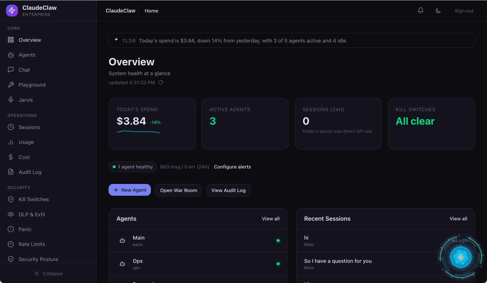
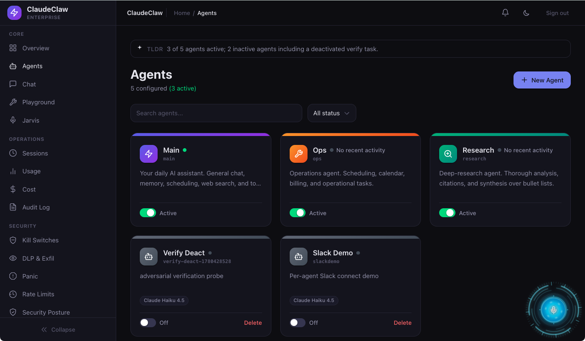
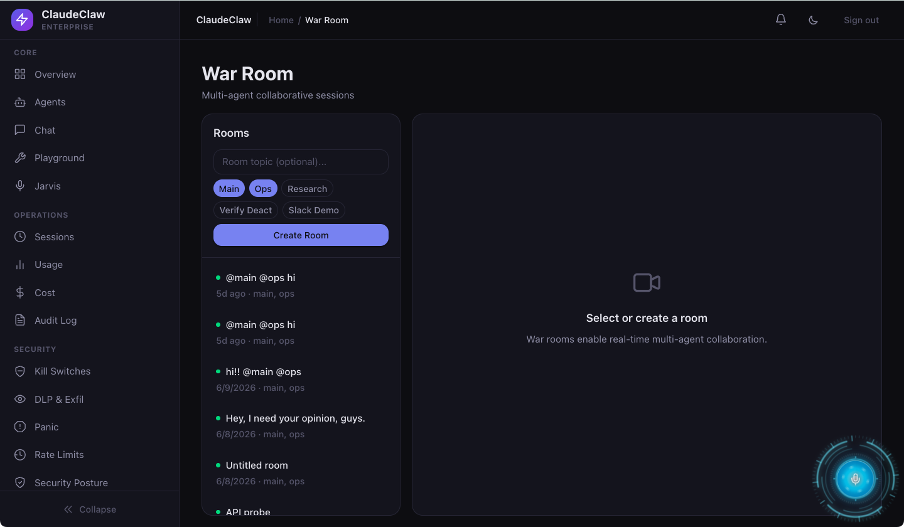
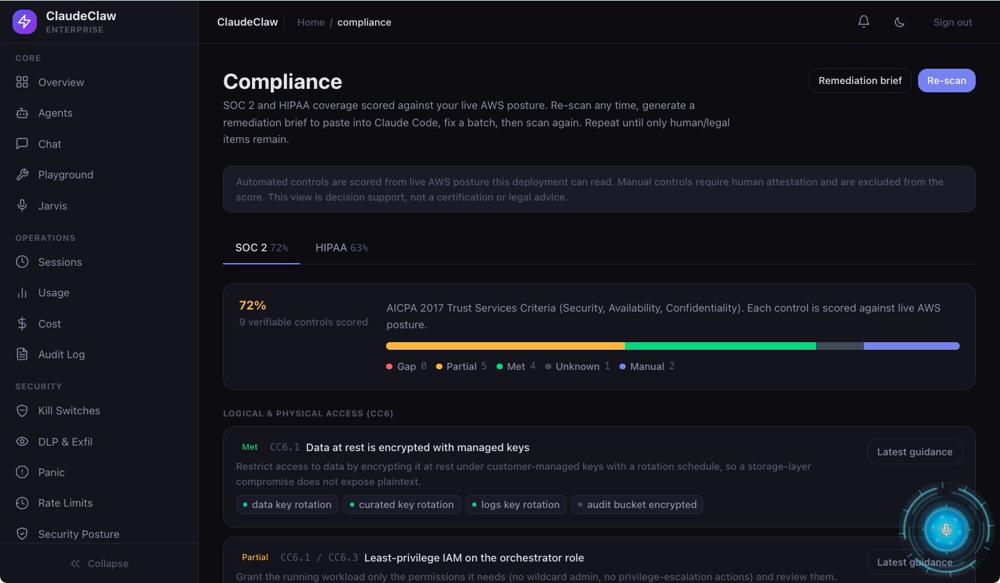
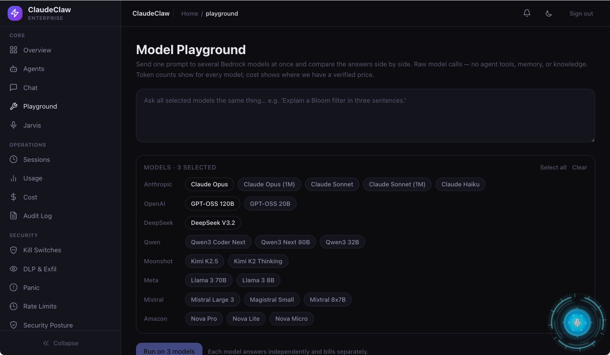
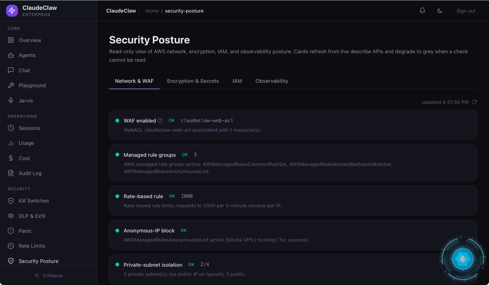

# EnterpriseOS by Netzer Labs

**EnterpriseOS** is developed by **Netzer Labs**.



AI agents your team talks to in Slack and Telegram, running entirely in your AWS account. One Fargate service hosts every agent; every model call goes through Amazon Bedrock; state lives in your DynamoDB and S3. An agent is configuration (a CLAUDE.md, an `agent.yaml`, a model selection), not a process, so you add agents without adding infrastructure. You deploy it with one command (`npm run up`), watch it from a built-in Mission Control dashboard, and nothing leaves your account except the chat platforms and vendors you explicitly connect ([the full list is one page](docs/security-model.md)).

> **Compatibility note.** Some internal AWS resource identifiers and environment variables still use the historical `claudeclaw` / `CCE` prefixes. They are retained in this transfer to avoid breaking deployments and can be migrated deliberately in a later release.

[](infra/) [](LICENSE.md)

> **Who can use this.** EnterpriseOS is private, proprietary software. Repository access does not grant permission to use, copy, modify, distribute, sublicense, sell, or disclose it. See the attorney-review draft [LICENSE](LICENSE.md).

## Start here (in this order)


| # | Step | Where |
|---|---|---|
| 1 | Create a **standalone AWS account** | New to AWS? [docs/aws-getting-started.md](docs/aws-getting-started.md) walks you through it |
| 2 | Install the **AWS CLI v2** and configure credentials, plus **Node 20+** | `aws configure`, then prove it: `aws sts get-caller-identity`. Docker is optional (no daemon? deploy builds in CodeBuild in your account, a few cents) |
| 3 | Grant **Bedrock Claude model access** in your region (optional up front) | Bedrock console → model catalog, one-time Anthropic use-case form. Skip it and `up` prints the URL and waits |
| 4 | Clone this repo, then `npm ci --ignore-scripts` and **`npm run up`** | One command conducts the rest: wizard, preflight, model probe, deploy, verify |

**Using an AI coding agent?** Point it at the cloned repo and say "install this." It reads [AGENTS.md](AGENTS.md) and drives the same steps, walking you through 1-3 if they are missing. Details, unattended mode, and the underlying commands: [Quick start](#quick-start).

---

## What you get

<p align="center">
  
  
</p>
<p align="center">
  
  
  
</p>

- **Chat surfaces.** Slack and Telegram (per-agent bots, slash commands, per-user memory scoping, live tool-call status), both with the full media pipeline: drop a PDF/DOCX/PPTX/audio and it is analyzed inline **and auto-ingested into the knowledge base** (queryable later from any surface); send a **video** and the agent watches it (Amazon Transcribe transcript + ffmpeg keyframes); voice notes in and out; generated images delivered as real photos / file uploads. The same human talking across Slack and Telegram is **one continuous conversation** (cross-surface session legibility).
- **Mission Control dashboard.** A 26-tab SPA: Chat (with file/image attachments), Agents (editor + version history + surface connections + a **template gallery** of 17 starter agents spanning support, sales, social, marketing, community, bookkeeping, finance, and compliance roles), **War Room** (multi-agent sessions), **Knowledge** (vector search + ingest UI), **Scheduled Tasks** (create/edit proactive routines), **Integrations** (one-click OAuth Connect for Slack + Salesforce), **Compliance** (SOC 2 / HIPAA control scoring), Cost, Playground, Audit Log, Kill Switches, DLP, Security Posture with an AI IAM copilot, Members (team RBAC), and more.
- **Jarvis.** A browser voice co-pilot (Amazon Nova Sonic bidirectional streaming) with a fail-closed role manifest.
- **Knowledge ingest.** PDF, DOCX, PPTX, HTML, Markdown, text, audio, and video transcripts in — from the dashboard **or any chat surface**; Titan embeddings + S3 Vectors out; citation-bearing retrieval as a model tool.
- **Proactive + collaborative agents.** Schedule a recurring brief that arrives in your pocket ("brief me every morning at 8"), and let one agent ask another mid-turn (`ask_agent`) and relay the answer.
- **Cost guardrails.** A daily Bedrock spend cap that fails closed, AWS Budget + Cost Anomaly Detection, a live Cost tab with a waste scanner, and per-tier defaults so a hobby install cannot surprise you.
- **Operations built in.** 40 runtime kill switches, an immutable dual-write audit log, a synthetic canary, 9 CloudWatch alarms, daily DynamoDB exports, and drift detection.

## Table of contents

- [Start here (in this order)](#start-here-in-this-order)
- [Prerequisites](#prerequisites)
- [Domains and HTTPS](#domains-and-https)
- [Quick start](#quick-start)
- [Agent-driven standalone install](#agent-driven-standalone-install)
- [What it costs](#cost)
- [After the deploy](#after-the-deploy)
- [Architecture at a glance](#architecture-at-a-glance)
- [Security](#security)
- [Rollback and teardown](#lifecycle)
- [CLI reference](#cli-reference)
- [Agent tools and add-ons](#agent-tools-and-add-ons)
- [Dashboard API, repository layout](#dashboard-api)
- [What is not here yet](#what-is-not-here-yet-intentional-defers)
- [License](#license)

Depth lives in [`docs/`](docs/README.md), indexed by what you are trying to do: deploy it, understand it, run it in production, or extend it.

---

<a name="prerequisites"></a>
## Prerequisites

Grouped by mechanism, so you know where each step actually happens. `npm run doctor` checks every one of these read-only before anything is created; [troubleshooting.md](docs/troubleshooting.md) documents each check and its exact fix.

**[CONSOLE] Bedrock model access. Do this FIRST.** Since AWS simplified Bedrock access in October 2025, most serverless models auto-enable on first invocation; Anthropic Claude is the one model this deploy calls that still needs a one-time use-case form, submitted on the Bedrock console model catalog page in your deploy region. Access lands on submission but can take a few minutes to propagate, so do it before running setup. (Forgot? `npm run up` catches a missing Claude grant, prints the exact console URL, and waits while it propagates.) The models:

- **Anthropic Claude**: always required; needs the one-time use-case form.
- **Titan Embed v2**: only if knowledge ingest is enabled; auto-enables on first use.
- **Nova Sonic**: only if Jarvis voice is enabled; auto-enables on first use.
- **Image generation** runs on a **Stability** text-to-image model (`stability.stable-image-core-v1:1`), which on Bedrock is **us-west-2-only** and **active** — Amazon's own image models (Nova Canvas, Titan Image) went provider-LEGACY in mid-2026 and Bedrock refuses them for new callers. Enabling image gen grants `bedrock:InvokeModel` on `stability.*` (see [docs/out-of-band-catalog.md](docs/out-of-band-catalog.md)); first use auto-creates a $0-subscription AWS Marketplace agreement (metered per image, ~$0.04). It still runs inside Bedrock — prompts are not used to train the provider's models. Override with `BEDROCK_IMAGE_MODEL` / `BEDROCK_IMAGE_REGION`.

Setup defaults console-grant-heavy features OFF at T0/T1 so a first deploy needs only Claude (plus Titan if you enable knowledge).

**[CLI] Local machine and AWS account.**

- Node 20+. Docker is OPTIONAL: with a running daemon, images build locally (fastest); without one, deploy builds in AWS CodeBuild inside your account (a few cents, ~10 min per deploy; force either way with `--build-local` / `--build-cloud`).
- AWS CLI v2 with an admin-level profile (`aws configure`).
- `session-manager-plugin`, only if you take the no-domain tunnel path (doctor names the per-OS install when it applies).
- A CDK-bootstrapped account/region (doctor validates this and prints the exact `npx cdk bootstrap` command if not).

**[EXTERNAL] Things AWS cannot do for you.**

- A Telegram bot token from [@BotFather](https://t.me/BotFather) and/or a Slack app ([docs/slack/README.md](docs/slack/README.md) includes the app manifest). Only needed for `chat` mode.
- Slack event-URL verification happens on api.slack.com after deploy; deploy prints the URL to paste. (Telegram webhook registration is automatic.)
- A GitHub PAT imported via `aws codebuild import-source-credentials`, only if you enable CodeBuild tag deploys. See [Connecting GitHub to AWS](docs/github-to-aws.md); no CI path is required to deploy.

## Domains and HTTPS

**No domain? Skip this whole section.** The default `infra-only` install needs none (dashboard access is a private tunnel), and that is the recommended first deploy. Come back here when you want chat mode or a public dashboard. Stated plainly, because it decides your install shape:

- **Public dashboard access, in either mode, needs a real domain plus an ACM certificate** on the ALB. `chat` mode always needs one, because Slack and Telegram webhooks require HTTPS.
- **No domain? Use `infra-only`.** The ALB is synthesized internal (not reachable from the internet at all) and you reach the dashboard privately with `npm run dashboard:tunnel`, an SSM port-forward to the running task. `npm run verify` enforces this posture and fails if any public path reaches the dashboard.
- Bearer auth over plain HTTP is never offered, and the CloudFront default `*.cloudfront.net` domain is not a workaround (no encrypted hop to the ALB origin without a certificate for a hostname you control).

<a name="quick-start"></a>
## Quick start

In this order:

1. **AWS account.** A standalone account you control. New to AWS? [docs/aws-getting-started.md](docs/aws-getting-started.md) walks you through creating one, step by step.
2. **Local tools.** Install the AWS CLI v2 and configure credentials (`aws configure`, then `aws sts get-caller-identity` to prove they work). Node 20+. Docker is optional; without it, deploy builds the image in AWS CodeBuild inside your account.
3. **Bedrock model access.** Submit the one-time Anthropic Claude use-case form on the Bedrock console model catalog page in your deploy region. (Skip it and `up` catches it: it prints the exact console URL and waits while the grant propagates.)
4. **Clone this repo and run:**

```bash
npm ci --ignore-scripts
npm run up        # ONE command: setup wizard, preflight, model probe, deploy, verify
```

`up` conducts the whole install and, when it hits something only a human can do (granting Bedrock model access in the console is the big one), it prints one instruction with the exact URL and keeps re-checking until you have done it, then continues on its own. At the final verify it also settles through brief post-deploy propagation (ECS steady state, CloudFront) instead of failing at the finish line. Ctrl-C is always safe; re-running `npm run up` resumes. Unattended runs: `npm run up -- --answers examples/answers/infra-only-t0.json --yes` (templates and schema in [examples/answers/](examples/answers/README.md); `--yes` pre-accepts the deploy cost gate). Pointing an AI coding agent at the repo works too: it reads [AGENTS.md](AGENTS.md) and drives the same command.

The underlying commands are still there when you want to drive them yourself:

```bash
npm run setup     # interactive wizard: tier, mode, surfaces, add-ons, CI choice
npm run deploy    # preflight, bootstrap-state, phased stacks, secrets, seed, health
npm run verify    # the gate: stack checks, value checks, external + Bedrock probes
```

`npm run doctor` is the free preflight: it runs the same read-only checks deploy runs first (identity, CDK bootstrap, Bedrock grants for your selected features, quotas, name collisions, domain/TLS, pending-deletion secrets), creates nothing, and prints a remediation per failure. Run it as often as you like before committing to a deploy. Deploy embeds the runtime-config seed, so `up` (or the three commands above) is the whole quick start; deploys are phased and idempotent, and a re-run after an interruption is safe. Always deploy through `npm run deploy` rather than a bare `cdk deploy`: the script forwards only a safe allowlist of your `.env` to synth, takes the lifecycle lock, and records a manifest that rollback depends on.

Setup asks one **deployment mode** question. `chat` makes Slack/Telegram first-class: it requires at least one surface token and a domain, and `verify` proves webhook delivery, not just token validity. `infra-only` is the dashboard-only install: no chat surfaces, no domain needed, readiness is satisfied by a working model plus dashboard auth, and the Chat tab drives the same agent loop the chat surfaces would. You can re-run setup later to switch modes. Either way setup also picks a tier (T0 Hobby to T3 Enterprise), which gates resources like WAF, X-Ray, CloudFront, and GuardDuty; tier upgrades are non-destructive.

<a name="agent-driven-standalone-install"></a>
## Agent-driven standalone install

A separate, newer install path takes a brand-new STANDALONE AWS account from a cloned repo to a verified deploy, driven by an AI coding agent (or a careful human) acting only on typed command output. It adds safety boundaries the default path does not need: a deny-by-default isolation scan that refuses a non-empty or Organizations-managed account, a scoped-deploy role whose permission boundary technically denies the off-account foothold catalog, an atomic fail-closed spend ledger, and a TTL tripwire that auto-destroys an abandoned half-deploy so no one is ever stuck paying.

- **Point your AI agent at the repo root.** It reads [AGENTS.md](AGENTS.md), the short runbook, and drives `npm run up`, the same conductor a human runs. Zero extra instructions needed.
- **For the phase-by-phase path with every safety rail spelled out, hand it [docs/agent-setup.md](docs/agent-setup.md)** — the signed, phase-ordered runbook (Phases 0 to 7, the typed-envelope contract, the named human gates, the single DONE predicate).
- **AWS-side prerequisites are handheld in [docs/aws-getting-started.md](docs/aws-getting-started.md)** — create a standalone account, install and configure the AWS CLI v2, verify identity, and grant Bedrock model access, with a read-only checkpoint the agent confirms before the install starts.
- **Try it for $0 first:** `npm run validate:tier1` runs the read-only Phases 1 to 3 and stops at the resource-creation boundary, so you can prove credentials, model access, account isolation, and the scoped-role boundary without creating a single paid resource.

This path is additive and default-off; it does not change the `setup`/`deploy`/`verify` quickstart above.

<a name="cost"></a>
## What it costs

Honest ranges from the [cost guide](docs/cost-guide.md), which states its assumptions (us-east-1, light traffic) and ships a recalculable estimator (`node scripts/cost-estimate.mjs`) so the numbers do not silently age. The floor is always-on plumbing (Fargate, NAT, ALB); Bedrock tokens are variable and bounded by the daily cap.

| Tier | Label | Fixed floor / month | Daily Bedrock cap (default) |
|---|---|---|---|
| T0 | Hobby | **$65 to $95** | $5 |
| T1 | Standard (default) | **$130 to $180** | $50 |
| T2 | Pro | **$230 to $400** | $200 |
| T3 | Enterprise | **$300 to $800** | $1000 |

At the assumed light-traffic profile, token spend is roughly $39/month on Sonnet or $10/month on Haiku. The single biggest optional line is VPC interface endpoints (`CCE_PRIVATE_ENDPOINTS=1`, default OFF, roughly $175/month for the full set); with NAT present the tasks already reach every AWS API. Per-tier provisioning detail, the worked token math, and "when the bill looks wrong" guidance: [docs/cost-guide.md](docs/cost-guide.md).

## After the deploy

1. **Confirm the SNS email.** The ops-alerts subscription stays `PendingConfirmation` until the recipient clicks the AWS confirmation email; alarms cannot reach you before that. (Budget and anomaly alerts email directly and are unaffected.)
2. **Verify the SES sender** (only if email send is enabled): `CCE_EMAIL_FROM` must be a verified SES identity before `send_email` works.
3. **Log into the dashboard.** Deploy writes `DASHBOARD_URL` into your `.env`. The bearer `DASHBOARD_TOKEN` from setup is the initial way in; every principal resolves to a capability profile (viewer / analyst / operator / admin / owner), and the backend, not the SPA, is the authority. The login box also offers email sign-in (magic links), but on a fresh deploy that path is deliberately inert: users come from invites (not self-signup) and sends silently skip until `CCE_EMAIL_FROM` (an SES-verified identity) and `CCE_DASHBOARD_URL` are set and deployed. Sign in with the token, then invite users; `npm run doctor` (`magic-link-email`) reports this state.
4. **Finish chat-mode wiring.** Deploy registers the Telegram webhook itself and validates it; for Slack, paste the printed `/slack/events` URL into your app's Event Subscriptions page (the one step that must happen on Slack's side).
5. **Create your first agent.** The [`examples/`](examples/README.md) folder has a complete worked agent (CLAUDE.md + `agent.yaml` + the registration row) and a sample MCP server entry. Agent system prompts live in the S3 config bucket (5-minute cache), so editing one is an upload, not a deploy.
6. **Learn runtime-config.** A DynamoDB table (`claudeclaw-runtime-config`) of live-editable settings: the daily cost cap, memory cadence, MCP server registry, feature arms like `iam/apply_enabled`. Changes apply within about 30 seconds with no redeploy; every such key is tagged `[LIVE_EDITABLE]` in [`.env.reference`](.env.reference), the annotated reference for every variable the system reads.
7. **Wire the power switch.** `npm run power:setup` prints the always-up pause/wake panel URL (bookmark it) and connects the dashboard's Power card. One tap pauses the whole stack between demos (compute to zero, AI spend hard-stopped, data untouched) and drops the bill to the network-layer floor; wake restores everything in 2 to 3 minutes with a live restore checklist. The panel also shows a live, itemized maintenance-cost breakdown (paused floor vs awake, computed from your actual resources and last-30-day AI spend), and with `CCE_POWER_URL` set at synth time, visiting the dashboard URL while paused redirects straight to the panel instead of a dead 503. A nightly auto-pause backstop means a forgotten wake never bleeds money. Details: [docs/agent-setup.md](docs/agent-setup.md#pause-and-wake-the-power-switch).

**Local development:** `npm run dev` runs the orchestrator locally with tsx watch. The unit suite is `npm test` (vitest; run the FULL suite before pushing) and there is a LocalStack integration suite: `npm run test:integration:all` brings the container up, runs it, and tears it down (`:up` / `:down` to manage it yourself). Playwright e2e harnesses live under `tests/e2e/` (see each directory's README).

## Architecture at a glance

A message hits the ALB (optionally behind WAF at T2+ and CloudFront at T3), the orchestrator verifies the Slack HMAC or Telegram secret and acks in under 3 seconds, an agent picker chooses the policy for the turn, the context builder loads that agent's CLAUDE.md plus memories and history, Bedrock runs a guardrailed Converse loop dispatching tools until the reply is ready, and the dispatcher sends it back through the originating surface while the audit trail and memory ingest run behind it.

Everything is 15 unconditionally-deployed CDK stacks in dependency order (Network, Storage, Guardrails, Secrets, Dynamo, Messaging, IAM, Compute, Observability, Security, Backup, Chaos, Extensions, CostGuardrails, and PowerSwitch), plus the opt-in CodeBuild and DemoReset stacks, backed by ~31 DynamoDB tables, 6 S3 buckets, and 3 customer-managed KMS keys. Depth, in reading order:

- **The narrative:** [how it actually works](docs/how-it-works.md), one real Telegram message end to end, plain English then code level, with the Slack deltas and the `infra-only` walkthrough.
- **The diagrams:** the maintained [Mermaid suite](docs/diagrams/README.md), split by concern: compute, data, messaging, trust boundaries, request lifecycle, deploy pipeline, rollback classes, teardown.
- **The decisions:** [ADRs](docs/adr/README.md) on the tier framework, single-tenancy, and Bedrock inference profiles.
- **The words:** [glossary](docs/glossary.md).

<a name="security"></a>
## Security

The claim "runs entirely in your AWS account" is backed with specifics in [docs/security-model.md](docs/security-model.md), which is derived from a machine-readable data-flow inventory ([data-flows.json](docs/data-flows.json)): every external processor, what leaves, when, and how to opt out. The telemetry claim is narrow and honest: the app ships no third-party telemetry of its own; what does leave is the chat platforms you connect, Bedrock prompts (inside the AWS boundary), web-search vendors you give keys to, MCP servers you register, and build-time registry pulls. Serious adopters should read that page first. The posture in brief:

- **Encryption:** customer-managed KMS keys on every bucket and table; TLS 1.2+ everywhere in transit.
- **Audit immutability:** every audit event double-writes to DynamoDB (IAM-denied deletes/updates) and an S3 Object Lock bucket (7-year governance retention, tier-gated T2+).
- **Secrets:** placeholders in CDK templates, real values populated post-deploy into Secrets Manager with per-deploy staging labels; secret material never appears in synth output.
- **Surface auth:** Slack HMAC with a 5-minute replay window; Telegram webhook secret token; capability-based dashboard auth.
- **Model safety:** a Bedrock Guardrail on every Converse call (12 PII entity types, 6 content filters), plus an outbound PII gate on web-search queries.
- **Runtime control:** 40 kill switches in DynamoDB (the [runbook](docs/runbooks/kill-switches.md) shows how to trip one in seconds) and a daily cost cap that fails closed.
- **Tiered hardening:** WAFv2 on the ALB at T2+; GuardDuty and AWS Config at T3.
- **Drift stays loud:** an opt-in daily drift-watch worker runs CloudFormation drift detection across the stacks, and CI runs a scheduled `cdk diff` gate; resources applied out-of-band are cataloged in [docs/out-of-band-catalog.md](docs/out-of-band-catalog.md) so nothing is invisible to verify or teardown.
- **The IAM copilot's write path is off by default** (runtime-config `iam/apply_enabled`), refuses the orchestrator's own and CDK roles, and is fully audited; detach its managed policy to revoke the capability entirely.

Operational runbooks (rotation, debugging silent bots, scaling, chaos testing) are indexed at [docs/runbooks/README.md](docs/runbooks/README.md).

<a name="lifecycle"></a>
## Rollback and teardown

### Rollback

There is no single "roll back": you roll back one of four things, and each has its own blast radius. **Image** (the new code is bad): `npm run deploy:rollback` re-points the ECS service at a previous recorded image, about a 60-second revert. **Infra** (a stack change broke you): redeploy the archived `cdk.out` from the target deploy's manifest, reproducible from a fresh clone. **Config/secret** (a rotation broke you): restore the per-secret versions recorded in the manifest, then force-roll ECS so running tasks actually pick them up. **Data** is its own class, below.

Every deploy records a manifest (image digests, per-stack template hashes, per-secret version IDs, seed revision, archived synth output) under a mandatory DynamoDB lifecycle lock, which is what makes the first three classes one-command and safe to run from any machine. The manifest also carries an application schema version, and rollback refuses to cross a schema boundary without a paired migration or restore plan, because rolling back code alone can strand the app on data shapes it cannot read.

**Data restore is deliberately disruptive**: lock, maintenance mode, service at zero, restore the table to its canonical name, rebind streams, re-adopt the resource into CloudFormation, then exit and verify. It is documented step by step in the [lifecycle runbook](docs/lifecycle.md), with the [rollback-classes diagram](docs/diagrams/rollback-classes.md) as the decision tree. Every rollback class ends the same way: `npm run verify`.

### Teardown

`npm run teardown` removes the install. It inventories from live CloudFormation, tags, the deploy manifest, and the committed [out-of-band catalog](docs/out-of-band-catalog.md) (the things `cdk destroy` cannot see: the bootstrap state bucket, the deploy-lock table, the ECR repo, runtime-created schedules, attached managed policies, the Telegram webhook), then walks an explicit order: offer a DynamoDB export first, empty and delete buckets, schedule-delete secrets (7-day window), remove runtime schedules, destroy the stacks, and finish with a residual sweep. Destruction requires a typed confirmation that includes your account ID, and `--dry-run` prints the full costed plan with zero mutations.

It is honest about what it cannot or will not delete. KMS keys are treated as dependencies, not leftovers: deletion is blocked while encrypted dependents exist, and cryptographic erasure is an explicit opt-in flag with a 7 to 30 day pending window. The WORM audit bucket (T2+) may be genuinely undeletable inside its retention and is reported as an intentional residual with bypass instructions and its ongoing cost. Shared account prerequisites (the GitHub OIDC provider, CodeBuild source credential, CDK bootstrap) are report-only by default, because other workloads may ride on them.

If the state bucket itself is lost, teardown still runs in a break-glass degraded mode from CloudFormation, tags, and the catalog alone, with extra confirmation, so paid resources are never stranded behind a lost state store. It ends with a manual checklist of what no script can remove (the Slack app, Bedrock model access grants). The [teardown decision tree](docs/diagrams/teardown-decision-tree.md) shows the whole flow.

## CLI reference

| Command | What it does |
|---|---|
| `npm run up` | The one-command install: conducts setup, doctor, early-win, deploy, verify; polls through human gates (Bedrock grant) instead of exiting. `--answers <file>` + `--yes` for unattended, `--plan` runs nothing. |
| `npm run setup` | Interactive wizard: AWS checks, tier, mode, surfaces, add-ons, CI choice. Writes `.env` + `claudeclaw.config.yaml`. |
| `npm run doctor` | Read-only preflight. Creates nothing; per-failure remediation. |
| `npm run deploy` | Phased deploy: preflight, bootstrap-state + lock, foundation stacks, secrets, seed, remaining stacks, force-roll, surface validation, manifest. Idempotent re-runs. |
| `npm run verify` | `status` in strict mode; the post-deploy gate (includes paid Bedrock probes, about a cent). Nonzero exit on failure. |
| `npm run status` | Same checks, non-strict; `--json` for CI. |
| `npm run seed` | Idempotent runtime-config defaults (also embedded in deploy). |
| `npm run demo:seed` / `npm run demo:reset` | Public-demo setup (seed fleet + synthetic KB + lockdown) and reset (scrub + re-seed). Target a dedicated demo deployment with `--env=demo`. |
| `npm run dashboard:tunnel` | Private dashboard access via SSM port-forward (no-domain `infra-only`). |
| `npm run deploy:rollback` | Image rollback (`--list`, `--to=<sha>`); about 60 seconds. |
| `npm run teardown` | Inventoried, ordered destruction with typed confirm; `--dry-run` for the costed plan. |
| `npm run deploy:cloud` | CodeBuild image-only deploy (no `cdk deploy`, cannot drift infra). |
| `npm run restore:ddb` | DynamoDB restore CLI (PITR or export, typed confirm). |
| `npm test` / `npm run test:integration` | Full vitest unit suite / LocalStack integration suite. |
| `npm run typecheck` / `npm run build` / `npm run synth` | Strict `tsc --noEmit` / compile / `cdk synth`. |
| `npm run dev` | Local orchestrator, tsx watch. |
| `npm run mission` / `npm run schedule:cli` / `npm run audit-query` | Terminal CLIs for missions, scheduled tasks, saved Athena audit queries. |
| `npm run battle` / `npm run loadtest` | Behavior battle harness (`--chaos`) / k6 load test. |

Every lifecycle command in this table (`up`, `setup`, `doctor`, `early-win`, `deploy`, `verify`/`status`, `seed`, `destroy`, `teardown`, `deploy:rollback`, `restore:ddb`, `dashboard:tunnel`, `power:setup`, `update`) answers `-- --help` with its flags and its mutation/cost contract, without running anything.

**Standalone, agent-driven install (new path, see [Agent-driven standalone install](#agent-driven-standalone-install)).** These commands belong to the brand-new-account onboarding flow defined in [docs/agent-setup.md](docs/agent-setup.md). They are additive and do not change the `setup`/`deploy`/`verify` path above.

| Command | What it does |
|---|---|
| `npm run validate:tier1` | Zero-cost validation of onboarding Phases 1 to 3 (doctor, early-win, bootstrap gates). Creates nothing; `--plan` runs nothing. |
| `npm run early-win` | One bounded guardrailed Bedrock probe (max 32 output tokens). Proves model access with zero AWS resources. |
| `npm run bootstrap` | Phase 3: isolation gate, arm the TTL tripwire, create state primitives, mint the scoped-deploy role with its permission boundary. |
| `npm run destroy` | Phase 7: idempotent teardown with multi-identifier completeness plus the off-account foothold sweep. |
| `npm run verify:boundary` | Prove the scoped-role boundary denies the I4 foothold catalog via `iam:SimulateCustomPolicy` (read-only, $0, no account-mutation). |
| `npm run doctor -- --envelope` / `npm run verify -- --envelope` | The same preflight/verify checks emitted as the I1 typed command envelope. |

## Public demo mode

To show ClaudeClaw to a non-technical audience without asking anyone to deploy their own, run a dedicated demo deployment seeded with a fictional business:

- `npm run demo:seed -- --env=demo` activates a six-agent creator/SMB fleet (support, sales, social, marketing, community, bookkeeping), ingests a synthetic knowledge base so the grounded agents have real docs to cite, and applies a lockdown: a low daily Bedrock cap that fails closed, paid and outbound tools off (image, TTS, email, document gen, web search, Telegram, Slack), guardrail and PII redaction on.
- A nightly reset (the `DemoReset` stack, gated behind `CCE_DEMO_RESET_ENABLED=1`) scrubs the conversational tables and any visitor-created agents on a daily cron, preserving the seed fleet. It is dormant unless that flag is set, so production deploys never create it.

Point both at a **separate** deployment, never production: the reset deletes non-seed agents and empties the session and memory tables. `npm run demo:reset -- --env=demo` does the same wipe plus a full re-seed for manual recovery.

## Agent tools and add-ons

28 built-in tools register at boot; capability add-ons register only when their key or config is present, each paired with a kill switch, and the orchestrator logs a one-line skip for anything unconfigured.

| Add-on | Required | Kill switch |
|---|---|---|
| Image generation (Stability on Bedrock, us-west-2) | Bedrock grant on `stability.*`, no vendor key | `image_gen_disabled` |
| Document generation (PDF/DOCX/XLSX) | nothing | `document_gen_disabled` |
| Voice replies (Polly TTS) | nothing | `tts_disabled` |
| Email send (SES) | `CCE_EMAIL_FROM` + verified sender | `email_send_disabled` |
| Web search | a Tavily / Brave / Exa / Serper key (adapter picks the first configured) | `web_search_disabled` |
| Salesforce (SOQL + record CRUD) | an OAuth connection (Integrations → Connect Salesforce) | `salesforce_disabled` |

<details>
<summary>The full built-in tool catalog</summary>

- `get_time`, `list_agents`: boring but useful
- `add_memory`, `list_memories`, `search_memories`, `forget_memory`: per-(agent, chat) long-term recall; top memories auto-inject into every turn
- `s3_vectors_search`, `ingest_document`: Titan v2 embeddings, paragraph-aware chunking, citation-bearing retrieval; files dropped in chat auto-ingest here too
- `dynamodb_query`: allowlisted-table reads with per-table caps
- `schedule_task`, `list_scheduled_tasks`, `cancel_scheduled_task`: one-shot reminders + recurring jobs (wall-clock + timezone aware; also creatable/editable from the Scheduled Tasks tab, with a delivery target so a "morning brief" reaches Telegram/Slack)
- `ask_agent`: ask another agent a question and wait for its answer in this turn (synchronous delegation; depth-capped)
- `send_dm`, `read_inbox`: inter-agent messaging, queued into the recipient's next turn
- `log_to_hive`, `search_hive`: cross-agent shared scratchpad
- `create_mission`, `list_missions`, `update_mission`: tracked work units with auto-assigned owners
- `generate_image`, `generate_document`, `send_email`, `web_search`, `salesforce_query`, `salesforce_record`: the add-ons above
- `start_identity_claim`, `complete_identity_claim`: link one person across Slack/Telegram/web
- `forget_me`: GDPR-style purge for the current chat (an audit row stays with a pre-delete sha256)

MCP extends this list live: register a server in runtime-config (`mcp/servers`) and its tools appear namespaced as `mcp__<server>__<tool>` with no redeploy. See [docs/mcp/README.md](docs/mcp/README.md).

</details>

## Dashboard API

Everything under `/api/*`, capability-gated (viewer / analyst / operator / admin / owner); the backend is the authority, the SPA only hides surfaces.

<details>
<summary>Route table</summary>

| Route(s) | Methods | Purpose |
|---|---|---|
| `/api/auth/login`, `/verify`, `/logout`, `/invite/:token`(+`/accept`) | GET, POST | Magic-link login, token verify, logout, invite accept |
| `/api/whoami` | GET | Current principal + role + capabilities |
| `/api/agents` (+`/create`, `/validate-id`, `/templates`(+`/:id`), `/:id`, `/:id/activate`, `/:id/deactivate`) | GET, POST, PATCH, DELETE | Agent CRUD + activation; template gallery (list + full prompt preview) |
| `/api/agents/:id/file`, `/history`, `/history/:revId` | GET, PUT | Agent CLAUDE.md read/save + revision history |
| `/api/agents/:id/{telegram,slack}/{validate-token,connect,disconnect}` | GET, POST | Per-agent surface connections; `/slack/manifest` returns the app manifest |
| `/api/agents/health`, `/:id/health` | GET | Per-agent health rollup |
| `/api/models`, `/api/playground/models`, `/api/playground/run` | GET, POST | Live model catalog + multi-model Playground |
| `/api/test-turn`, `/test-turn/stream` | POST | Full server-side agent turn (plain + SSE) |
| `/api/sessions`(+`/transcript`,`/export`) | GET | Sessions, transcripts, CSV export |
| `/api/usage`(+`/daily`,`/export`), `/api/cost-today` | GET | Token usage + today's Bedrock cost |
| `/api/cost/summary`, `/cost/risks` (op), `/cost/evaluate` (admin), `/api/cost-cap` | GET, POST | Live spend + projection, waste scan, daily cap + AWS Budget sync |
| `/api/tldr` | POST | One-line Bedrock summary of a tab's data |
| `/api/iam/status`, `/iam/draft`, `/iam/apply` (admin) | GET, POST | IAM copilot: draft + lint + Access Analyzer; gated apply |
| `/api/drift/status`, `/drift/check` (admin) | GET, POST | Drift-watch state + on-demand CFN drift detection |
| `/api/posture/{network,security,iam,observability}` (op) | GET | Read-only AWS posture cards |
| `/api/compliance/summary`, `/brief`, `/analyze` | GET, POST | SOC 2 / HIPAA control scoring + AI analyst |
| `/api/audit`(+`/export`) | GET | Audit rows + CSV |
| `/api/kill-switches` | GET, POST | Read + flip kill switches |
| `/api/dlp/{test,patterns,patterns/:id,validate}` | GET, POST, DELETE | DLP/exfil pattern management |
| `/api/panic`(+`/restore`,`/force-release`) | GET, POST | Global panic stop |
| `/api/rate-limits/:key/{policy,usage,reset}` | GET, POST | Per-key rate limits |
| `/api/alerts/subscribe`, `/subscriptions`(+`/:email`) | GET, POST, DELETE | Ops-alert recipients |
| `/api/integrations`(+`/secrets-posture`,`/mcp`) | GET, PUT | Integration inventory, secrets posture, MCP server registry |
| `/api/oauth/:provider/start`(admin), `/oauth/callback`, `/oauth/status`, `/oauth/:provider/credentials` | GET, POST, PUT | One-click OAuth Connect (Slack + Salesforce); state-signed callback, redacted status |
| `/api/memories`, `/api/hive` | GET | Memories for a `?chatId`; Hive Mind notes |
| `/api/missions`(+`/:owner/:id/status`,`/reassign`) | GET, POST | Mission kanban |
| `/api/scheduled`(+`/:agentId/:taskId`), `/api/inbox` | GET, POST, PUT, DELETE | Scheduled tasks (create/edit/cancel); inter-agent inbox |
| `/api/vectors`(+`/search`,`/answer`,`/upload-url`,`/:scope/:docId`), `/api/ingest`(+`/stream`) | GET, POST, DELETE | Vector index ops; presigned upload (WAF 8 KB bypass) |
| `/api/warroom`(+`/:id`,`/history`,`/turn`,`/stream`,`/participants`,`/end`) | GET, POST | Multi-agent War Room (SSE) |
| `/api/jarvis/{manifest,text-turn,ws-ticket,canary/:tokenHash}` | GET, POST, DELETE | Voice co-pilot |
| `/api/members`(+`/invite`,`/:id`,`/:id/disable`), `/api/profiles` | GET, POST, PATCH | Team RBAC |
| `/api/tokens`(+`/:hashPrefix`), `/api/notifications` | GET, POST, DELETE | Dashboard tokens, notifications |
| `/api/tier`, `/api/addons`, `/api/config`(+`/:category`,`/:category/:key`) | GET, POST | Tier + add-ons + runtime-config KV |
| `/api/export` | GET, DELETE | Per-chat GDPR export + purge (DELETE needs `X-Dashboard-User`) |

</details>

## Repository layout

<details>
<summary>Where things live</summary>

```
infra/                  AWS CDK app (15 stacks)
  bin/app.ts            entry, dependency-ordered composition
  lib/constants.ts      resource names, model IDs, TIERS[]
  lib/*-stack.ts        network, storage, guardrails, secrets, dynamo, messaging,
                        iam, compute, observability, security, backup, chaos,
                        extensions, cost-guardrails, codebuild
  lib/tripwire-stack.ts onboarding TTL tripwire (standalone, not in the app graph)
src/
  index.ts              boot + in-process scheduler + canary
  server.ts             Hono app: /tg /slack /api /dashboard, tool wiring
  config/env.ts         zod env validation + mode-aware readiness
  agent/                agent-loop (Converse + tools), picker, commands,
                        memory-ingest, scheduler, canary
  adapters/             telegram/, slack/, dashboard/ (the /api routers + SPA shell)
  workers/              cost-watch, drift-watch, consolidation-worker
  lambdas/              ttl-tripwire (onboarding auto-destroy handler)
  lib/                  bedrock/, aws/ (cost, budget, iam-copilot, posture),
                        audit/, state/ (repos), cost/ (onboarding spend ledger +
                        KMS-MAC integrity), tools/, search/adapters/, vectors/,
                        jarvis/, pii/, addons/registry.ts
web/                    Vite + Preact dashboard SPA (one page per tab)
scripts/                setup, doctor, deploy, status/verify, seed, teardown,
                        dashboard-tunnel, rollback, restore-ddb, cost-estimate,
                        onboarding CLIs (bootstrap, destroy, early-win,
                        tier1-validate, verify-boundary), CLIs +
                        lib/lifecycle/ (bootstrap-state, lock, journal) +
                        lib/{envelope, run-state, isolation, onboarding} (the
                        typed-envelope I1, run-state, scanner, scoped-role)
tests/                  load/ (k6) + e2e/ (Playwright harnesses)
docs/                   the documentation site-in-a-repo (docs/README.md is the index)
examples/               worked agent + MCP registry samples
.env.reference          annotated reference for every env var (tagged by origin)
buildspec.yml           CodeBuild image-only / unified deploy
Dockerfile              multi-stage, ARM64, non-root, healthcheck
```

</details>

### Repository governance

Repository changes enter through `development` and promote by pull request
through `qa`, `staging`, and `production`. See [CONTRIBUTING.md](CONTRIBUTING.md)
for the contributor contract, [cutover.md](cutover.md) for the operator
checklist and stop conditions, and the approved
[repository cutover design](docs/superpowers/specs/2026-08-08-netzar-os-repository-cutover-design.md)
for the complete decision record. The existing `CCE_*`, `claudeclaw`, AWS,
domain, browser-storage, and release identifiers remain compatibility
contracts unless a separately approved migration changes them.

## What is not here yet (intentional defers)

- **EventBridge Scheduler cutover**: the fire queue + exec role are provisioned, the in-process scheduler is still the active path.
- **Slack interactive Block Kit modals**: endpoint stubs wired, dispatch is a follow-up.
- **AWS Security Hub aggregation**: GuardDuty + Config are live at T3.
- **Secrets rotation Lambdas**: manual rotation works at single-tenant scale (runbooks exist).
- **Cognito multi-tenant**: single-tenant on purpose; in-app Members/RBAC covers team access within one tenant.
- **Tier-2 data tools** (Athena query, Bedrock KB retrieve, OpenSearch Serverless) and a queryable DDB-to-data-lake export: code ready, provisioning gated on a real data-lake decision (the daily PITR export already covers recovery).
- **CloudFront-scope WAF in us-east-1**: the regional WAF on the ALB still covers all traffic through CloudFront.
- **ALB hard-gating on the CloudFront origin header**: capability auth on `/api/*` is the real boundary today; see [docs/cloudfront-cutover.md](docs/cloudfront-cutover.md).

## Acknowledgements

- Built on AWS [Bedrock](https://aws.amazon.com/bedrock/) (Anthropic Claude, Titan Embed v2, Amazon Nova Sonic, Amazon Transcribe, and Stability Stable Image Core for image generation).

## License

EnterpriseOS is private, proprietary software. Copyright (c) 2026 Emmanuel Adams. All rights reserved. Repository access does not grant use, modification, redistribution, sublicensing, publication, sale, or disclosure rights. Third-party dependencies remain governed by their own licenses. See the draft [LICENSE](LICENSE.md) and [third-party notices](THIRD_PARTY_NOTICES.md); attorney review is required before external commercial use.
