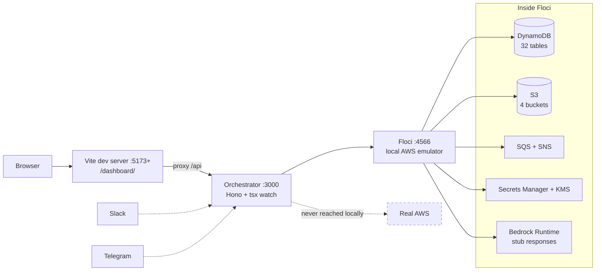

# Netzer Development Environment

**This document is the canonical source of truth for Netzer OS local development.**

It covers how to run, develop, test, reset and troubleshoot Netzer OS on a
developer machine, isolated from every real AWS environment. Anything in this
repository that describes local development defers to this file. If another
document disagrees with this one, this one is right and the other is stale.

Everything below was verified by actually running it on 2026-08-10 against
Floci 1.6.0, Docker 28.3.2 and Node 24.3.0 on macOS. Commands that were not
run are marked as unverified.

Scope: local development only. Deploying, staging and production are covered by
[docs/deployment.md](docs/deployment.md), [docs/staging.md](docs/staging.md) and
[CONTRIBUTING.md](CONTRIBUTING.md). Nothing in this guide touches AWS.

---

## Repository map

### Netzer OS (this repository)

- Repository: <https://github.com/emmanuelmadams4-lgtm/Netzer-Labs>
- Branch used for development: `development`
- npm package name: `enterpriseos`. Internal codename throughout the source is
  "ClaudeClaw Enterprise" (CCE), and resources are named `claudeclaw-*`.

**Netzer OS and Netzer Labs are the same repository.** There is no separate
"Netzer OS" repo on GitHub or on disk. This one repository holds the product,
its infrastructure, and this documentation.

| Directory | Responsibility |
|---|---|
| `src/` | Orchestrator: Hono HTTP server, agent loop, AWS clients, business logic |
| `src/adapters/` | Surfaces: dashboard API, Slack, Telegram, status page |
| `src/lib/` | Subsystems: state repos, bedrock, auth, cost, posture, jarvis, vectors |
| `src/workers/`, `src/lambdas/` | Out of process jobs (not run locally, see Limitations) |
| `web/` | Dashboard SPA: Vite + Preact + Tailwind, served under `/dashboard/` |
| `infra/` | AWS CDK stacks. Source of truth for all resource names and schemas |
| `scripts/` | Lifecycle CLIs (deploy, destroy, seed, status) |
| `scripts/local/` | **Local development only**: guard, provisioner, launcher |
| `tests/e2e/` | Playwright suites (target a deployed URL, see Limitations) |

### Floci

- Repository: <https://github.com/floci-io/floci>
- Role: the local AWS emulator. Netzer OS talks to Floci instead of AWS.
- Floci is a drop in replacement for LocalStack Community on the same port
  (4566) and serves the same `/_localstack/health` endpoint.

---

## Architecture overview

Netzer OS is a single TypeScript orchestrator process fronted by a Preact SPA.
It is AWS native: there is no relational database, no Redis and no ORM. All
state lives in DynamoDB and S3.

- **Frontend**: Vite + Preact + Tailwind (`web/`), mounted at `/dashboard/`,
  proxies `/api` to the orchestrator.
- **Backend**: Hono on `@hono/node-server` (`src/index.ts`), port 3000, plus a
  raw WebSocket upgrade for the Jarvis voice relay.
- **Database**: DynamoDB, 32 tables, single table style with `PK`/`SK`.
- **Object storage**: S3 for agent prompts, media, vectors and branding.
- **Auth**: bearer token, plus optional SES magic links. No Cognito at runtime.
- **AI**: Amazon Bedrock (Converse / ConverseStream) for every agent turn.
- **Jobs**: EventBridge Scheduler to SQS, drained in process, or a legacy in
  process DynamoDB poll.



Dotted lines are paths that exist in deployed environments and are deliberately
unreachable locally. Slack and Telegram are inbound webhooks; they are not
configured locally.

---

## Local vs AWS architecture

| Component | Local | AWS development / staging | Production |
|---|---|---|---|
| Orchestrator | `tsx watch` on host, port 3000 | ECS Fargate | ECS Fargate behind ALB |
| Dashboard | Vite dev server, port 5173+ | Built and served by orchestrator | Same, via CloudFront |
| AWS APIs | Floci on `127.0.0.1:4566` | Real AWS (`claudeclaw-staging-*`) | Real AWS (`claudeclaw-*`) |
| Credentials | Fake (`local` / `local`) | Task role | Task role |
| Bedrock | Floci stub text, no real model | Real Bedrock | Real Bedrock |
| Table names | `claudeclaw-*` | `claudeclaw-staging-*` | `claudeclaw-*` |
| Secrets | None. Env file only | Secrets Manager | Secrets Manager |
| TLS | None, plain HTTP | ACM | ACM |

Local uses the same unsuffixed table names as production **inside the emulator**.
That is intentional: it keeps local code on exactly the same path as deployed
code. Isolation comes from the endpoint override, not from renaming (see
[AWS safety](#aws-safety)).

---

## Prerequisites

| Tool | Version | Why |
|---|---|---|
| Docker + Compose v2 | 28.x / v2.38+ verified | Runs Floci |
| Node.js | 20 or newer (`.nvmrc` pins 20; 24.3.0 verified) | Orchestrator and tooling |
| Git | any recent | Source control |

Not required: the AWS CLI (not installed on the verified machine and not
needed), AWS credentials, an AWS account, LocalStack, or a database server.

---

## Initial setup

From a clean checkout:

```bash
git clone https://github.com/emmanuelmadams4-lgtm/Netzer-Labs.git
cd Netzer-Labs
git switch development
npm ci --ignore-scripts
npm run local
```

`npm run local` is the whole setup. It creates `.env` from
`.env.local.example` if absent, starts Floci, runs the AWS isolation guard,
provisions all tables and buckets, seeds runtime config, then starts the
orchestrator and the dashboard together. Press Ctrl-C to stop both.

Verified from a completely clean state (no `.env`, no container, no volumes):
**6 seconds** from command to a healthy orchestrator.

Expected output:

```
created .env from .env.local.example
starting Floci emulator...
 Container netzer-os-floci  Healthy
Provisioning local emulator at http://127.0.0.1:4566
  DynamoDB   32 created, 0 already present (32 tables)
  S3         4 created, 0 already present
  SNS topic  arn:aws:sns:us-east-1:000000000000:claudeclaw-config-invalidation
  SQS queue  http://127.0.0.1:4566/000000000000/claudeclaw-scheduled-fire
seeded 13, left 0 existing
starting orchestrator (:3000) and dashboard (:5173)
```

Then open the dashboard URL that Vite prints and sign in with the token from
`.env` (`DASHBOARD_TOKEN=local-dev-dashboard-token`) under
**Sign in with a dashboard token**.

> Vite prints the real port. It uses 5173 when free and increments otherwise.
> On the verified machine two unrelated dev servers already held 5173 and 5174,
> so the dashboard came up on **5175**. Always read the URL Vite prints.

---

## Environment variables

Local values live in `.env`, created from `.env.local.example`. `.env` is
gitignored. **There are no real secrets in local development.**

| Variable | Required | Sensitive | Local example | Purpose |
|---|---|---|---|---|
| `AWS_ENDPOINT_URL` | Yes | No | `http://127.0.0.1:4566` | **The isolation control.** Routes every AWS SDK call to Floci |
| `AWS_REGION` | Yes | No | `us-east-1` | Region for all clients |
| `AWS_ACCESS_KEY_ID` | Yes | No (fake) | `local` | Placeholder credential |
| `AWS_SECRET_ACCESS_KEY` | Yes | No (fake) | `local` | Placeholder credential |
| `AWS_ACCOUNT_ID` | No | No | `000000000000` | The emulator account id |
| `NODE_ENV` | Yes | No | `development` | **Never set `production` locally** |
| `PORT` | No | No | `3000` | Orchestrator port |
| `LOG_LEVEL` | No | No | `info` | pino level |
| `DASHBOARD_TOKEN` | Yes | No (fake) | `local-dev-dashboard-token` | Dashboard bearer login |
| `CCE_DASHBOARD_URL` | No | No | `http://localhost:5173` | Link base for magic links |
| `BEDROCK_DEFAULT_MODEL` | Yes | No | `us.anthropic.claude-sonnet-4-5-20250929-v1:0` | Agent loop throws without at least one model id |
| `CONFIG_BUCKET` | No | No | `claudeclaw-config` | Agent prompts (`agents/<id>/CLAUDE.md`) |
| `RAW_BUCKET` | No | No | `claudeclaw-raw` | Chat media, generated documents |
| `CURATED_BUCKET` | No | No | `claudeclaw-curated` | Branding assets |
| `VECTORS_BUCKET` | No | No | `claudeclaw-vectors-staging` | Vector index. Throws if unset when used |
| `AUDIT_LOCK_BUCKET` | No | No | *(unset on purpose)* | Needs S3 Object Lock, not emulated |
| `CCE_TASK_ROLE_NAME` | No | No | `claudeclaw-task-role` | Named in posture cards |
| `CCE_SCHEDULER_DISABLED` | No | No | `1` | Quiets the scheduler loop |
| `CCE_WEBHOOK_MONITOR_DISABLED` | No | No | `1` | Quiets the webhook monitor |
| `CCE_TRANSCRIBE_DISABLED` | No | No | `1` | Transcribe writes to a bucket that does not exist locally |

Rules for editing `.env`, each verified:

1. **Never write a bare `KEY=`.** Node materialises it as `''`, and zod's
   `.optional()` / `.default()` only fire on `undefined`. Omit the line instead.
   Affects the enums (`NODE_ENV`, `LOG_LEVEL`, `CCE_DEPLOY_MODE`,
   `CCE_WEB_SEARCH_PII_POLICY`) and coerced numbers (`PORT`,
   `CONFIG_CACHE_TTL_SECONDS`, the `JARVIS_*` numbers).
2. **Do not copy `.env.example`, `.env.reference` or `.env.staging.example`.**
   All three fail `loadEnv()`. Use `.env.local.example`.
3. **Never set `NODE_ENV=production`**: it arms a deployed-task fail fast and
   the orchestrator refuses to start.
4. **Do not set `CCE_NAME_SUFFIX`** locally. It renames tables, but four modules
   read the unsuffixed literal regardless and would look for missing tables.

---

## AWS dependency inventory

Every AWS service the running orchestrator touches, and how it is served
locally. "Verified" means it was exercised against Floci during this work.

| AWS service | Netzer OS feature | Code location | Access | Local implementation | Floci support | Limitations |
|---|---|---|---|---|---|---|
| DynamoDB | All state: sessions, audit, agents, tokens, memories, missions, cost, jarvis | `src/lib/state/*`, `src/lib/state/ddb.ts` | read/write | Floci | Full, verified | No PITR, TTL not enabled locally |
| S3 | Agent prompts, media, vectors, branding | `src/lib/config/agent-loader.ts`, `src/lib/vectors/store.ts`, `src/lib/branding/assets.ts` | read/write | Floci | Full, verified | No Object Lock |
| SQS | Scheduled task fire queue, config invalidation | `src/lib/scheduler/queue-drain.ts` | read/write | Floci | Full, verified | |
| SNS | Config invalidation fanout, ops alerts | `src/lib/config/invalidation-listener.ts` | read/write | Floci | Full, verified | |
| EventBridge Scheduler | Scheduled agent tasks | `src/lib/scheduler/eb-scheduler.ts` | read/write | Floci | CRUD verified | Actual timed delivery into SQS not verified |
| Secrets Manager | Deploy time secret storage | `scripts/`, `infra/` | read | Floci | Verified | `ListSecrets` omits scheduled deletions (see Limitations) |
| KMS | Encryption keys | `infra/`, audit | read/write | Floci | Verified | Local tables are not CMK encrypted |
| STS | Account identity | `src/lib/aws/budget-writer.ts` | read | Floci | Verified | Returns `000000000000`, used as the isolation proof |
| CloudWatch Logs / Metrics | Observability posture, metrics | `src/lib/observability/` | read/write | Floci | Verified | |
| CloudTrail | Observability posture cards | `src/lib/aws/cloudtrail-reader.ts` | read | Floci | Verified | No trails exist, cards read "unknown" |
| Cost Explorer | Cost tab summary | `src/lib/cost/cost-reader.ts` | read | Floci | Verified | Returns synthetic data |
| WAFv2, EC2, ECS, ELBv2, IAM, CloudFormation | Security posture, drift | `src/lib/posture/`, `src/lib/aws/` | read | Floci | Verified | Empty results, cards mostly "unknown" |
| **Bedrock Runtime** | **Every agent turn, embeddings, Jarvis** | `src/lib/bedrock/client.ts`, `src/agent/agent-loop.ts` | write | Floci **stub** | Partial | Fixed placeholder text. No tool use, no embeddings. See Limitations |
| Bedrock control plane | Model catalog | `@aws-sdk/client-bedrock` | read | None | **Not supported** | Model pickers read a static catalog, so unaffected |
| Polly | Text to speech | `src/lib/polly/` | write | None | **Not supported** | All TTS silent locally |
| Transcribe | Voice note transcription | `src/lib/transcribe/` | write | API answers | Partial | Writes to a nonexistent bucket, always fails. Disabled by default |
| Budgets | Mirrors cost cap to AWS Budgets | `src/lib/aws/budget-writer.ts` | write | None | **Not supported** | Best effort by design, degrades cleanly |
| GuardDuty | Threat detection posture card | `src/lib/posture/` | read | None | **Not supported** | Card shows grey "unknown" |
| IAM Access Analyzer | IAM Copilot policy validation | `src/lib/posture/` | read | None | **Not supported** | **Degrades invisibly**, see Limitations |
| Lambda, ECS RunTask | Consolidation, hooks, tripwire | `src/lambdas/`, `src/workers/` | write | None | Out of process | Not run locally |
| SES | Magic link email | `src/lib/email/` | write | Floci | API verified | Sent mail is not readable, so magic link login cannot complete |

---

## Floci integration

### Why Floci

Netzer OS already had a LocalStack Community setup for its integration suite
(`docker-compose.test.yml`). Floci was adopted for local development because it
is a drop in replacement on the same port and same health endpoint, **and it
additionally serves services LocalStack Community does not**: Bedrock Runtime,
CloudTrail, Cost Explorer, WAFv2 and Transcribe. Those are exactly the services
the dashboard's chat, cost and posture tabs read, so Floci covers materially
more of this product's surface.

Only one emulator runs at a time. The integration suite still points at 4566 and
now runs against Floci unchanged.

### Configuration

Defined in `docker-compose.local.yml`:

- Image `floci/floci:1.6.0`, pinned so an upstream release cannot silently
  change what "works locally" means.
- Port `127.0.0.1:4566` only. Bound to loopback because the emulator is an
  unauthenticated API surface and must not be reachable from the network.
- `FLOCI_HOSTNAME=127.0.0.1` so returned URLs (SQS `QueueUrl`) resolve from the host.
- `FLOCI_STORAGE_MODE=memory` (default). State is ephemeral.
- Healthcheck polls `/_localstack/health`. Floci keeps LocalStack's endpoints
  for compatibility.

Credentials are `local` / `local`. Floci accepts anything.

### Startup, persistence and reset

Floci starts in about 2 seconds and reported these services running on the
verified machine: s3, dynamodb, sqs, sns, secretsmanager, kms, iam, scheduler,
cloudwatchlogs, cloudwatchmetrics, cloudtrail, bedrock-runtime, ses, ec2, ecs,
elbv2, wafv2, cloudformation, transcribe, ce, cognito, stepfunctions and more.

State is **in memory by default**, so every restart is a clean slate and
`npm run local` reprovisions in seconds. To keep state across restarts, set
`FLOCI_STORAGE_MODE=persistent` and mount a volume at `/app/data`. Unverified.

### Provisioning

`scripts/local/provision.ts` creates the 32 DynamoDB tables, 4 S3 buckets, the
config invalidation SNS topic and the scheduled fire SQS queue. It is idempotent.

Table schemas are **not hand written**. `scripts/local/table-schemas.ts`
synthesizes the real CDK `DynamoStack` in memory and reads the exact
`KeySchema`, `AttributeDefinitions` and GSIs out of the generated CloudFormation
template. Adding a table in `infra/` therefore provisions locally with no
further action. Synth is purely local and makes no AWS calls; the stack is
pinned to account `000000000000` so CDK never performs an environment lookup.

---

## Local service endpoints

| Service | Host | Port | URL | Notes |
|---|---|---|---|---|
| Orchestrator API | 127.0.0.1 | 3000 | <http://127.0.0.1:3000> | `/health`, `/ready`, `/api/*` |
| Dashboard (Vite) | localhost | 5173+ | `http://localhost:<port>/dashboard/` | Port increments if taken. Read Vite's output |
| Floci (AWS) | 127.0.0.1 | 4566 | <http://127.0.0.1:4566> | All AWS APIs |
| Floci health | 127.0.0.1 | 4566 | <http://127.0.0.1:4566/_localstack/health> | JSON service list |

Note: Vite binds `localhost`, which resolves to IPv6 `::1` on macOS. Use
`localhost`, not `127.0.0.1`, for the dashboard.

---

## Database

- **Engine**: DynamoDB, emulated by Floci. There is no SQL database.
- **Tables**: 32, all `PAY_PER_REQUEST`, mostly `PK` (S) + `SK` (S) with
  `GSI1PK`/`GSI1SK` style indexes. Exceptions found in the schema:
  `claudeclaw-jarvis-tickets` keys on `ticket`, and `claudeclaw-jarvis-ledger`
  has a NUMBER sorted GSI on `expiresAt`.
- **Names**: unsuffixed `claudeclaw-*`. Every repo in `src/` falls back to that
  literal, so no `TABLE_*` variables are needed locally.
- **Migrations**: none. Tables are created by CDK in AWS and by
  `npm run local:provision` locally.
- **Seeding**: `npm run local:provision` then the seed step writes 13 runtime
  config rows via conditional puts, so re-running never overwrites local edits.
- **Reset**: `npm run local:reset`.
- **Backup/restore**: not applicable locally. `npm run restore:ddb` is a
  production tool and must not be run locally.

---

## Authentication

Local authentication is a **bearer token**, and that is the only login path that
completes locally.

1. `DASHBOARD_TOKEN` in `.env` is the root token. Default:
   `local-dev-dashboard-token`.
2. Open the dashboard, click **Sign in with a dashboard token**, paste the value.
3. Verified: this returns role `admin`, label "Root token", and the full
   capability set.

Requests without a token get `401`; with the token, `200`. Verified on
`/api/agents`, `/api/tier`, `/api/whoami`, `/api/sessions`, `/api/kill-switches`,
`/api/config`, `/api/models`.

Additional tokens can be minted in the dashboard (Settings) and are stored in
`claudeclaw-dashboard-tokens` keyed by sha256.

**Magic link email sign in does not work locally.** It needs SES plus a way to
read the sent message; Floci accepts the send but the raw token is never
returned, never logged, and only its hash is persisted. Use the bearer token
locally and verify magic links in staging.

Cognito is not used at runtime. It appears nowhere in the orchestrator's
dependencies.

Production auth is unchanged by anything in this guide. There is no local
bypass, no weakened check, and no development-only credential in the auth path:
the local token is simply a value in a local env file.

---

## Starting development

```bash
npm run local
```

That is the primary workflow. It starts everything and streams both logs.

Confirm health:

```bash
curl -s http://127.0.0.1:3000/health
```

Expect `{"status":"ok",...}`. `GET /ready` returning `503` is **normal**
locally: it reports Slack and Telegram as unconfigured, which they are.

Secondary workflows, when you want the pieces separately:

```bash
npm run local:up          # just Floci
npm run local:provision   # just tables and buckets
npm run dev               # just the orchestrator (needs .env)
npm --prefix web run dev  # just the dashboard
```

---

## Stopping development

Ctrl-C stops the orchestrator and dashboard. To stop the emulator:

```bash
npm run local:down
```

---

## Restarting services

```bash
npm run local:down && npm run local:up && npm run local:provision
```

The orchestrator hot reloads on file changes via `tsx watch`; it rarely needs a
manual restart. The dashboard hot reloads via Vite.

---

## Resetting the environment

```bash
npm run local:reset
```

This removes the Floci container (destroying all local tables, buckets, queues,
topics and secrets), starts a fresh one, reprovisions every resource and reseeds
runtime config.

**This cannot affect real AWS.** It operates only on the Docker container and
on `127.0.0.1:4566`. It issues no AWS API call outside that endpoint, and the
provisioner refuses to run at all unless the isolation guard passes.

To also discard local config, delete `.env`; the next `npm run local` recreates
it from the template.

---

## Development data

- **Runtime config**: 13 rows seeded by `scripts/seed.ts` (daily cost cap,
  cap/ledger/watch flags, MCP server registry, alert recipients). Conditional
  puts, so your local edits survive reseeding.
- **Agents**: none seeded. The orchestrator falls back to a built in `main`
  persona, so the Agents tab is populated on first boot without any seed.
- **Users, sessions, audit**: empty at first boot. Audit rows appear as soon as
  you use the dashboard (verified: 4 rows after a short session).
- **No production data is used anywhere**, and no mechanism here can read it.

`npm run demo:seed` and `npm run demo:reset` exist but are **not** local
development tools. See [Dangerous commands](#dangerous-commands-never-run-locally).

---

## Testing Netzer OS features

Legend: **Works** = verified locally. **Partial** = runs but with reduced
fidelity. **Cannot** = does not work locally, reason given.

| Feature | How to exercise | Expected locally | Status |
|---|---|---|---|
| API health | `curl http://127.0.0.1:3000/health` | `{"status":"ok"}` | **Works** (verified) |
| Readiness | `curl http://127.0.0.1:3000/ready` | `503`, slack/telegram false | **Works** (verified, 503 is correct) |
| Dashboard loads | Open Vite's URL | Login screen renders | **Works** (verified) |
| Token login | Sign in with a dashboard token | Full dashboard, role admin | **Works** (verified) |
| Auth rejection | Call `/api/agents` with no token | `401` | **Works** (verified) |
| DynamoDB read | Agents / Sessions / Audit tabs | Rows render | **Works** (verified) |
| DynamoDB write | Trip a kill switch, then reload | Value persists | **Works** (verified: `tool_use` tripped and read back) |
| Audit trail | Use the dashboard, open Audit Log | Rows accumulate | **Works** (verified) |
| S3 write | Agents tab, edit an agent's prompt | Saves; object appears at `agents/<id>/CLAUDE.md` | **Works** (verified in Floci) |
| S3 read | Reload the prompt editor | Shows saved content | **Works** (verified) |
| Chat (non streaming) | `POST /api/test-turn` | Full turn: text, cost, tokens, session row | **Partial** (verified; text is stub) |
| Chat (streaming) | Chat tab, or `POST /api/test-turn/stream` | SSE `chunk`, `final`, `done` | **Partial** (verified; one chunk, not token by token) |
| Cost and token metering | Usage tab after a chat turn | Token counts and USD recorded | **Works** (verified: `claudeclaw-token-usage` populated) |
| Cost cap | Cost tab, set a cap | Persists; gated routes 503 when exceeded | **Works** (write verified) |
| Kill switches | Kill Switches tab | Invalid names rejected, valid ones persist | **Works** (verified) |
| Queues and events | SNS publish to a subscribed SQS queue | Message delivered | **Works** (verified end to end) |
| Scheduler CRUD | EventBridge Scheduler create/list/delete | Succeeds | **Works** (verified) |
| Scheduled task firing | Enable in process scheduler, wait for tick | Task claimed, then turn fails at the model | **Partial** |
| Security posture | Security Posture tab | Renders. GuardDuty grey, most cards "unknown" | **Partial** |
| Compliance | Compliance tab | Scores; GuardDuty controls excluded | **Partial** |
| Tool use in chat | Ask the agent to use a tool | Never reached | **Cannot** (stub `stopReason` is always `end_turn`) |
| Document ingest / vector search | Knowledge tab, upload | Throws: embeddings unavailable | **Cannot** |
| Jarvis voice | Jarvis tab | "Jarvis is disabled for your token" unless enabled; live stream 404s | **Cannot** |
| Text to speech | Any narration | Silent | **Cannot** (Polly not emulated) |
| Voice transcription | Attach a voice note | Fails | **Cannot** (disabled by default) |
| Magic link login | Email sign in | Link cannot be retrieved | **Cannot** |
| Slack / Telegram | Inbound webhook | Rejected without secrets; turn would fail at the model | **Cannot** |

---

## Automated tests

| Command | What it runs | Verified result |
|---|---|---|
| `npm test` | Full vitest unit suite | **178 files, 1927 tests, all passing** |
| `npm run typecheck` | `tsc --noEmit` | **Clean** |
| `npm run local:test:integration` | Integration suite against Floci | **31/32 passing**, 1 known emulator gap |
| `npm run build` | `tsc -p tsconfig.build.json` | Not run during this work |
| `npm --prefix web run typecheck` | Dashboard types | Not run during this work |
| `npm --prefix web run build` | Dashboard production build | Not run during this work |

Use `npm run local:test:integration`, not `npm run test:integration`: the local
variant passes `--env-file=.env` so the suite picks up the Floci endpoint and
credentials.

**Do not run `npm run test:integration:up`.** It starts LocalStack on port 4566,
which collides with Floci. Two emulators must never run at once.

The single integration failure is
`scripts/destroy.integration.test.ts > checkSecrets ... schedule-deleted`. The
test was **not** modified. Root cause is documented under
[Known local limitations](#known-local-limitations).

---

## AWS safety

Local development cannot reach a real AWS environment. Four independent layers:

1. **Explicit endpoint.** `AWS_ENDPOINT_URL=http://127.0.0.1:4566` in `.env`.
   AWS SDK v3 honours this natively for every client, so all traffic goes to
   Floci with no application code change.
2. **Fake credentials.** `AWS_ACCESS_KEY_ID=local` / `AWS_SECRET_ACCESS_KEY=local`.
   Real AWS rejects these. If the endpoint override were ever lost, calls fail
   with an auth error rather than succeeding against a real account.
3. **Fail closed guard.** `scripts/local/guard.ts` runs before provisioning and
   in `npm run local`. It refuses to continue unless all five checks pass, and
   the provisioner aborts if it does not.
4. **No credentials on the machine.** The verified machine has no `~/.aws`
   directory and no `AWS_*` shell variables, so the default credential chain has
   nothing to fall back to.

The guard's final check is a positive proof rather than an assumption: it calls
`sts:GetCallerIdentity` through the configured endpoint and requires the account
id `000000000000`, which only an emulator returns.

### Verify it yourself

```bash
npm run local:verify
```

Expected:

```
AWS isolation guard
  PASS  AWS_ENDPOINT_URL is set
  PASS  AWS_ENDPOINT_URL points at this machine
  PASS  AWS credentials are local placeholders
  PASS  No real AWS identity inherited from the shell
  PASS  Endpoint reports the emulator account id
        sts:GetCallerIdentity returned 000000000000 (the emulator account). Confirmed local.

All checks passed. This process is talking to a local emulator, not AWS.
```

Exit code is `0` when isolated and `1` otherwise. All of these were verified to
fail closed with exit 1:

| Scenario | Result |
|---|---|
| `AWS_ENDPOINT_URL` unset | FAIL, no network call attempted |
| Endpoint points at `*.amazonaws.com` | FAIL, no network call attempted |
| `AWS_ACCESS_KEY_ID` looks real (`AKIA...`) | FAIL |
| `AWS_PROFILE` or `AWS_SESSION_TOKEN` inherited | FAIL |
| Emulator not running | FAIL with a clear message |
| Guard fails, then provisioner run | Provisioner refuses to create anything |

### Dangerous commands, never run locally

These mutate or destroy real infrastructure, cost money, or call third parties.
Several read `.env`, so they became live the moment a local `.env` existed.

- **Destructive**: `npm run demo:reset` (unguarded full table scan and delete
  across 7 tables, no confirmation, and its environment flag defaults to prod),
  `npm run destroy`, `npm run teardown`, `npm run restore:ddb`,
  `npm run deploy:rollback`.
- **Deploys or provisions**: `npm run deploy`, `npm run deploy:cloud`,
  `npm run up`, `npm run bootstrap`, `npm run setup`, `npm run power:setup`,
  `npm run update`, `npm run cdk <anything>`, `npm run demo:seed`.
- **Spends money**: `npm run early-win`, `npm run validate:tier1`,
  `npm run status -- --strict`, `npm run verify`, `npm run battle`,
  `npm run loadtest`, the `scripts/jarvis-*-probe.ts` files.
- **Attaches to live infrastructure**: `npm run dashboard:tunnel`,
  `npm run mission`, `npm run schedule:cli`.

Safe locally: `npm test`, `npm run typecheck`, `npm run build`, `npm run synth`,
everything under `npm run local:*`, and `--help` on any lifecycle CLI.

---

## Inspecting Floci

There is no AWS CLI requirement. Use the SDK already in the repo:

```bash
# Service status
curl -s http://127.0.0.1:4566/_localstack/health

# List tables and count rows
node --env-file=.env --input-type=module -e '
const { DynamoDBClient, ListTablesCommand, ScanCommand } = await import("@aws-sdk/client-dynamodb");
const c = new DynamoDBClient({});
for (const t of (await c.send(new ListTablesCommand({}))).TableNames) {
  const r = await c.send(new ScanCommand({ TableName: t, Select: "COUNT" }));
  console.log(String(r.Count).padStart(5), t);
}'

# List bucket contents
node --env-file=.env --input-type=module -e '
const { S3Client, ListObjectsV2Command } = await import("@aws-sdk/client-s3");
const c = new S3Client({});
for (const b of ["claudeclaw-config","claudeclaw-raw","claudeclaw-curated","claudeclaw-vectors-staging"]) {
  const r = await c.send(new ListObjectsV2Command({ Bucket: b }));
  console.log(b, r.KeyCount ?? 0, (r.Contents ?? []).map(o => o.Key).join(", "));
}'
```

---

## Logs and debugging

| What | Command |
|---|---|
| Orchestrator + dashboard | Foreground output of `npm run local` |
| Floci | `npm run local:logs` |
| Floci (one shot) | `docker logs netzer-os-floci` |
| Container status | `docker compose -f docker-compose.local.yml ps` |
| More Floci detail | Set `FLOCI_LOG_LEVEL=DEBUG` and restart |
| Orchestrator detail | Set `LOG_LEVEL=debug` in `.env` |

Orchestrator logs are pino JSON. Pipe through `npx pino-pretty` for readability.

---

## Troubleshooting

Real issues hit during this work. Kept even where fixed, so the next person does
not rediscover them.

**`npm run dev` exits immediately with an env file error**
Cause: `npm run dev` is `node --env-file=.env ...` and there is no
`--env-file-if-exists`. A missing `.env` aborts before any source is evaluated.
Fix: `npm run local`, or `cp .env.local.example .env`.

**`Could not load credentials from any providers` when running a script**
Cause: the script was invoked without the env file. `npm run seed` is
`tsx scripts/seed.ts` with no `--env-file`, so it never sees the local endpoint
or credentials.
Fix: `node --env-file=.env node_modules/.bin/tsx scripts/seed.ts`, which is what
`npm run local` does.

**Dashboard is not on port 5173**
Cause: Vite increments the port when 5173 is busy. On the verified machine two
unrelated servers held 5173 and 5174, so it used 5175.
Fix: read the URL Vite prints. Do not hardcode 5173.

**Dashboard refuses connections on `127.0.0.1:<port>` but works on `localhost`**
Cause: Vite binds `localhost`, which resolves to IPv6 `::1` on macOS. curl to
the IPv4 literal fails.
Fix: use `localhost`.

**Log says an add-on is missing `RAW_BUCKET` even though it is set**
Cause: cosmetic. `src/lib/addons/registry.ts:99` logs **every** requirement of a
skipped add-on, not only the unmet ones. `image_gen_nova` is skipped because
`CCE_IMAGE_GEN_ENABLED` is unset; `RAW_BUCKET` is listed regardless.
Fix: none needed. Confirm with the `document_gen` add-on, which registers
successfully using the same `RAW_BUCKET`.

**Chat returns 500 `turn_failed`, or a script logs a `ConverseStream` error**
Cause: Floci answers `ConverseStream` with HTTP 501 `UnsupportedOperationException`.
That name matches neither the retry classifier nor the fallback trigger, so it
propagates on the first attempt.
Fix: already handled. `src/lib/bedrock/client.ts` detects this **only when
`AWS_ENDPOINT_URL` is set** and replays the request as a single non streaming
`Converse`. If you see this error, check that `AWS_ENDPOINT_URL` is exported in
the process.

**`src/adapters/dashboard/jarvis.flow.test.ts` intermittently times out at 5000ms**
Cause: pre-existing flake, not a code fault. The test's DynamoDB and
runtime-config reads fall through to the real AWS credential provider chain,
which takes about 2 seconds each to fail when no credentials exist. On a cold
vitest transform cache, or a loaded machine, the test exceeds vitest's 5 second
default timeout. Verified: the same file passes 18/18 on a warm cache, with and
without any local changes.
Fix: re-run. If it persists, run that file on its own first to warm the cache.
Do not chase it as a regression before reproducing it twice.

**"Invalid token" / 401 with the correct `DASHBOARD_TOKEN`**
Cause: a poisoned row in `claudeclaw-dashboard-tokens`. `authenticateDashboardToken`
denies the env root token whenever a row for its hash exists but is not
`active`. `touchLastUsed` is a bare `UpdateItem`, so it **upserts** a stub row
containing only `lastUsedAt` when the row is missing, and `seedRootToken` is
guarded by `attribute_not_exists(PK)` so it can never repair that stub. The
result is a permanent 401 with a correct token.
Locally this is triggered by resetting DynamoDB while the orchestrator keeps
running: its in-process `rootSeeded` flag suppresses a reseed, and the next
request's fire-and-forget touch recreates the stub.
Fix: `npm run local:provision`. It now writes a complete, active root-token row
and overwrites an incomplete one, so this is self healing. Confirm with:

```bash
curl -s -o /dev/null -w '%{http_code}\n' \
  -H "Authorization: Bearer $(grep '^DASHBOARD_TOKEN=' .env | cut -d= -f2)" \
  http://127.0.0.1:3000/api/tier
```

Expect `200`. If the dashboard still shows the error after that, hard reload the
page: the SPA keeps the token in browser storage and will not retry on its own.

**Several dashboards are running and one of them is stale**
Cause: Vite increments its port instead of failing, so an abandoned
`npm run local` or `npm --prefix web run dev` leaves an old server behind. All
of them proxy to the same orchestrator on 3000, so a stale tab can look broken
for unrelated reasons.
Fix: find them and keep one.

```bash
lsof -nP -iTCP:5173 -iTCP:5174 -iTCP:5175 -sTCP:LISTEN
```

**Port 4566 already in use**
Cause: LocalStack from `docker-compose.test.yml` is running, or a stray Floci.
Fix: `docker compose -f docker-compose.test.yml down` and
`docker rm -f netzer-os-floci`, then `npm run local:up`.

**A script hangs or errors talking to a real AWS hostname**
Stop immediately and run `npm run local:verify`. A FAIL means the process was
not isolated.

---

## Known local limitations

Verified during this work. These are emulator or architecture limits, not bugs
in the local setup.

1. **Bedrock returns stub text.** Floci answers Converse with a fixed
   `Floci stub response for model=...` string. The full turn pipeline (auth,
   agent loop, session persistence, audit, token and cost metering, SSE
   streaming) is exercised correctly, but the words are not from a model. Local
   development validates plumbing, not model behaviour.
2. **Tool use is unreachable, and no shim can fix it.** The stub's `stopReason`
   is always `end_turn`, so the agent loop early returns and the tool dispatch
   loop never runs. No built in tool, MCP tool, image generation or scheduling
   tool can be exercised locally.
3. **`ConverseStream` is not implemented.** Streaming is emulated by replaying
   as non streaming and emitting one chunk, so you cannot observe true token by
   token streaming, latency-to-first-token, or prompt cache accounting locally.
4. **Embeddings do not work**, so document ingest, vector search and grounded
   answers all throw. The stub response carries no `embedding` field.
5. **Polly is not emulated at all.** Requests fall through to the S3 handler and
   return an S3 error. All text to speech is silent.
6. **Transcribe answers but its output bucket does not exist**, so voice note
   transcription always fails. Disabled by default in the template.
7. **GuardDuty, Budgets, IAM Access Analyzer and the Bedrock control plane are
   unsupported.** The first three degrade cleanly. **Access Analyzer degrades
   invisibly**: the IAM Copilot renders an empty findings list identically to
   "validated clean", so do not read a clean local IAM Copilot result as a pass.
8. **The cost waste scan reports a false clean.** `readCostRisks` hardcodes
   `available: true` while its underlying describes swallow errors, so the Cost
   tab confidently shows "no waste detected" and caches it for 30 minutes.
   Local cost output is not meaningful. This is pre-existing application
   behaviour, not something the local setup introduced.
9. **`ListSecrets` omits secrets scheduled for deletion.** Real AWS and
   LocalStack list them with a `DeletedDate`; Floci does not. This is the single
   integration test failure (`destroy.integration.test.ts > checkSecrets`),
   which expects `warn` and gets `pass`. Verified directly against Floci. The
   test is correct and was left unchanged; only the destroy sweep, a deploy time
   tool, depends on this.
10. **Magic link login cannot complete** (no readable sent mail).
11. **Lambda, ECS RunTask, EventBridge cron rules, the TTL tripwire and the
    power switch are out of process** and are not run locally.
12. **S3 Object Lock, DynamoDB PITR and CMK encryption have no local
    equivalent.** No runtime code path depends on them.
13. **`npm run doctor`, `status` and `verify` give no useful local signal.**
    They look for deployed CloudFormation stacks, a steady ECS service, an ALB
    and ECR images, so they fail rather than skip against an empty emulator.
14. **Playwright e2e and k6 load tests target a deployed URL** with a real
    token. Repointing them at the local dashboard was not attempted.
15. **EventBridge Scheduler timed delivery into SQS was not verified.** Schedule
    create, list and delete all work; whether Floci actually fires a schedule
    into the queue on time is untested.

---

## Useful commands

| Command | Purpose |
|---|---|
| `npm run local` | Start everything (the normal command) |
| `npm run local:up` | Start Floci only |
| `npm run local:down` | Stop Floci |
| `npm run local:reset` | Destroy and rebuild all local state |
| `npm run local:provision` | Create tables, buckets, topic, queue |
| `npm run local:verify` | Prove AWS isolation |
| `npm run local:logs` | Follow Floci logs |
| `npm run local:test:integration` | Integration suite against Floci |
| `npm test` | Full unit suite |
| `npm run typecheck` | Type check |
| `npm run dev` | Orchestrator only |
| `npm --prefix web run dev` | Dashboard only |

---

## Architectural discoveries

Things that are not obvious from the README and cost real time to establish.

1. **No AWS client in `src/` sets an `endpoint` option.** Every client is
   constructed with `{ region }` only. That is why `AWS_ENDPOINT_URL` alone
   redirects the entire application, and equally why a missing variable silently
   sends everything to real AWS. This single fact is what makes the guard
   necessary.
2. **AWS SDK v3.1053 honours `AWS_ENDPOINT_URL` natively.** Verified across S3,
   DynamoDB, SQS, SNS, Secrets Manager, KMS, Scheduler, STS, SESv2 and
   CloudWatch Logs. No adapter layer or client factory change was needed.
3. **Table names are compiled in at import time.** Repos resolve
   `process.env.TABLE_X ?? 'claudeclaw-<literal>'` in a module level const, so a
   `TABLE_*` override must be set before the first import.
   `src/lib/state/agents-repo.ts` is the lone lazy exception.
4. **`infra/lib/constants.ts` is the single source of truth for every resource
   name**, via `buildResourceNames()`. `infra/lib/dynamo-stack.ts` is the source
   of truth for schemas, and its header comment claiming "All 14 DynamoDB
   tables" is stale: it creates 32.
5. **The CDK stack can be synthesized offline** and read for exact table
   schemas. This is what the local provisioner does, which is why it cannot
   drift from `infra/`.
6. **`npm run verify:boundary` is not a local isolation check.** It is a
   deploy time IAM policy simulation that requires real credentials and skips
   without them. The local guard is a separate tool.
7. **The scheduler backend is selected by the absence of two ARNs**, not
   primarily by `CCE_USE_IN_PROCESS_SCHEDULER`. Locally the in process poll is
   already selected because the ARNs are unset.
8. **Several lifecycle scripts default their environment flag to prod** and read
   `.env`. They were inert only because no `.env` existed. Creating one for
   local development makes them dangerous.
9. **Every agent turn's first model call is `ConverseStream`**, even when no
   streaming callback is supplied. That is why an unimplemented `ConverseStream`
   breaks every chat surface rather than just the streaming ones.

---

## Local development decisions

**Floci rather than the existing LocalStack setup.**
Problem: the repo already ran LocalStack Community for integration tests, but
that image does not serve Bedrock Runtime, CloudTrail, Cost Explorer, WAFv2 or
Transcribe, which the chat, cost and posture tabs read. Chosen: Floci, a drop in
replacement on the same port and health endpoint that serves all of them.
Alternatives: LocalStack Pro (paid), running two emulators (rejected: port
conflict and doubled surface). Limitation: Bedrock is a stub, and a few services
are still missing.

**Configuration only, no application refactor.**
Problem: pointing the app at a local emulator. Chosen: set `AWS_ENDPOINT_URL`,
which the SDK honours natively. Alternatives: a client factory or adapter layer
per service (rejected: a large change to production code for a local benefit).
Result: zero production code changed for endpoint routing.

**One deliberate, tightly gated source change.**
Problem: Floci does not implement `ConverseStream`, and the resulting 501 is
neither retryable nor a fallback trigger, so every chat surface hard failed and
the local environment could not exercise its main feature. Chosen: in
`src/lib/bedrock/client.ts`, catch that specific error **only when
`AWS_ENDPOINT_URL` is set** and replay as non streaming `Converse`. The variable
is never set by `infra/`, `buildspec.yml`, the `Dockerfile` or any deploy
script, so the branch is unreachable in production and the deployed streaming
path is unchanged. Verified: 1916 unit tests still pass. Alternatives: leaving
chat broken locally (rejected: guts the environment's value), or a mock Bedrock
service (rejected: more moving parts, and still stub text).

**Real table names inside the emulator.**
Problem: whether to namespace local resources. Chosen: unsuffixed
`claudeclaw-*`, matching the code's built in fallbacks, so local and deployed
code take the same path and no `TABLE_*` variables are needed. Alternatives:
`CCE_NAME_SUFFIX=local` (rejected: four modules ignore the suffix and would look
for missing tables). Isolation comes from the endpoint and the guard, not from
naming.

**Schemas synthesized from CDK rather than hand written.**
Problem: a second copy of 32 table definitions would drift on the first new
table. Chosen: synth `DynamoStack` in memory and read the generated template.
Alternatives: regex parsing the stack (rejected: brittle, and it would miss the
irregular Jarvis tables), a static manifest (rejected: drifts).

**Ephemeral emulator state by default.**
Problem: persistence versus reproducibility. Chosen: in memory, reprovisioned on
every start, because provisioning takes seconds and guarantees a clean, identical
state. Limitation: local data does not survive `local:down`. Opt into
`FLOCI_STORAGE_MODE=persistent` if you need it.

**Emulator only in Compose; app on the host.**
Problem: containerising the orchestrator would slow hot reload and complicate
debugging. Chosen: Compose runs Floci; `npm run local` runs the app and
dashboard on the host and orchestrates all of it with one command.

---

## Feature work (`docs/features/<slug>/HANDOFF.md`)

Every meaningful feature worked on in this repository keeps its documentation in
`docs/features/<slug>/`: a `README.md` holding verified behavior and its
authorities, and a `HANDOFF.md` holding only volatile operational state. The
folder shape, the frontmatter contract, the status vocabulary, the required
sections, and the templates are specified in exactly one place, the
[feature knowledge framework](docs/features/README.md). Docs CI enforces that
specification with `node scripts/ci/feature-knowledge.mjs`.

**Do not restate those rules here or on any other page.** A second copy is how
the convention drifted before. This document owns one part of the picture that
the framework defers to it: the branch and environment reality below. Feature
handoffs are written against that mapping, so a stale mapping is worse than no
mapping at all.

Reference implementation: [Missions README](docs/features/missions/README.md)
and [Missions HANDOFF](docs/features/missions/HANDOFF.md).

### How to develop a new feature, end to end

The whole sequence, in order. Steps 2 and 6 are the only ones people skip, and
they are the two that make the work legible to whoever picks it up next.

**1. Branch from `development`.** Ordinary work never starts from `production`
and never targets it directly.

```bash
git checkout development
git pull origin development
git checkout -b feature/<slug>
```

**2. Create the feature folder before you write code.** `docs/features/<slug>/`
with exactly `README.md` and `HANDOFF.md`, copied from the templates in the
[feature knowledge framework](docs/features/README.md). Writing the README first
forces you to state what you are actually building and which files own it. Skip
this only for a genuinely trivial change.

**3. Bring the local environment up.** First time on this machine, work through
[Initial setup](#initial-setup). After that it is one command, covered in
[Starting development](#starting-development):

```bash
npm run local
```

**4. Record a baseline before changing anything.** Run the suite on the
untouched branch and write down what already fails, into the feature HANDOFF.
Without it nobody can tell a pre-existing failure from a regression you
introduced.

```bash
npm test
```

**5. Build it test-first.** Write the failing test, watch it fail for the right
reason, then write the minimum code that passes it. Commit in small steps.
Cross-surface chat changes must be mirrored across Telegram, Slack, and the
dashboard, per [CLAUDE.md](CLAUDE.md); manual exercise paths are in
[Testing Netzer OS features](#testing-netzer-os-features).

**6. Keep the feature HANDOFF current as you go**, not at the end. It is the
file that answers "where is this, and what is the next action" after you close
your laptop. If it and the code disagree, **the code wins**: inspect the
implementation and correct the document.

**7. Run the FULL validation before pushing.** Not a scoped run. The per-command
expectations are in [Automated tests](#automated-tests); the last two are the
documentation gates that Docs CI will run anyway.

```bash
npm run typecheck
npm test
npm run build
npm --prefix web run typecheck
npm --prefix web run build
npm run local:test:integration
node scripts/ci/docs-links.mjs
node scripts/ci/feature-knowledge.mjs
git diff --check
```

Never record a command as passing unless it actually ran. A skipped environment
is not a passing result.

**8. Open a pull request into `development`**, one logical change, describing
what changed and why. CI and Docs CI must be green before merge. See
[CONTRIBUTING.md](CONTRIBUTING.md) for PR and commit conventions.

**9. Delete the branch once it merges.** Only the four long-lived branches
survive, so the branch list stays readable and a handoff that names a branch
names something that still exists.

**10. Promote in order**, one step at a time: `development` into `qa`, `qa` into
`staging`, `staging` into `production`. Each promotion is its own pull request,
and merging to `production` deploys nothing on its own. What each branch does
and does not reach is the [mapping below](#branch-to-environment-mapping).

### Name the branch. Never just say "production"

The single most common way a handoff goes wrong is being vague about where the
work is going. "Ready for production" is not a statement anyone can act on: this
repository has four long-lived branches and only two of them correspond to an
AWS environment at all.

The framework requires every feature HANDOFF to name its current branch, its
next merge target, its deployment state, and whether the work has been pushed.
The table below is what those statements are resolved against.

### Branch to environment mapping

| Branch | Deploys to | Stack prefix | Resource prefix | How |
|---|---|---|---|---|
| `feature/*`, `fix/*`, `chore/*` | nothing | — | — | local only (this document) |
| `development` | nothing | — | — | CI runs tests + hermetic `cdk synth`; no deploy |
| `qa` | **nothing** | — | — | review gate only — there is no QA AWS environment |
| `staging` | staging | `CCE-STAGING` | `claudeclaw-staging-*` | `deploy.yml`, manual dispatch, `env: staging` |
| `production` | production | `CCE` | `claudeclaw-*` | `deploy.yml`, manual dispatch, `env: prod` |
| `hotfix/*` | nothing until merged | — | — | branch from `production`, merge to `production`, then backport |

Verified in `.github/workflows/deploy.yml` (the `env` input accepts only `prod`
and `staging`; `CCE_NAME_SUFFIX` is `staging` or empty) and
`infra/lib/constants.ts`. **Deployment is never automatic** — `deploy.yml` is
`workflow_dispatch` only and requires typing `deploy` to confirm. A merge to
`production` ships nothing on its own.

Two consequences worth stating plainly, because both have surprised people:

- `qa` is a code-promotion gate, not a deployment target. Work sitting on `qa`
  is not running anywhere.
- Merging to `production` does not deploy. Someone must dispatch `deploy.yml`.

### Long-lived branches

`development`, `qa`, `staging`, and `production` are the only permanent
branches. Everything else (`feature/*`, `fix/*`, `chore/*`, `hotfix/*`) is
transient and is deleted once it merges, so the branch list stays readable and a
handoff that names a branch names something that still exists.

The required contents of a feature HANDOFF, including the baseline rule and the
never-claim-an-unrun-command rule, are specified in the
[feature knowledge framework](docs/features/README.md).

---

## Maintenance rules

**`development.md` in the Netzer-Labs repository root is the source of truth for
Netzer OS local development.**

Update this document in the same change whenever you alter:

- local infrastructure or `docker-compose.local.yml`
- environment variables or `.env.local.example`
- ports or service endpoints
- startup, reset or provisioning commands
- database tables or seed data
- Floci configuration or version
- AWS emulation coverage or isolation guarantees
- authentication behaviour
- testing procedures
- the branch-to-environment mapping above (if a branch or AWS environment is
  added or removed, update that table in the same change — a stale mapping is
  worse than none, because handoffs are written against it)

The feature documentation rules themselves are **not** maintained here. They
live in the [feature knowledge framework](docs/features/README.md); change them
there and nowhere else.

Do not create a second local development guide. `docs/development.md` is a
separate concern (the cross machine Git workflow) and does not describe the
local environment; note that it still refers to LocalStack for the integration
suite, which this environment replaces with Floci on the same port. If you
discover a new limitation or troubleshooting item, add it here rather than in a
commit message or a personal note, and leave fixed troubleshooting entries in
place so the next person benefits.
