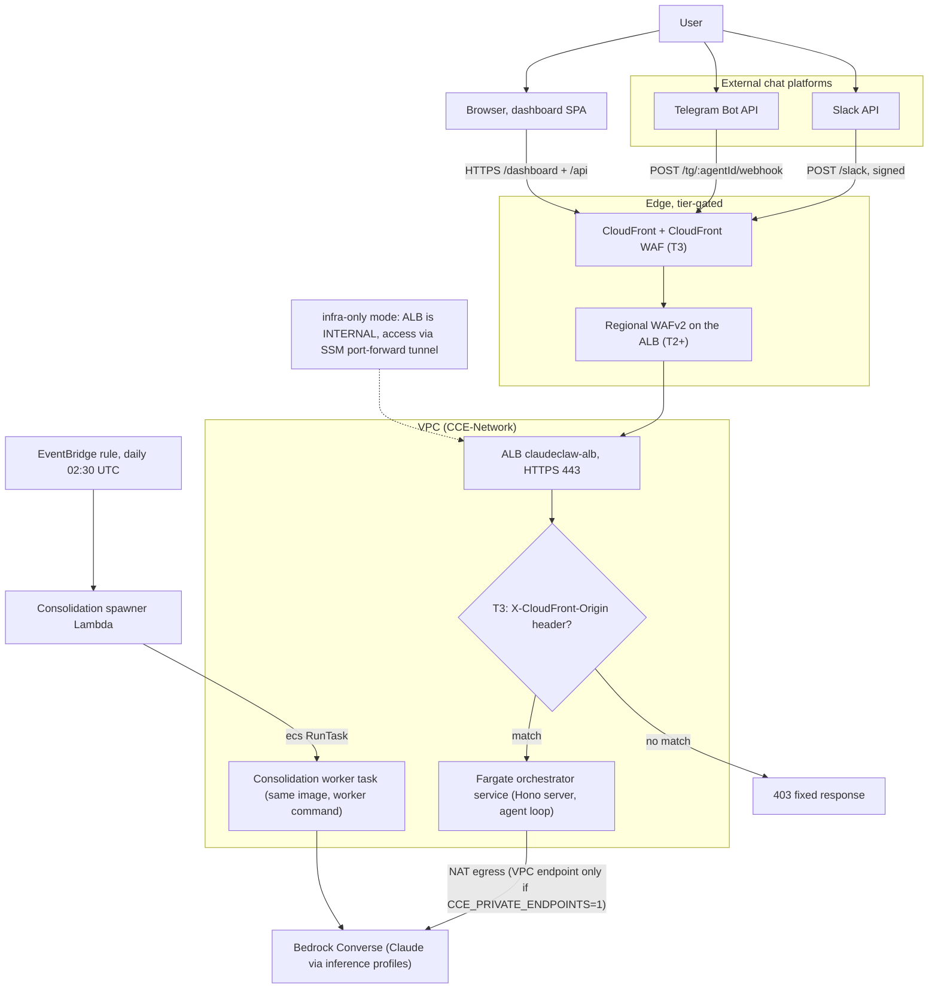

<!-- drift-gate: verified against the knowledge-durability hotfix; mapped-source changes were the VECTORS_BUCKET env value and a new RESOURCE_NAMES entry, neither of which this diagram depicts -->
<!-- drift-gate: verified against PR #104; mapped-source changes were dead-import removals only, no depicted flow changed. -->
# Architecture, compute view

> A user talks to the system through Slack, Telegram, or the browser dashboard, and every one of those paths lands on the same Application Load Balancer in front of a Fargate orchestrator service. At higher tiers, CloudFront and WAF sit in front of the ALB as the hardened edge; at Tier 3 the ALB only answers requests carrying CloudFront's secret origin header. The orchestrator runs the agent loop against Bedrock, and a separate consolidation worker task (same image, different command) is spawned nightly by a Lambda.

## Legend

- Solid arrows are the live request path; the dotted arrow marks the infra-only variant.
- **Edge is tier-gated**: T0/T1 have no WAF or CloudFront (requests hit the ALB directly), T2 adds regional WAFv2, T3 adds CloudFront plus a CloudFront-scoped WAF. The `X-CloudFront-Origin` listener rule exists only at T3; at lower tiers the HTTPS listener forwards directly.
- **infra-only variant** (`CCE_DEPLOY_MODE=infra-only`, no domain): the ALB is synthesized internal with no public listener, and the only access path is `npm run dashboard:tunnel` (SSM port-forward to the running task).
- The orchestrator service and the consolidation worker share one ECR image; the worker runs `node dist/workers/consolidation-worker.js`. Task counts scale per tier (1 task at T0 up to 20 max at T3).
- The task env carries one `TABLE_*` name per DynamoDB table (now including `TABLE_SPEND_LEDGER`, the atomic daily spend ledger); adding a table means a dynamo-stack construct + an iam-stack grant + a compute-stack env entry, all three in one PR.
- Secrets inject at task start (ECS `secrets:` mapping): surface tokens, dashboard token, app encryption key, guardrail id/version, vendor keys, and the emergency kill phrase (`kill_phrase` field of the dashboard secret; any chat message containing it trips the panic freeze in `src/agent/agent-loop.ts`).
- Sources: `infra/bin/app.ts`, `infra/lib/compute-stack.ts`, `infra/lib/network-stack.ts`, `infra/lib/security-stack.ts`, `infra/lib/constants.ts` (tier table).
