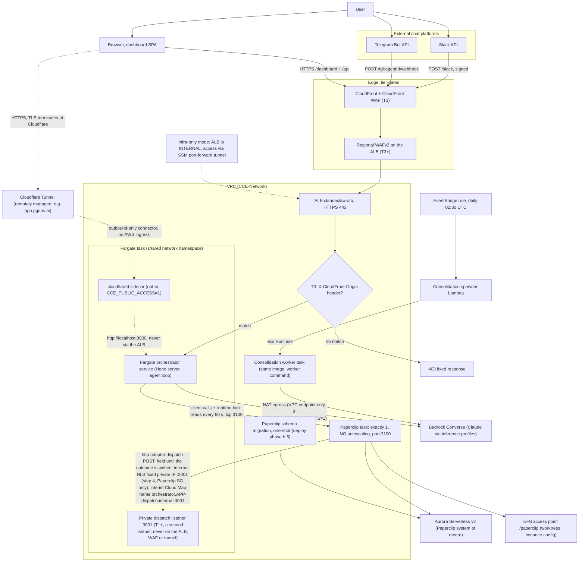

<!-- drift-gate: verified against Work Platform step 5 (ADR 0013); no box, edge, task, service or tier behaviour changed. The mapped edits are one new `TABLE_EFFECT_LEDGER` env entry on the existing orchestrator container (compute-stack.ts), the table's name in constants.ts, and its ARN in the Backup stack's table list (app.ts). The only depicted statement that changed is the legend's table count, now 33 entries and 29 received. -->
<!-- drift-gate: a depicted flow DID change and the diagram was updated (Work Platform step 4, ADR 0013, decision 38). At tiers that provision Paperclip the Compute stack adds an internal Network Load Balancer on tcp 3001 in front of the orchestrator's dispatch port, network-stack.ts adds its security group (Paperclip to the load balancer, the load balancer to Fargate), paperclip-stack.ts lists the load balancer's private-IP origin next to the interim Cloud Map origin in the adapter allowlist, and the dispatch is now held until the outcome is written. The dispatch edge and the notes say so. -->
<!-- drift-gate: verified against the Haiku model-id correction; no depicted element changed. The mapped-source edit is one string literal in BEDROCK_MODELS in infra/lib/constants.ts: 'us.anthropic.claude-haiku-4-5' was not a valid Bedrock inference profile and is now 'us.anthropic.claude-haiku-4-5-20251001-v1:0', verified against the live account with list-inference-profiles. It reaches the task definition as BEDROCK_HAIKU_MODEL via compute-stack.ts and fixes memory ingest and tldr generation, both of which were failing on every turn with ValidationException. No container, no table, no bucket, no key, no flow and no boundary moved. -->
<!-- drift-gate: verified against the War Room table-name fix (WRT-9 / M12). infra/lib/compute-stack.ts gains three env entries on the existing orchestrator container -- TABLE_WARROOM_MEETINGS, TABLE_WARROOM_TURNS, TABLE_WARROOM_CONNECTIONS -- naming DynamoDB tables that dynamo-stack already creates and iam-stack already grants. No box, edge, task, service or tier behaviour changes: a production synth before and after is byte-identical across 17 of 18 templates and adds exactly these three environment entries to the eighteenth. The legend TABLE_* bullet was corrected in the same PR; it claimed one TABLE_* per table, which was never true and is what let this fault ship unnoticed. -->
<!-- drift-gate: verified 2026-09-03 against staging Deploy runs 33733071639 and 33773788920. infra/lib/paperclip-stack.ts now sets two variables on the Paperclip service task: PAPERCLIP_ALLOWED_HOSTNAMES (the Cloud Map hostname the orchestrator dials; without it the private-hostname guard answered 403) and PAPERCLIP_BIND=lan (all interfaces; without it the EFS config.json's server.bind=loopback shrank a freshly booted task to 127.0.0.1 and the orchestrator's connection got no response). No box or edge changes: both variables make the depicted orchestrator -> Paperclip edge actually carry traffic. -->
<!-- drift-gate: Phase 9 makes Paperclip part of the standard T1-T3 stack set; Phase 4.5 removes the former ALB listener path because the pinned artifact permits open signup. The diagram now shows the single task, Aurora/EFS, migration job and internal service boundary with no browser-facing ALB edge. -->
# Architecture, compute view

> A user talks to the system through Slack, Telegram, or the browser dashboard. Those paths land either on the Application Load Balancer in front of a Fargate orchestrator service, or — in the opt-in public posture — on a Cloudflare Tunnel whose `cloudflared` sidecar runs inside the task itself and forwards to the orchestrator over localhost, never touching the ALB. At higher tiers, CloudFront and WAF sit in front of the ALB as the hardened edge; at Tier 3 the ALB only answers requests carrying CloudFront's secret origin header. The orchestrator runs the agent loop against Bedrock, and a separate consolidation worker task (same image, different command) is spawned nightly by a Lambda.

## Legend

- Solid arrows are the live request path; the dotted arrow marks the infra-only variant.
- **Edge is tier-gated**: T0/T1 have no WAF or CloudFront (requests hit the ALB directly), T2 adds regional WAFv2, T3 adds CloudFront plus a CloudFront-scoped WAF. The `X-CloudFront-Origin` listener rule exists only at T3; at lower tiers the HTTPS listener forwards directly.
- **infra-only variant** (`CCE_DEPLOY_MODE=infra-only`, no domain): the ALB is synthesized internal with no public listener, and the break-glass access path is `npm run dashboard:tunnel` (SSM port-forward to the running task).
- **public variant** (`CCE_PUBLIC_ACCESS=1`, layered on infra-only): a `cloudflared` sidecar joins the task and dials out to a remotely managed Cloudflare Tunnel, which publishes the hostname in `CCE_PUBLIC_HOSTNAME`. Because the sidecar shares the task network namespace it reaches the orchestrator on `http://localhost:3000`, so **the ALB is not in the public request path at all** and no AWS ingress is added: no public task IP, no public listener, no security-group hole. The connector is `essential`, reads its token from the `token` field of the `<app>-public-tunnel` secret, and is attached only after that token exists (see the readiness gate in `scripts/deploy.ts`).
- The orchestrator service and the consolidation worker share one ECR image; the worker runs `node dist/workers/consolidation-worker.js`. Task counts scale per tier (1 task at T0 up to 20 max at T3).
- The task env carries a `TABLE_*` name for **most** DynamoDB tables, not all. Of the 33 `RESOURCE_NAMES.ddb` entries the orchestrator container receives 29, and `hookIdempotency`, `extensionSubnetPool` and `extensionsRegistry` are exported nowhere. **Omission is not inert:** the repo module then falls back to a hard-coded *unsuffixed* literal, which in any suffixed environment resolves to the **production** table name and is correctly denied. That is precisely how every War Room read on staging returned 500 while production looked healthy (M12) — production's `${app}` prefix happens to equal the fallback. Adding a table means a dynamo-stack construct + an iam-stack grant + a compute-stack env entry, all three in one PR.
- Secrets inject at task start (ECS `secrets:` mapping): surface tokens, dashboard token, app encryption key, guardrail id/version, vendor keys, and the emergency kill phrase (`kill_phrase` field of the dashboard secret; any chat message containing it trips the panic freeze in `src/agent/agent-loop.ts`). At tiers that provision Paperclip, the same mapping injects the deployment-pinned `company_id`; Tier 0 does not reference that additive field.
- **Paperclip** (provisioned at Tier 1+; a Tier 0 Hobby install synthesizes the same three stacks empty) runs beside the orchestrator on its own security group and its own port (3100), with its own ECS task role -- it is a service boundary, not a shared database: Aurora admits 5432 from the Paperclip SG and deliberately NOT from the Fargate SG. It is drawn as exactly one task because it keeps node-local state (git worktrees, spawned children, an in-process port registry, a process-local cleanup lock) that EFS does not make shareable, and it rolls at minHealthyPercent 0 / maxHealthyPercent 100 so a deploy never runs two of them. Schema migration is the one-shot task, never the service: `PAPERCLIP_MIGRATION_AUTO_APPLY` is absent from the long-running container on purpose.
- **The Paperclip operator console has no ALB arrow.** The pinned artifact allows unauthenticated email signup even in authenticated mode, so the stack never attaches the board to Compute's potentially public listener. Operators use the AWS-authenticated ECS Exec/SSM port-forward to port 3100, and there is deliberately no link to it anywhere in the Netzar SPA.
- **Fixed dispatch address (Work Platform step 4, ADR 0013, decision 38).** Where Paperclip is provisioned, the Compute stack adds an internal Network Load Balancer (`DispatchNlb`, one TCP listener on 3001, an IP target group on the orchestrator's dispatch port, 300 s deregistration delay, default 350 s idle timeout). Its security group (`DispatchNlbSg`, Network stack) admits 3001 only from Paperclip's group, and the orchestrator's group admits 3001 from it. A deploy-time lookup reads the load balancer's private IP; the Paperclip task's adapter allowlist carries that origin next to the interim Cloud Map origin, and the stack output `DispatchLoadBalancerIp` is what the operator passes to the bootstrap script. Paperclip cuts a dispatch to a hostname at 30 s but holds a raw-IP one for about 300 s; Netzer holds up to 240 s. The looked-up IP sits in one zone: if that zone fails, the operator re-points.
- **Private dispatch and the runtime lock (Work Platform step 2, ADR 0014).** Where Paperclip is provisioned (T1+), Paperclip's http adapter reaches the orchestrator on a second listener, port 3001 (`PAPERCLIP_DISPATCH_PORT`), at `orchestrator.<app>-dispatch.internal`, a Cloud Map private namespace in the Compute stack (Paperclip's own `<app>.internal` namespace is created later, so registering the orchestrator there would be a stack cycle). Only Paperclip's security group may reach 3001; the ALB, the WAF and the tunnel never route to it, and the public app answers 404 for the dispatch route in code. In the other direction the orchestrator reads Paperclip's five runtime-lock conditions at start and every 60 s through a read-only company-member key (`lock_auditor_key` in the Paperclip secret, injected as `PAPERCLIP_LOCK_AUDITOR_KEY`): a violation at start refuses to start, and an unreadable Paperclip closes the Paperclip surface (see `docs/security-model.md`).
- Sources: `infra/bin/app.ts`, `infra/lib/compute-stack.ts`, `infra/lib/paperclip-stack.ts`, `infra/lib/network-stack.ts`, `infra/lib/security-stack.ts`, `infra/lib/constants.ts` (tier table).
