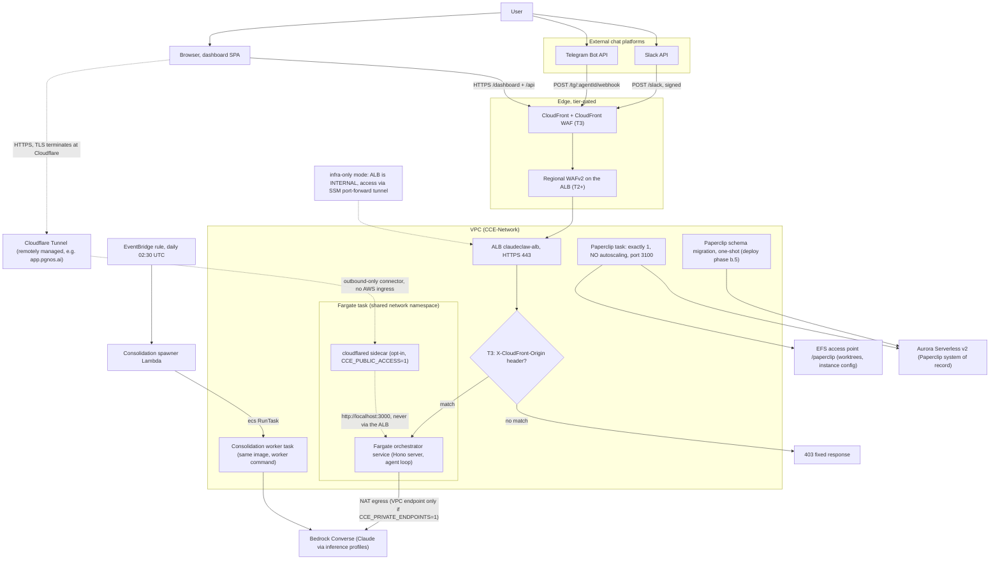

<!-- drift-gate: verified against the Paperclip fresh-install repair. The orchestrator now receives deployment-pinned PAPERCLIP_COMPANY_ID from Secrets Manager only at tiers that provision Paperclip; no compute node or edge changed. -->
<!-- drift-gate: verified against the knowledge-durability hotfix; mapped-source changes were the VECTORS_BUCKET env value and a new RESOURCE_NAMES entry, neither of which this diagram depicts -->
<!-- drift-gate: Phase 9 makes Paperclip part of the standard T1-T3 stack set; Phase 4.5 removes the former ALB listener path because the pinned artifact permits open signup. The diagram now shows the single task, Aurora/EFS, migration job and internal service boundary with no browser-facing ALB edge. -->
# Architecture, compute view

> A user talks to the system through Slack, Telegram, or the browser dashboard. Those paths land either on the Application Load Balancer in front of a Fargate orchestrator service, or — in the opt-in public posture — on a Cloudflare Tunnel whose `cloudflared` sidecar runs inside the task itself and forwards to the orchestrator over localhost, never touching the ALB. At higher tiers, CloudFront and WAF sit in front of the ALB as the hardened edge; at Tier 3 the ALB only answers requests carrying CloudFront's secret origin header. The orchestrator runs the agent loop against Bedrock, and a separate consolidation worker task (same image, different command) is spawned nightly by a Lambda.

## Legend

- Solid arrows are the live request path; the dotted arrow marks the infra-only variant.
- **Edge is tier-gated**: T0/T1 have no WAF or CloudFront (requests hit the ALB directly), T2 adds regional WAFv2, T3 adds CloudFront plus a CloudFront-scoped WAF. The `X-CloudFront-Origin` listener rule exists only at T3; at lower tiers the HTTPS listener forwards directly.
- **infra-only variant** (`CCE_DEPLOY_MODE=infra-only`, no domain): the ALB is synthesized internal with no public listener, and the break-glass access path is `npm run dashboard:tunnel` (SSM port-forward to the running task).
- **public variant** (`CCE_PUBLIC_ACCESS=1`, layered on infra-only): a `cloudflared` sidecar joins the task and dials out to a remotely managed Cloudflare Tunnel, which publishes the hostname in `CCE_PUBLIC_HOSTNAME`. Because the sidecar shares the task network namespace it reaches the orchestrator on `http://localhost:3000`, so **the ALB is not in the public request path at all** and no AWS ingress is added: no public task IP, no public listener, no security-group hole. The connector is `essential`, reads its token from the `token` field of the `<app>-public-tunnel` secret, and is attached only after that token exists (see the readiness gate in `scripts/deploy.ts`).
- The orchestrator service and the consolidation worker share one ECR image; the worker runs `node dist/workers/consolidation-worker.js`. Task counts scale per tier (1 task at T0 up to 20 max at T3).
- The task env carries one `TABLE_*` name per DynamoDB table (now including `TABLE_SPEND_LEDGER`, the atomic daily spend ledger); adding a table means a dynamo-stack construct + an iam-stack grant + a compute-stack env entry, all three in one PR.
- Secrets inject at task start (ECS `secrets:` mapping): surface tokens, dashboard token, app encryption key, guardrail id/version, vendor keys, and the emergency kill phrase (`kill_phrase` field of the dashboard secret; any chat message containing it trips the panic freeze in `src/agent/agent-loop.ts`). At tiers that provision Paperclip, the same mapping injects the deployment-pinned `company_id`; Tier 0 does not reference that additive field.
- **Paperclip** (provisioned at Tier 1+; a Tier 0 Hobby install synthesizes the same three stacks empty) runs beside the orchestrator on its own security group and its own port (3100), with its own ECS task role -- it is a service boundary, not a shared database: Aurora admits 5432 from the Paperclip SG and deliberately NOT from the Fargate SG. It is drawn as exactly one task because it keeps node-local state (git worktrees, spawned children, an in-process port registry, a process-local cleanup lock) that EFS does not make shareable, and it rolls at minHealthyPercent 0 / maxHealthyPercent 100 so a deploy never runs two of them. Schema migration is the one-shot task, never the service: `PAPERCLIP_MIGRATION_AUTO_APPLY` is absent from the long-running container on purpose.
- **The Paperclip operator console has no ALB arrow.** The pinned artifact allows unauthenticated email signup even in authenticated mode, so the stack never attaches the board to Compute's potentially public listener. Operators use the AWS-authenticated ECS Exec/SSM port-forward to port 3100, and there is deliberately no link to it anywhere in the Netzar SPA.
- Sources: `infra/bin/app.ts`, `infra/lib/compute-stack.ts`, `infra/lib/paperclip-stack.ts`, `infra/lib/network-stack.ts`, `infra/lib/security-stack.ts`, `infra/lib/constants.ts` (tier table).
