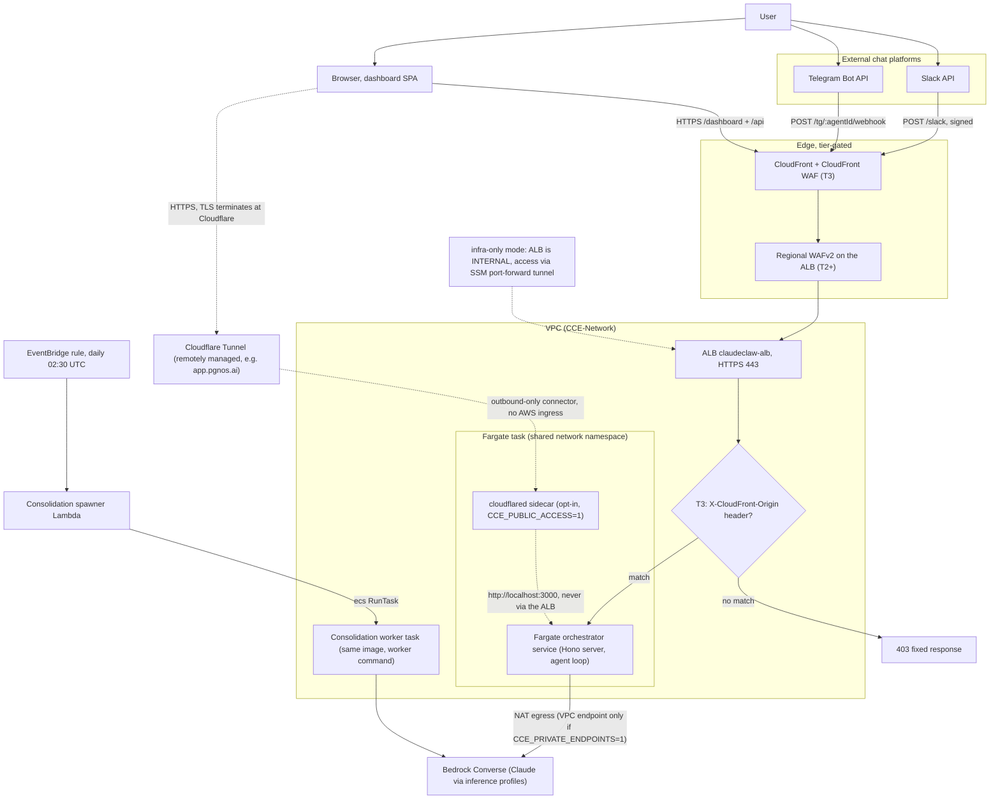

<!-- drift-gate: verified against the CCE_PAPERCLIP_ENABLED gate; no depicted compute flow changed. `infra/bin/app.ts` now instantiates CCE-Database and CCE-Filesystem only when CCE_PAPERCLIP_ENABLED=1. Those two stacks were already "Deliberately NOT drawn" below, and nothing consumes them, so the drawn topology is identical with the flag either way. The reason for the gate is operational, not architectural: ungated, first-time Aurora/EFS creation rode every routine app deploy, and on 2026-08-19 that reported a failed staging deploy while the orchestrator drawn here had in fact shipped and was running 1/1. Prior verification: verified against the Paperclip Phase 1 foundations (ADR 0010); no depicted compute flow changed. `infra/lib/network-stack.ts` gains `PaperclipSg` (ingress ALB->3100, its own port so the two services stay distinguishable in flow logs), `infra/bin/app.ts` instantiates the new CCE-Database and CCE-Filesystem substrate stacks, and `infra/lib/constants.ts` adds suffix-aware Paperclip names — but NO Paperclip task, target group, or listener rule exists yet (that is ADR 0010 Phase 2). Deliberately NOT drawn: adding the Paperclip service to this diagram before the service exists would depict a request path that cannot be exercised. When Phase 2 lands, draw the Paperclip task beside the orchestrator task with its 3100 TG and /api/health check, and its Aurora/EFS attachments from the data view. Prior verification: verified against the connector-availability change; no depicted flow changed, and one scheduled path that could have ERASED a depicted flow is now blocked. `infra/bin/app.ts` passes `autoPauseEnabled` to PowerSwitchStack: false for production, and the stack throws at synth if production tries to arm it. That schedule set ECS desiredCount to 0 nightly, which would delete every `cloudflared` sidecar drawn here and serve Cloudflare 1033 with no wake path — this diagram would have stayed accurate about the architecture while the architecture was switched off. Observability additionally gains an outside-in probe of the published hostname and a connector-capacity alarm; neither is a compute path, both watch one. Prior verification: verified against the public-entrypoint guard change; no depicted flow changed. The sidecar, its localhost:3000 path and its ALB bypass are exactly as drawn. What changed is the CONDITION under which the sidecar is drawn at all: synth now throws rather than silently emitting a task definition without it, so the `CCE_PUBLIC_ACCESS=1` branch of this diagram can no longer be quietly absent from a successful deploy. On 2026-08-14 it was, and app.pgnos.ai served Cloudflare 1033 for ten hours while every box drawn here remained correct. Prior verification: verified against the staging-public-url change; no depicted flow changed. The only compute-stack edit is the tunnel secret's description string, now interpolated from the resolved per-environment tunnel name instead of a frozen production literal. The topology this diagram shows is identical; the same shape now also serves staging.pgnos.ai from CCE-STAGING. Prior verification: the pgnos public-dashboard merge — a depicted flow DID change and the diagram was updated to add the opt-in `cloudflared` sidecar sharing the task network namespace and forwarding to localhost:3000, bypassing the ALB entirely. Before that: PR #104 — dead-import removals only. -->
# Architecture, compute view

> A user talks to the system through Slack, Telegram, or the browser dashboard. Those paths land either on the Application Load Balancer in front of a Fargate orchestrator service, or — in the opt-in public posture — on a Cloudflare Tunnel whose `cloudflared` sidecar runs inside the task itself and forwards to the orchestrator over localhost, never touching the ALB. At higher tiers, CloudFront and WAF sit in front of the ALB as the hardened edge; at Tier 3 the ALB only answers requests carrying CloudFront's secret origin header. The orchestrator runs the agent loop against Bedrock, and a separate consolidation worker task (same image, different command) is spawned nightly by a Lambda.

## Legend

- Solid arrows are the live request path; the dotted arrow marks the infra-only variant.
- **Edge is tier-gated**: T0/T1 have no WAF or CloudFront (requests hit the ALB directly), T2 adds regional WAFv2, T3 adds CloudFront plus a CloudFront-scoped WAF. The `X-CloudFront-Origin` listener rule exists only at T3; at lower tiers the HTTPS listener forwards directly.
- **infra-only variant** (`CCE_DEPLOY_MODE=infra-only`, no domain): the ALB is synthesized internal with no public listener, and the break-glass access path is `npm run dashboard:tunnel` (SSM port-forward to the running task).
- **public variant** (`CCE_PUBLIC_ACCESS=1`, layered on infra-only): a `cloudflared` sidecar joins the task and dials out to a remotely managed Cloudflare Tunnel, which publishes the hostname in `CCE_PUBLIC_HOSTNAME`. Because the sidecar shares the task network namespace it reaches the orchestrator on `http://localhost:3000`, so **the ALB is not in the public request path at all** and no AWS ingress is added: no public task IP, no public listener, no security-group hole. The connector is `essential`, reads its token from the `token` field of the `<app>-public-tunnel` secret, and is attached only after that token exists (see the readiness gate in `scripts/deploy.ts`).
- The orchestrator service and the consolidation worker share one ECR image; the worker runs `node dist/workers/consolidation-worker.js`. Task counts scale per tier (1 task at T0 up to 20 max at T3).
- The task env carries one `TABLE_*` name per DynamoDB table (now including `TABLE_SPEND_LEDGER`, the atomic daily spend ledger); adding a table means a dynamo-stack construct + an iam-stack grant + a compute-stack env entry, all three in one PR.
- Secrets inject at task start (ECS `secrets:` mapping): surface tokens, dashboard token, app encryption key, guardrail id/version, vendor keys, and the emergency kill phrase (`kill_phrase` field of the dashboard secret; any chat message containing it trips the panic freeze in `src/agent/agent-loop.ts`).
- Sources: `infra/bin/app.ts`, `infra/lib/compute-stack.ts`, `infra/lib/network-stack.ts`, `infra/lib/security-stack.ts`, `infra/lib/constants.ts` (tier table).
