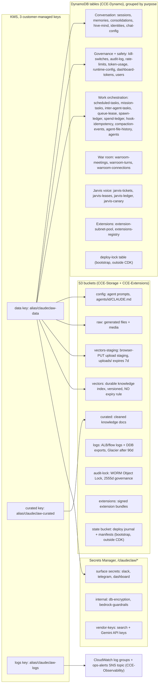

<!-- drift-gate: verified against the knowledge-durability hotfix; the durable vectors bucket is new and is drawn below; the staging bucket's expiry is now scoped to uploads/ -->
# Architecture, data view

> All durable state lives in S3 buckets, DynamoDB tables, and Secrets Manager, encrypted with three customer-managed KMS keys. The roughly 30 DynamoDB tables are shown grouped by purpose rather than enumerated, because the grouping is what matters for reasoning about blast radius and backup. The state bucket and deploy-lock table are bootstrap primitives created by the deploy script outside CDK.

## Legend

- Arrows mean "encrypts". The data key is the broadest: DDB tables, the config/raw/vectors-staging/vectors buckets, the secrets, and the extensions stack all ride it. The curated key covers only the curated bucket; the logs key covers CloudWatch log groups and the ops-alerts SNS topic, NOT the logs bucket.
- The logs and audit-lock buckets both use S3-managed encryption (SSE-S3), not KMS, but for different reasons. The logs bucket is SSE-S3 because it is the server-access-log destination for the other buckets and S3 server-access-log delivery cannot write to SSE-KMS buckets (`storage-stack.ts` says so at the `LogsBucket` construct). The audit-lock bucket is not a server-access-log target; it is SSE-S3 so its WORM retention stays readable independently of the customer-managed KMS keys, which teardown can schedule for cryptographic erasure — a deleted data key must never render the immutable audit trail unreadable. Its Object Lock governance retention (2555 days) also makes it an intentional residual at teardown.
- `vectors` and `vectors-staging` are deliberately separate buckets. The staging bucket is scratch: browser uploads land under `uploads/` and a 7-day expiry reclaims them. The `vectors` bucket holds the durable index at `index/<scope>/<docId>.jsonl`, is versioned, and carries no rule that can expire a current object — nothing anywhere re-derives that index, and in 2026-08 a single unprefixed expiry rule on the shared bucket destroyed the entire production knowledge base. `infra/lib/storage-stack.test.ts` enforces the separation.
- Vendor API keys (Tavily/Brave/Exa/Serper/Gemini) live in the `vendor-keys` secret, never in plain task-def env (IaC readiness item 5).
- The state bucket and deploy-lock table are the bootstrap primitives from `scripts/lib/lifecycle/bootstrap-state.ts`; they exist before any CDK stack and are owned by teardown, not `cdk destroy`.
- Table names are `claudeclaw-*` (or `claudeclaw-<suffix>-*` when `CCE_NAME_SUFFIX` is set); the full list is in `infra/lib/constants.ts`.
- Sources: `infra/lib/storage-stack.ts`, `infra/lib/dynamo-stack.ts`, `infra/lib/secrets-stack.ts`, `infra/lib/extensions-stack.ts`, `infra/lib/constants.ts`.
