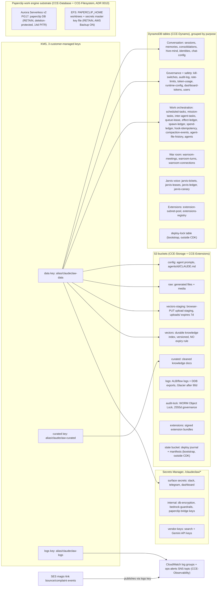

<!-- drift-gate: a depicted store DID change and the diagram's notes were updated (Work Platform step 6 (ADR 0016, ADR 0014)). secrets-stack.ts adds the `shadow-approvers` secret (created as `{"v":1,"slots":{}}`, data key, RETAIN) and constants.ts names it. The Paperclip substrate note lists it and the new Paperclip-secret field; the drawing's boxes are unchanged to keep the node budget. No new table: the registry rows share the users table. -->
<!-- drift-gate: a depicted store DID change and the diagram was updated (Work Platform step 5, ADR 0013). dynamo-stack.ts adds the `effect-ledger` table (PK and SK, no expiry, point-in-time recovery, the data key, one sparse index for unknown rows) and constants.ts names it. The Work orchestration group now lists it and the legend says what it holds. infra/bin/app.ts adds its ARN to the Backup stack's table list, so the daily export (T1 and up) covers it; that stack is not drawn here. -->
<!-- drift-gate: verified against Work Platform step 2 (ADR 0014); no depicted store was added, removed or re-owned. The only mapped-source edit is infra/lib/constants.ts gaining DISPATCH_PORT (3001) and the dispatch namespace names, which are network settings, not state. The Paperclip secret gains one field, lock_auditor_key (merge-added with a REPLACE_ME default by deployment code and written later by the operator bootstrap), inside the existing secret. -->
<!-- drift-gate: verified against the Haiku model-id correction; no depicted element changed. The mapped-source edit is one string literal in BEDROCK_MODELS in infra/lib/constants.ts: 'us.anthropic.claude-haiku-4-5' was not a valid Bedrock inference profile and is now 'us.anthropic.claude-haiku-4-5-20251001-v1:0', verified against the live account with list-inference-profiles. It reaches the task definition as BEDROCK_HAIKU_MODEL via compute-stack.ts and fixes memory ingest and tldr generation, both of which were failing on every turn with ValidationException. No container, no table, no bucket, no key, no flow and no boundary moved. -->
<!-- drift-gate: verified against the Paperclip fresh-install repair. No store was added or re-owned: deployment code merge-adds company_id to the retained Paperclip secret after creation so CloudFormation never replaces live credentials, and CI idempotently creates/hardens the existing bootstrap state bucket when absent. -->
<!-- drift-gate: verified against the ADR 0010 Phase 9 tier gate; no depicted store was added, removed or re-owned. The `infra/lib/constants.ts` change is one new TierShape field, paperclipEnabled (false at Tier 0 Hobby, true at T1-T3), which decides whether the Paperclip Aurora cluster and EFS are PROVISIONED at all rather than how they are shaped - the stacks themselves are now always constructed and gate their own resources inside, so `cdk ls` prints the same 18 names at every tier. No DynamoDB table, bucket, KMS key or secret moves, and the Paperclip secret and its Aurora-generated credentials secret are untouched (both are RETAIN with fixed names and were deliberately left unconditional). Prior verification: the Aurora ceiling became tiered via TierShape.paperclipAuroraMaxAcu (T0 1 ACU, T1 2, T2 4, T3 8) while the 0.5 min-ACU floor stayed untiered - which is exactly why Tier 0 now provisions no cluster at all: the floor is the part that bills continuously. -->
# Architecture, data view

> All durable state lives in S3 buckets, DynamoDB tables, and Secrets Manager, encrypted with three customer-managed KMS keys. The roughly 30 DynamoDB tables are shown grouped by purpose rather than enumerated, because the grouping is what matters for reasoning about blast radius and backup. The state bucket and deploy-lock table are bootstrap primitives created by the deploy script outside CDK.

## Legend

- Arrows mean "encrypts". The data key is the broadest: DDB tables, the config/raw/vectors-staging/vectors buckets, the secrets, and the extensions stack all ride it. The curated key covers only the curated bucket; the logs key covers CloudWatch log groups and the ops-alerts SNS topic, NOT the logs bucket.
- Because the ops-alerts topic is encrypted with the logs key, every service that publishes to it needs its own grant in that key's policy, not just permission on the topic. `storage-stack.ts` carries `AllowSNS` and `AllowSES`; the SES grant (scoped by `aws:SourceAccount`) is what lets the magic-link configuration set deliver bounce and complaint events. Without it `CreateConfigurationSetEventDestination` fails with "Access denied to KMS key for SNS topic", even though the topic policy already allows in-account publish.
- The logs and audit-lock buckets both use S3-managed encryption (SSE-S3), not KMS, but for different reasons. The logs bucket is SSE-S3 because it is the server-access-log destination for the other buckets and S3 server-access-log delivery cannot write to SSE-KMS buckets (`storage-stack.ts` says so at the `LogsBucket` construct). The audit-lock bucket is not a server-access-log target; it is SSE-S3 so its WORM retention stays readable independently of the customer-managed KMS keys, which teardown can schedule for cryptographic erasure — a deleted data key must never render the immutable audit trail unreadable. Its Object Lock governance retention (2555 days) also makes it an intentional residual at teardown.
- `vectors` and `vectors-staging` are deliberately separate buckets. The staging bucket is scratch: browser uploads land under `uploads/` and a 7-day expiry reclaims them. The `vectors` bucket holds the durable index at `index/<scope>/<docId>.jsonl`, is versioned, and carries no rule that can expire a current object — nothing anywhere re-derives that index, and in 2026-08 a single unprefixed expiry rule on the shared bucket destroyed the entire production knowledge base. `infra/lib/storage-stack.test.ts` enforces the separation.
- Vendor API keys (Tavily/Brave/Exa/Serper/Gemini) live in the `vendor-keys` secret, never in plain task-def env (IaC readiness item 5).
- The state bucket and deploy-lock table are the bootstrap primitives from `scripts/lib/lifecycle/bootstrap-state.ts`; they exist before any CDK stack and are owned by teardown, not `cdk destroy`.
- **Effect ledger (Work Platform step 5, ADR 0013).** The `effect-ledger` table holds one row per deterministic business write, keyed by case, stage, step and stage entry (`PK = CASE#<caseKey>`, `SK = EFFECT#...`), plus frozen drafts under `SK = DRAFT#...`. Rows carry a state (`pending`, `applied`, `retryable` or `unknown`) and the recorded result. The table has point-in-time recovery, the data key and a retain policy, and it has no expiry. A sparse index, `gsi1-unknown`, holds only the rows in the `unknown` state. The key is frozen: it is one-way once a live pack runs. The executor that writes it is a library in step 5; the dispatch completion write does not use it yet.
- Table names are `claudeclaw-*` (or `claudeclaw-<suffix>-*` when `CCE_NAME_SUFFIX` is set); the full list is in `infra/lib/constants.ts`.
- **Paperclip substrate (ADR 0010)**: Aurora storage encryption and EFS encryption use AWS-managed keys, deliberately NOT the three CMKs — the cluster/filesystem are RETAIN so teardown's CMK erasure must never brick them. Two secrets ride along (kept out of the drawing for the node budget): `/claudeclaw/paperclip` (bridge keys plus the merge-added, deployment-pinned `company_id`, in the internal-secrets node, data-key encrypted) and `/claudeclaw/paperclip-db` (Aurora-generated credentials, AWS-managed key). Step 6 adds `/claudeclaw/shadow-approvers` (approver board keys, data-key encrypted, outside the `paperclip*` name; the orchestrator's task role may read it and the deploy role may not) and the Paperclip secret gains a `signup_probe_email` field; the slot logins are in a second secret, `/claudeclaw/shadow-approvers-setup`, that no service role reads. The approver registry is rows in the existing users table (`SHADOWSLOT#`, `USER#`, `PCUSER#` keys), not a new table. CloudFormation retains the original bridge-secret seed shape; deploy phase b adds `company_id` only when absent, preserving every live key and database URL. The `/claudeclaw/paperclip` CloudWatch log group is created by CCE-Filesystem. The work-item schema inside the Aurora `paperclip` database is owned by Paperclip's own migrations — Netzar never touches it (DL-2).
- Sources: `infra/lib/storage-stack.ts`, `infra/lib/dynamo-stack.ts`, `infra/lib/secrets-stack.ts`, `infra/lib/database-stack.ts`, `infra/lib/filesystem-stack.ts`, `infra/lib/extensions-stack.ts`, `infra/lib/constants.ts`.
