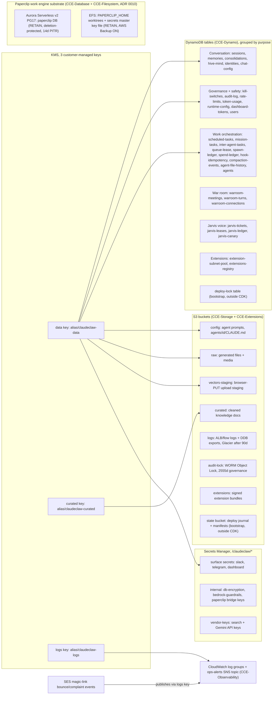

<!-- drift-gate: verified against the ADR 0010 Phase 9 tier gate; no depicted store was added, removed or re-owned. The `infra/lib/constants.ts` change is one new TierShape field, paperclipEnabled (false at Tier 0 Hobby, true at T1-T3), which decides whether the Paperclip Aurora cluster and EFS are PROVISIONED at all rather than how they are shaped - the stacks themselves are now always constructed and gate their own resources inside, so `cdk ls` prints the same 18 names at every tier. No DynamoDB table, bucket, KMS key or secret moves, and the Paperclip secret and its Aurora-generated credentials secret are untouched (both are RETAIN with fixed names and were deliberately left unconditional). Prior verification: the Aurora ceiling became tiered via TierShape.paperclipAuroraMaxAcu (T0 1 ACU, T1 2, T2 4, T3 8) while the 0.5 min-ACU floor stayed untiered - which is exactly why Tier 0 now provisions no cluster at all: the floor is the part that bills continuously. -->
# Architecture, data view

> All durable state lives in S3 buckets, DynamoDB tables, and Secrets Manager, encrypted with three customer-managed KMS keys. The roughly 30 DynamoDB tables are shown grouped by purpose rather than enumerated, because the grouping is what matters for reasoning about blast radius and backup. The state bucket and deploy-lock table are bootstrap primitives created by the deploy script outside CDK.

## Legend

- Arrows mean "encrypts". The data key is the broadest: DDB tables, the config/raw/vectors-staging buckets, the secrets, and the extensions stack all ride it. The curated key covers only the curated bucket; the logs key covers CloudWatch log groups and the ops-alerts SNS topic, NOT the logs bucket.
- Because the ops-alerts topic is encrypted with the logs key, every service that publishes to it needs its own grant in that key's policy, not just permission on the topic. `storage-stack.ts` carries `AllowSNS` and `AllowSES`; the SES grant (scoped by `aws:SourceAccount`) is what lets the magic-link configuration set deliver bounce and complaint events. Without it `CreateConfigurationSetEventDestination` fails with "Access denied to KMS key for SNS topic", even though the topic policy already allows in-account publish.
- The logs and audit-lock buckets both use S3-managed encryption (SSE-S3), not KMS, but for different reasons. The logs bucket is SSE-S3 because it is the server-access-log destination for the other buckets and S3 server-access-log delivery cannot write to SSE-KMS buckets (`storage-stack.ts` says so at the `LogsBucket` construct). The audit-lock bucket is not a server-access-log target; it is SSE-S3 so its WORM retention stays readable independently of the customer-managed KMS keys, which teardown can schedule for cryptographic erasure — a deleted data key must never render the immutable audit trail unreadable. Its Object Lock governance retention (2555 days) also makes it an intentional residual at teardown.
- Vendor API keys (Tavily/Brave/Exa/Serper/Gemini) live in the `vendor-keys` secret, never in plain task-def env (IaC readiness item 5).
- The state bucket and deploy-lock table are the bootstrap primitives from `scripts/lib/lifecycle/bootstrap-state.ts`; they exist before any CDK stack and are owned by teardown, not `cdk destroy`.
- Table names are `claudeclaw-*` (or `claudeclaw-<suffix>-*` when `CCE_NAME_SUFFIX` is set); the full list is in `infra/lib/constants.ts`.
- **Paperclip substrate (ADR 0010)**: Aurora storage encryption and EFS encryption use AWS-managed keys, deliberately NOT the three CMKs — the cluster/filesystem are RETAIN so teardown's CMK erasure must never brick them. Two secrets ride along (kept out of the drawing for the node budget): `/claudeclaw/paperclip` (bridge keys, in the internal-secrets node, data-key encrypted) and `/claudeclaw/paperclip-db` (Aurora-generated credentials, AWS-managed key). The `/claudeclaw/paperclip` CloudWatch log group is created by CCE-Filesystem. The work-item schema inside the Aurora `paperclip` database is owned by Paperclip's own migrations — Netzar never touches it (DL-2).
- Sources: `infra/lib/storage-stack.ts`, `infra/lib/dynamo-stack.ts`, `infra/lib/secrets-stack.ts`, `infra/lib/database-stack.ts`, `infra/lib/filesystem-stack.ts`, `infra/lib/extensions-stack.ts`, `infra/lib/constants.ts`.
