<!-- drift-gate: verified against Work Platform step 2 (ADR 0014); no depicted queue, topic, rule or flow changed. The mapped compute-stack.ts edits give the orchestrator container a second port (3001) at tiers that provision Paperclip, register the service in a new Cloud Map private namespace, and add one injected secret field and one env entry; none touches SQS, SNS, EventBridge, the scheduler or the invalidation listener. -->
<!-- drift-gate: verified against P7 (Netzar Chat step 9, ADR 0011). The only mapped edit is a one-line COMMENT above the in-process drain's `appendTurns` call in `src/lib/scheduler/queue-drain.ts` (the M1 parity note: a scheduled turn sends no request id, so a chat deleted mid-turn is not re-checked); no depicted queue, topic, schedule, subscription or drain flow changed. -->
<!-- drift-gate: verified against the War Room table-name fix (WRT-9 / M12). The mapped compute-stack edit adds three TABLE_* env entries naming existing DynamoDB tables on the orchestrator task. It adds or alters no queue, topic, subscription, schedule, DLQ or message-flow edge, so this diagram is unchanged. -->
<!-- drift-gate: verified against the Paperclip staging-contract probe. The mapped compute-stack edit is a reworded comment on the orchestrator task's PAPERCLIP_COMPANY_ID secret entry; it does not add or alter a queue, topic, subscription, schedule, DLQ, or message-flow edge, so this diagram is unchanged. -->
<!-- drift-gate: verified against the Paperclip fresh-install repair; the compute-stack change conditionally injects a secret field and does not change any depicted queue, topic, schedule, subscription or drain flow. -->
<!-- drift-gate: verified against the knowledge-durability hotfix; the compute-stack change was an env-var value only; no depicted message flow changed -->
<!-- drift-gate: verified against ADR 0010 Phase 9; no depicted flow changed. The only `infra/lib/compute-stack.ts` edit is a COMMENT on the CCE_PAPERCLIP_ENABLED task-def env entry, recording that the variable is now the RUNTIME router flag and nothing else (the Paperclip stacks are provisioned by tier since Phase 9, not by that variable). The entry itself, its value expression and every queue, topic, schedule, subscription and DLQ depicted here are unchanged. Prior verification: Phase 4 appended two entries to the execution role secret ARN list (the Paperclip secret and the Aurora credentials secret), which this diagram also does not depict. -->
# Architecture, messaging view

> Asynchronous work flows through two SQS pipelines: scheduled tasks fire from EventBridge Scheduler into the scheduled-fire queue, and config changes fan out from an SNS topic to per-task queues so every running orchestrator task hot-reloads. Each due scheduled task is a one-shot EventBridge schedule created at runtime inside the `claudeclaw` scheduler group. Memory consolidation is a separate nightly path: an EventBridge rule triggers a spawner Lambda that launches one Fargate worker task per agent-and-chat pair with pending memories.

```mermaid
flowchart TD
  subgraph sched["Scheduled tasks"]
    GROUP["EventBridge Scheduler group claudeclaw"]
    SCHEDS["Runtime one-shot schedules, one per due task (created by eb-scheduler.ts)"]
    EXECROLE["Scheduler exec role: sqs SendMessage only"]
    FIREQ["SQS claudeclaw-scheduled-fire"]
    FIREDLQ["scheduled-fire DLQ"]
    DRAIN["Orchestrator in-process drain (queue-drain.ts)"]
    SCHEDS --> GROUP
    GROUP -->|"assumes"| EXECROLE
    EXECROLE --> FIREQ
    FIREQ --> DRAIN
    FIREQ -.->|"5 failures"| FIREDLQ
  end

  subgraph cfg["Config hot-reload fan-out"]
    CONFIGB["S3 config bucket object change"]
    RULE["EventBridge rule ConfigChangeRule"]
    TOPIC["SNS claudeclaw-config-invalidation"]
    PERTASK["Per-task SQS queues, runtime-created (config-sub-*)"]
    RELOAD["In-memory config reload in each task"]
    CONFIGB --> RULE
    RULE --> TOPIC
    TOPIC --> PERTASK
    PERTASK --> RELOAD
  end

  subgraph ingest["Knowledge ingest"]
    INGESTQ["SQS claudeclaw-ingest"]
    INGESTDLQ["ingest DLQ"]
    INGESTQ -.->|"5 failures"| INGESTDLQ
  end

  subgraph consolidation["Nightly memory consolidation"]
    NIGHTLY["EventBridge rule, daily 02:30 UTC"]
    SPAWNER["Spawner Lambda claudeclaw-consolidation-spawner"]
    CWORKER["Fargate consolidation worker task, one per agent+chat"]
    CDLQ["hook DLQ + consolidation DLQ (CCE-Extensions)"]
    NIGHTLY --> SPAWNER
    SPAWNER -->|"ecs RunTask"| CWORKER
    CWORKER -.-> CDLQ
  end

  ALERTS["SNS claudeclaw-ops-alerts (CloudWatch alarms to email)"]
```

## Legend

- Dotted arrows are failure paths into dead-letter queues; solid arrows are the happy path.
- The scheduler GROUP is a deploy-verified prerequisite (`ensureSchedulerGroup` in `scripts/deploy.ts` runs right after the foundation stacks); the SCHEDULES inside it are app data, created and deleted at runtime by `src/lib/scheduler/eb-scheduler.ts` and owned by maintenance mode and teardown, not CDK.
- Per-task config-invalidation queues are created at runtime by `src/lib/config/invalidation-listener.ts` with the `claudeclaw-config-sub-` prefix, one queue per running Fargate task; the queue-lifecycle IAM grants are scoped to `claudeclaw-config-sub-*`.
- A daily DDB-export Lambda (CCE-Backup, 02:00 UTC cron, T1+) and the Jarvis spend-reservation reaper Lambda (`claudeclaw-jarvis-reaper`, CCE-Dynamo, on an EventBridge rate rule — it reclaims unspent spend-ledger reservations left by crashed Jarvis sessions) also run on EventBridge rules; they are deliberately omitted here to keep this view on the message-flow concern.
- compute-stack is a mapped source for its spawner + nightly rule only; its other concerns (task env map, table wiring) change without touching any messaging path shown here.
- Task-level env/secrets wiring in compute-stack (including the emergency kill phrase injection) does not change any messaging flow shown here.
- Sources: `infra/lib/messaging-stack.ts`, `infra/lib/compute-stack.ts` (spawner + nightly rule), `infra/lib/extensions-stack.ts` (DLQs), `src/lib/scheduler/eb-scheduler.ts`, `src/lib/config/invalidation-listener.ts`.
