<!-- drift-gate: verified against the Paperclip Phase 2 readiness work; no depicted flow changed. The mapped-source change is ComputeStack exposing the HTTPS:443 listener it ALREADY creates as an optional public field (httpsListener), so the Paperclip stack in ADR 0010 Phase 2 can attach its own listener rule instead of the listener staying a local const. Nothing is created, removed or reordered: same construct, same certificate, same default action, same CloudFrontOnly and DirectHost rules. It is typed OPTIONAL on purpose because the listener is only built when DOMAIN_NAME is set, so a tier with no domain has no HTTPS listener at all -- a fact the diagrams do not depict and callers must handle. ComputeOutputs is unchanged (it declares albDnsName only). Prior verification: verified against the public-entrypoint guard change; nothing in this diagram is affected. The drift gate flags it because it maps `infra/lib/compute-stack.ts`, but the edits there are a synth-time assertion and an IAM grant on the tunnel secret. No queue, topic, schedule or consumer changed. Prior verification: verified against the staging-public-url change; no depicted flow changed. The compute-stack edit is a secret description string only. Every async path shown here — the scheduler group, the scheduled-fire queue, the config SNS fan-out, the nightly consolidation spawner — is untouched, and none of them is environment-name-sensitive in a way this change alters (queue and topic names already came from buildResourceNames). Prior verification: the pgnos public-dashboard merge — the compute-stack change added an inbound HTTP edge and touched none of these paths. Before that: PR #104 — dead-import removals only. -->
# Architecture, messaging view

> Asynchronous work flows through two SQS pipelines: scheduled tasks fire from EventBridge Scheduler into the scheduled-fire queue, and config changes fan out from an SNS topic to per-task queues so every running orchestrator task hot-reloads. Each due scheduled task is a one-shot EventBridge schedule created at runtime inside the `claudeclaw` scheduler group. Memory consolidation is a separate nightly path: an EventBridge rule triggers a spawner Lambda that launches one Fargate worker task per agent-and-chat pair with pending memories.

```mermaid
flowchart TD
  subgraph sched["Scheduled tasks"]
    GROUP["EventBridge Scheduler group claudeclaw"]
    SCHEDS["Runtime one-shot schedules, one per due task (created by eb-scheduler.ts)"]
    EXECROLE["Scheduler exec role: sqs SendMessage only"]
    FIREQ["SQS claudeclaw-scheduled-fire"]
    FIREDLQ["scheduled-fire DLQ"]
    DRAIN["Orchestrator in-process drain (queue-drain.ts)"]
    SCHEDS --> GROUP
    GROUP -->|"assumes"| EXECROLE
    EXECROLE --> FIREQ
    FIREQ --> DRAIN
    FIREQ -.->|"5 failures"| FIREDLQ
  end

  subgraph cfg["Config hot-reload fan-out"]
    CONFIGB["S3 config bucket object change"]
    RULE["EventBridge rule ConfigChangeRule"]
    TOPIC["SNS claudeclaw-config-invalidation"]
    PERTASK["Per-task SQS queues, runtime-created (config-sub-*)"]
    RELOAD["In-memory config reload in each task"]
    CONFIGB --> RULE
    RULE --> TOPIC
    TOPIC --> PERTASK
    PERTASK --> RELOAD
  end

  subgraph ingest["Knowledge ingest"]
    INGESTQ["SQS claudeclaw-ingest"]
    INGESTDLQ["ingest DLQ"]
    INGESTQ -.->|"5 failures"| INGESTDLQ
  end

  subgraph consolidation["Nightly memory consolidation"]
    NIGHTLY["EventBridge rule, daily 02:30 UTC"]
    SPAWNER["Spawner Lambda claudeclaw-consolidation-spawner"]
    CWORKER["Fargate consolidation worker task, one per agent+chat"]
    CDLQ["hook DLQ + consolidation DLQ (CCE-Extensions)"]
    NIGHTLY --> SPAWNER
    SPAWNER -->|"ecs RunTask"| CWORKER
    CWORKER -.-> CDLQ
  end

  ALERTS["SNS claudeclaw-ops-alerts (CloudWatch alarms to email)"]
```

## Legend

- Dotted arrows are failure paths into dead-letter queues; solid arrows are the happy path.
- The scheduler GROUP is a deploy-verified prerequisite (`ensureSchedulerGroup` in `scripts/deploy.ts` runs right after the foundation stacks); the SCHEDULES inside it are app data, created and deleted at runtime by `src/lib/scheduler/eb-scheduler.ts` and owned by maintenance mode and teardown, not CDK.
- Per-task config-invalidation queues are created at runtime by `src/lib/config/invalidation-listener.ts` with the `claudeclaw-config-sub-` prefix, one queue per running Fargate task; the queue-lifecycle IAM grants are scoped to `claudeclaw-config-sub-*`.
- A daily DDB-export Lambda (CCE-Backup, 02:00 UTC cron, T1+) and the Jarvis spend-reservation reaper Lambda (`claudeclaw-jarvis-reaper`, CCE-Dynamo, on an EventBridge rate rule — it reclaims unspent spend-ledger reservations left by crashed Jarvis sessions) also run on EventBridge rules; they are deliberately omitted here to keep this view on the message-flow concern.
- compute-stack is a mapped source for its spawner + nightly rule only; its other concerns (task env map, table wiring) change without touching any messaging path shown here.
- Task-level env/secrets wiring in compute-stack (including the emergency kill phrase injection) does not change any messaging flow shown here.
- Sources: `infra/lib/messaging-stack.ts`, `infra/lib/compute-stack.ts` (spawner + nightly rule), `infra/lib/extensions-stack.ts` (DLQs), `src/lib/scheduler/eb-scheduler.ts`, `src/lib/config/invalidation-listener.ts`.
