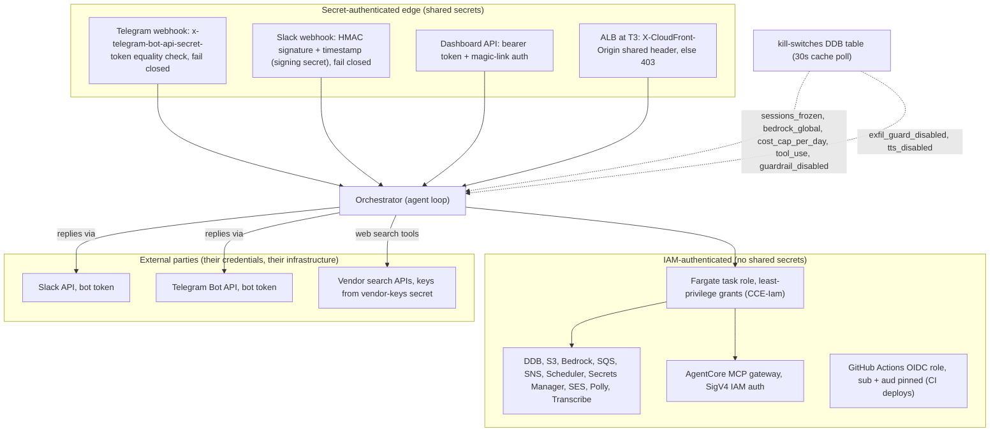

<!-- drift-gate: verified against the Paperclip fresh-install repair. The existing GitHub OIDC deploy role gains least-privilege create/hardening access to the deterministic state bucket and write access only under cloud-build/; no trust boundary or role assumption changed. -->
<!-- drift-gate: verified against the knowledge-durability hotfix; the task role gained bucket + object access on the new vectors bucket, which this diagram shows as an unenumerated grant; no depicted trust boundary changed -->
<!-- drift-gate: verified against the empty-turn poisoning fix (PR #96); the mapped sources changed only the chat-history repair path and the tool-loop output ceiling, which are availability and data-integrity concerns — no depicted trust boundary, IAM grant or kill switch changed -->
<!-- drift-gate: verified against ADR 0010 Phase 9; no trust boundary moved. The only mapped source touched is `infra/lib/compute-stack.ts`, and only a comment in it: CCE_PAPERCLIP_ENABLED is now purely the runtime router flag the orchestrator task reads, while the Paperclip substrate is provisioned by deploy tier. No IAM statement, role, kill switch or authorization path changes - notably the Paperclip task role stays separate from the orchestrator task role (DL-2), and the engine still admits 5432 from its own SG only. `infra/lib/iam-stack.ts` is untouched by this change; the ordering trap its comments describe (cicdRole grants must land in an earlier deploy than the step that uses them) now keys on the tier instead of the variable, which is recorded in the workflow comments rather than here. Prior verification: Phase 4 widened the GitHub OIDC DEPLOY role with the PaperclipSecretPopulate / PaperclipCloudBuild statements, mirrored into the prod and staging branches. -->
# Architecture, security view (trust boundaries)

> Three kinds of trust hold the system together: shared secrets authenticate everything crossing the public edge (webhook signatures, the dashboard bearer token, CloudFront's origin header), IAM authenticates everything the orchestrator does inside AWS (one task role with least-privilege grants), and external services like Slack, Telegram, and vendor search APIs are reached with stored credentials. Kill switches in a DynamoDB table sit at every one of these boundaries and can shut a path down in about 30 seconds (cache-poll propagation). Nothing inside the VPC trusts a request that has not passed one of the secret-auth checks at the edge.

## Legend

- Solid arrows are authenticated calls; dotted arrows show where kill switches intercept.
- **Fail-closed webhooks**: a missing or `REPLACE_ME` Telegram secret or Slack signing secret REJECTS requests (401). Signature verification is **unconditional** — there is no per-surface `*_signature_check_disabled` bypass switch (removed in Wave A; see the note below); break-glass for a broken secret is to close ingress, not to accept unsigned traffic.
- **Kill-switch placement** (all in the `claudeclaw-kill-switches` table, namespaced MCP tools ride the same `tool_use` switch as built-ins):
  - edge: none — webhook signature verification is unconditional and cannot be switched off (Wave A)
  - turn entry: `sessions_frozen`, per-identity rate limits, `bedrock_global`, `cost_cap_per_day`
  - in-turn: `tool_use` / `tool_dispatch_disabled` (re-checked before every tool round, so a mid-incident flip stops in-flight turns too), `guardrail_disabled`, `exfil_guard_disabled`, `tts_disabled`
  - armed: `paperclip_disabled` (41st switch, ADR 0010) — checked inside the transport at **every** client invoke (`src/lib/paperclip/client.ts`), and again at the dashboard ACL routes (`src/adapters/dashboard/missions.ts`), the inbound dispatch route (`src/adapters/dashboard/paperclip-dispatch.ts`) and the Paperclip agent tools (`src/lib/tools/paperclip-tools.ts`), so no caller can bypass it; it is the permanent Netzar-side stop that works even when Paperclip is unreachable, and it stays registered permanently regardless of how the integration is provisioned
- Bedrock is drawn inside the IAM boundary because calls are IAM-signed and stay in the AWS account/region, but prompts do leave the app process; the data-flow inventory in the security model doc is the authoritative list of processors.
- Propagation is a cache poll (~30s TTL), not push; flipping a switch is not instantaneous.
- Ingress authentication is UNCONDITIONAL (Wave A): the slack/telegram signature-check bypass switches were removed — an unsigned webhook carries an attacker-controlled sender principal, so no switch may accept unsigned traffic. Break-glass for a broken/missing secret is closed ingress (401), and a missing secret rejects rather than passing unverified.
- Availability under throttle (H2): the turn path degrades Opus -> Sonnet -> Haiku only when the failure precedes the first emitted chunk; validation/guardrail/auth errors never trigger a model switch.
- Audit-trail hardening (C5c): control-plane changes (kill-switch set, token mint/revoke, IAM apply) are on the always-audited list (immune to `audit_log_disabled`), and the privilege-granting ones await their audit write, surfacing a 500 instead of silence when no store accepts it.
- Spend control (C2-full): every agent turn passes a fail-closed admission gate before Bedrock is invoked — the atomic spend-ledger table (in the task role's per-table DdbRW grant) reserves worst-case headroom so concurrent tasks cannot collectively overshoot the daily cap; a ledger outage blocks spend rather than admitting it.
- Emergency kill phrase: any inbound chat message containing it (all three surfaces share the agent-loop path) trips the same panic freeze as the dashboard panic button, before any Bedrock work; the phrase reaches the task from the dashboard secret's `kill_phrase` field.
- Route authorization is defense in depth: dashboard agent-mutation routes require BOTH operator-rank and `agents:write`, while the MCP-registry write (`PUT /api/integrations/mcp`) requires **admin**-rank and `config:write` — so a custom profile that clears the rank gate but has the capability stripped is still denied. The double gate is intentional; do not collapse it into a single check.
- Tool-surface containment (PR #107): model-supplied tool args are not trusted for authorization. Mission tools reject an `owner` other than the calling agent, knowledge ingest/search resolve their corpus scope server-side (own scope + shared only, so a prompt-injected agent cannot poison the shared corpus or read another agent's), and War Room turns enforce the per-meeting tool blocklist through `runAgentTurn`'s `blockedTools` (spec stripped from the model AND dispatch refused).
- The opt-in IAM-copilot write grant (`CCE_IAM_COPILOT_WRITE=1`, default off) no longer includes `iam:CreateUser`: minting a fresh principal was the one escalation path the infra-role Deny cannot enumerate.
- Generated-artifact containment: the S3 key for a generated document is derived server-side from `ctx.chatId` (sanitized `[^A-Za-z0-9_-] -> _`) plus a fresh UUID — the model supplies the document *spec*, never a storage path, so a prompt-injected agent cannot steer where bytes land or overwrite another chat's object. The display filename taken from the spec title is separately sanitized and length-capped because it reaches a download filename. Delivery rides `ToolMedia` to the surface rather than a presigned URL embedded in reply text: a URL in the text is read by the model and reproduced in its output, which both mangles the signature and needlessly widens what the model can echo.
- CI build path (ADR 0010 Phase 1.5): the GitHub OIDC deploy role can start ONE CodeBuild project, `claudeclaw[-suffix]-paperclip-cloud-build`, and pass ONE role to it — the least-privilege build role that pushes to a single ECR repo and reads a single S3 prefix. Before staging source, that deploy role may create and apply the versioning, SSE and public-access-block baseline to only the deterministic environment state bucket; object writes remain limited to `cloud-build/`. The image is built on a native ARM64 host and self-verifies its architecture inside the build, so a wrong-platform image is never pushed. Source for that build is `git archive HEAD` of the checkout: tracked, committed files only, so a runner-local `.env` cannot reach the build.
- Sources: `src/adapters/telegram/handler.ts`, `src/adapters/slack/handler.ts`, `src/adapters/dashboard/handler.ts`, `src/agent/agent-loop.ts`, `infra/lib/iam-stack.ts`, `infra/lib/compute-stack.ts` (origin header rule).
