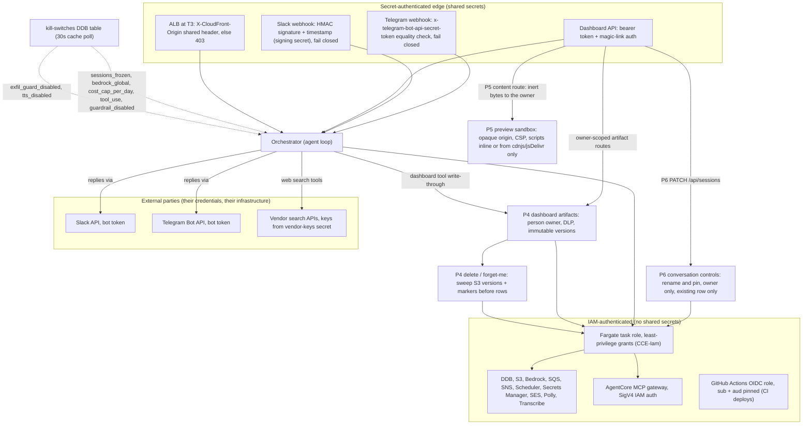

<!-- drift-gate: verified against NZR-5. The only mapped source touched is `src/adapters/dashboard/handler.ts`: six knowledge routes (`GET /vectors`, `POST /vectors/search`, `POST /vectors/answer`, `POST /ingest`, `POST /ingest/stream`, `DELETE /vectors/:scope/:docId`) and the Jarvis `vectors` query resource gain an in-route scope check (`canReadScope` in `src/lib/vectors/scope-access.ts`): `default`/`shared` need `vectors:read`, any other scope needs the new admin-tier capability `knowledge:private:read`; refusals are one uniform 403 `forbidden_scope` plus an always-audited `knowledge_scope_denied` row carrying a scope hash only. `POST /vectors/upload-url` now needs `agents:write`, and the legacy role gate lets POST search/answer/upload-url through to those in-route capability checks. This NARROWS what existing routes return inside the dashboard bearer boundary: no new route, principal, IAM grant, kill switch or trust boundary. -->
<!-- drift-gate: verified against NZR-43. The only mapped source touched is `src/adapters/dashboard/handler.ts`: the generic `/api/config*` routes (three GETs and the POST) gain an in-route category policy (`CONFIG_POLICY` in `src/lib/state/config-policy.ts`, default deny) that refuses `oauth`, `oauth_state` and `mcp` to every principal, owner included, with one uniform 403 `forbidden_category` and an always-audited `config_access_denied` row (names only); `power`, `alerting` and `jarvis` reads need `security:read`, `paperclip` `integrations:read`; secret-shaped values are masked in responses, the `config_updated` audit row and the log line. This NARROWS what an existing route returns inside the dashboard bearer boundary: no new route, principal, IAM grant, capability, kill switch or trust boundary. -->
<!-- drift-gate: a depicted control set DID change and the diagram's notes were updated (Work Platform step 6 (ADR 0016, ADR 0014)). The task role gains a read-only grant on the `shadow-approvers` secret and on the users table by ARN (iam-stack.ts); the Paperclip task closes sign-up by default (compute-stack.ts); the runtime lock gains the sign-up probe. The diagram's edges are unchanged; the runtime-lock legend bullet and a new approvals bullet record the controls. -->
<!-- drift-gate: a depicted control set DID change and the diagram's notes were updated (Work Platform step 5, ADR 0013). A Paperclip-dispatched turn is now an AI step: the agent loop denies a write tool there (a built-in tool must be read-only; a remote tool must be in the role allowlist), checks that policy on the offered tool list and again at dispatch, and writes one `tool_invoke` audit row per call. The task role gains a grant on the new `effect-ledger` table and its index (iam-stack.ts). The diagram's edges are unchanged; a new legend bullet records the controls. No new principal, kill switch or trust boundary. -->
<!-- drift-gate: a depicted control set DID change and the diagram's notes were updated (Work Platform step 4, ADR 0013). The dispatch route no longer pre-checks the `paperclip_disabled` switch, the runtime lock closes with `unknown:paperclip_routing_off` when routing is off, the task role gains a cluster-scoped ECS task-protection grant, and an internal load balancer admitted only from Paperclip's security group fronts port 3001. The diagram's edges are unchanged; the legend notes record these. -->
<!-- drift-gate: P6 adds owner-only PATCH /api/sessions rename and pin controls in `src/adapters/dashboard/handler.ts`, backed by the owner-conditional, version-bumping `setConversationMeta` in `src/lib/state/sessions-repo.ts`; the diagram shows the route reaching the existing task role, with no new IAM grant, principal or trust boundary. Telegram and Slack carry P6 SKIP comments only. -->
<!-- drift-gate: P5 artifact UI adds GET /api/artifacts/content behind the same guards as /artifacts/download (sessions:read, owner or awaited-audit admin, exact version, one 404) and returns stored bytes only as an inert attachment (application/octet-stream, nosniff, a sandbox CSP, no-store); view=outline turns a deck into bounded slide text after the P3 ZIP check. The dashboard renders HTML and Mermaid previews only inside an opaque-origin srcdoc sandbox (allow-scripts, never allow-same-origin) under its own policy and a best-effort WebRTC guard (WebRTC is a known residual: a frame the preview makes gets it back), and the dashboard page's own frame policy (frame-src 'self' blob:) refuses a preview navigating its frame off-site; SVG only as an image; markdown with remote media, inline SVG, MathML and form controls removed. No IAM grant, principal, capability, kill switch or new trust boundary; the ART-16 export channel is deferred, so a preview has no channel back to the page. Telegram and Slack carry a P5 panel SKIP comment only. -->
<!-- drift-gate: P4 artifact infrastructure adds person-owned dashboard CURATED heads/versions, DLP before storage, URL-free transcript/SSE references, owner-reminted downloads and version-aware erasure. The task role gains only curated ListBucketVersions/DeleteObjectVersion; no new service, principal or external trust boundary. Telegram and Slack retain legacy media delivery and skip durable artifact ownership. -->
<!-- drift-gate: verified against P2 (WI-2.1..2.4 and the step 4 review's fixes; owner decisions 37, 41, 50, 51, 52, 53). Mapped sources touched: `src/adapters/dashboard/handler.ts` (both send routes now refuse an unknown agent or a model outside the catalog before spend; a `clientMessageId` becomes a conditional TURN# record; Stop aborts the turn; typed errors carry a code and a fixed message, never exception text), `src/agent/agent-loop.ts` (the abort signal, tool start/end with capped arguments and results, the guardrail stream mode read from runtime-config) and `src/adapters/telegram/handler.ts` / `src/adapters/slack/handler.ts` (a PARITY SKIP comment only). The review's fixes add: tool inputs and results pass the block-severity redactor, a failed tool's text loses ARNs and account ids, `dynamodb_query`'s raw result is not passed on (decision 53), Telegram and Slack post the sanitized error sentence (a kill switch's reason included in what stays out), a turn record that cannot be written is a typed 503, and the generic API-key pattern (`src/lib/safety/exfil-patterns.ts`) also matches a JSON-quoted key name. The one trust-relevant change is the guardrail's stream mode on ConverseStream (owner decision 50): recorded in a new Legend bullet with the measured cause (decision 51), AWS's stated trade-off and the runtime switch back. No IAM grant, kill switch, capability, principal or trust boundary was added; the TURN# record lives inside the existing sessions-table containment. -->
<!-- drift-gate: verified against P1 (WI-1.1..1.4, owner decisions 1, 9, 46, 47). The mapped source touched is `src/adapters/dashboard/handler.ts`: a conversation's owner becomes a PERSON (a session's userId, or the one user an admin linked a user-less token to), every dashboard and Jarvis conversation route enforces it (`src/adapters/dashboard/jarvis.ts` applies the same rule), an admin's read of someone else's conversation is audited before anything is returned, and `POST /api/tokens/:hashPrefix/link` adds the audited, one-time link. No IAM grant, kill switch, capability or trust boundary was added: the override rides `security:write` (the tier DELETE /sessions already used) and the link `tokens:write` behind the existing admin-rank `/tokens` gate. A new Legend bullet records the owner model; the containment bullet's `#` sentence is corrected. -->
<!-- drift-gate: verified against WI-1.0, the sessions-table containment gate (owner decision 11). The only mapped source touched is `src/adapters/dashboard/handler.ts`, which gains `isConversationRow` and applies it to the two existing sessions reads; `src/adapters/dashboard/jarvis.ts`, which is not a mapped source, applies the same predicate to the Jarvis `sessions` action. No route, capability, IAM grant, kill switch, principal or trust boundary changed: the two routes already required `sessions:read` and the Jarvis action its `viewer` role floor (`authorizeRead`), and this NARROWS what all three return. It closes a disclosure rather than opening one, so a new Legend bullet records the rule. -->
<!-- drift-gate: verified against the War Room PDF-safety slice. The existing `GET /api/warroom-transcripts/:id` route now passes transcript text through `toPdfSafeText` and turns a failed render into a 422; no route, IAM grant, principal or trust boundary changed. `assertPdfRenderable` still refuses content its callers own. -->
<!-- drift-gate: verified against the corrupt-but-successful builder fixes; no depicted trust boundary, IAM grant or kill switch changed. The mapped-source edits are truncatedNotice applied on the tool-loop return path as well as the non-tool one, and repairEmptyTurns switching from optional chaining to a typeof check so a legacy turn whose text is a number is repaired rather than throwing a TypeError inside getSession. Both are availability and data-integrity concerns inside an existing boundary. -->
<!-- drift-gate: verified against the War Room table-name fix (WRT-9 / M12). The only mapped source touched is infra/lib/compute-stack.ts, which gains three TABLE_* env entries on the orchestrator container. No IAM statement, role, principal, kill switch or trust boundary changes: infra/lib/iam-stack.ts already grants the task role on warroomMeetingsTable / warroomTurnsTable / warroomConnectionsTable via CDK table constructs, so those ARNs already follow CCE_NAME_SUFFIX. This removes an authorization ANOMALY rather than adding a grant -- before it, a suffixed environment asked for production table names and was correctly denied. Table names are configuration, not secrets, and none is injected through the ECS secrets mapping. -->
<!-- drift-gate: verified against the War Room transcript PDF route (fix/warroom-scroll-and-pdf). The only mapped source touched is `src/adapters/dashboard/handler.ts`, which gains `GET /api/warroom-transcripts/:id` INSIDE the existing dashboard bearer boundary: the router-wide middleware (bearer auth, dashboard_read_disabled, role rank) runs first, the handler then requires the same `warroom:read` capability every War Room read requires and honours the existing `warroom_disabled` kill switch, and the PDF bytes stream straight back — no S3 object, no presigned URL, no new IAM grant, no new principal or trust boundary. -->
<!-- drift-gate: verified against the Paperclip staging-contract probe. The existing staging GitHub OIDC deploy role gains RunTask/DescribeTasks for the staging orchestrator probe, PassRole only for the staging orchestrator task/execution roles with PassedToService=ecs-tasks.amazonaws.com, and read access only to the staging orchestrator log group; production receives none of these grants. This is a least-privilege extension inside the already-depicted OIDC/IAM boundary, with no new principal, assumption path, network edge, or trust boundary. The mapped compute-stack edit is a reworded comment on the orchestrator task's PAPERCLIP_COMPANY_ID secret entry. -->
<!-- drift-gate: verified against the Paperclip staging target-group repair. The private Cloud Map-only ECS service no longer registers with an unattached ALB target group; its existing container health check remains authoritative, and no listener, ingress rule, IAM grant, or trust boundary changed. -->
<!-- drift-gate: verified against the Paperclip secret-population hotfix. The existing deploy role now receives kms:Decrypt and kms:GenerateDataKey on only the existing data CMK so Secrets Manager can read and replace the encrypted Paperclip secret; no trust boundary or role assumption changed. -->
<!-- drift-gate: verified against the Paperclip fresh-install repair. The existing GitHub OIDC deploy role gains least-privilege create/hardening access to the deterministic state bucket and write access only under cloud-build/; no trust boundary or role assumption changed. -->
<!-- drift-gate: verified against the knowledge-durability hotfix; the task role gained bucket + object access on the new vectors bucket, which this diagram shows as an unenumerated grant; no depicted trust boundary changed -->
<!-- drift-gate: verified against the empty-turn poisoning fix (PR #96); the mapped sources changed only the chat-history repair path and the tool-loop output ceiling, which are availability and data-integrity concerns — no depicted trust boundary, IAM grant or kill switch changed -->
<!-- drift-gate: verified against ADR 0010 Phase 9; no trust boundary moved. The only mapped source touched is `infra/lib/compute-stack.ts`, and only a comment in it: CCE_PAPERCLIP_ENABLED is now purely the runtime router flag the orchestrator task reads, while the Paperclip substrate is provisioned by deploy tier. No IAM statement, role, kill switch or authorization path changes - notably the Paperclip task role stays separate from the orchestrator task role (DL-2), and the engine still admits 5432 from its own SG only. `infra/lib/iam-stack.ts` is untouched by this change; the ordering trap its comments describe (cicdRole grants must land in an earlier deploy than the step that uses them) now keys on the tier instead of the variable, which is recorded in the workflow comments rather than here. Prior verification: Phase 4 widened the GitHub OIDC DEPLOY role with the PaperclipSecretPopulate / PaperclipCloudBuild statements, mirrored into the prod and staging branches. -->
# Architecture, security view (trust boundaries)

> Three kinds of trust hold the system together: shared secrets authenticate everything crossing the public edge (webhook signatures, the dashboard bearer token, CloudFront's origin header), IAM authenticates everything the orchestrator does inside AWS (one task role with least-privilege grants), and external services like Slack, Telegram, and vendor search APIs are reached with stored credentials. Kill switches in a DynamoDB table sit at every one of these boundaries and can shut a path down in about 30 seconds (cache-poll propagation). Nothing inside the VPC trusts a request that has not passed one of the secret-auth checks at the edge.

## Legend

- Chat attachment containment (P3, decisions 1, 3 and 54): staged keys live under `uploads/chat/<callerTag>/`, where the tag is derived from the caller's identity; one person cannot send another's upload. The file's size and type are signed into the PUT and checked again with `HeadObject` before a turn begins. Transcripts never carry storage keys. `GET /api/sessions/attachment` gives only the owner, or an admin after an awaited audited override, a short-lived GET link with attachment disposition. A chat file enters the knowledge base only through its chip's “Add to knowledge” switch; that knowledge copy stays when the chat is deleted. Deleting a conversation removes its stored files before its rows.
- Solid arrows are authenticated calls; dotted arrows show where kill switches intercept.
- **Fail-closed webhooks**: a missing or `REPLACE_ME` Telegram secret or Slack signing secret REJECTS requests (401). Signature verification is **unconditional** — there is no per-surface `*_signature_check_disabled` bypass switch (removed in Wave A; see the note below); break-glass for a broken secret is to close ingress, not to accept unsigned traffic.
- **Kill-switch placement** (all in the `claudeclaw-kill-switches` table, namespaced MCP tools ride the same `tool_use` switch as built-ins):
  - edge: none — webhook signature verification is unconditional and cannot be switched off (Wave A)
  - turn entry: `sessions_frozen`, per-identity rate limits, `bedrock_global`, `cost_cap_per_day`
  - in-turn: `tool_use` / `tool_dispatch_disabled` (re-checked before every tool round, so a mid-incident flip stops in-flight turns too), `guardrail_disabled`, `exfil_guard_disabled`, `tts_disabled`
  - armed: `paperclip_disabled` (41st switch, ADR 0010) — checked inside the transport at **every** client invoke (`src/lib/paperclip/client.ts`), and again at the dashboard ACL routes (`src/adapters/dashboard/missions.ts`), and the Paperclip agent tools (`src/lib/tools/paperclip-tools.ts`), so no caller can bypass it. The inbound dispatch route no longer pre-checks it (Work Platform step 4, ADR 0013: a 503 from the switch would forge a run outcome); the held attempt meets the switch at its first client call and ends with a real non-2xx; it is the permanent Netzar-side stop that works even when Paperclip is unreachable, and it stays registered permanently regardless of how the integration is provisioned
- **AI steps cannot write (Work Platform step 5, ADR 0013).** Every Paperclip-dispatched turn runs with `toolPolicy: { aiStep: true }`. In `src/agent/agent-loop.ts` (`toolDecision` in `src/lib/tools/tool-policy.ts`) a built-in tool runs in an AI step only when its handler is marked `readOnly: true`, and a remote tool runs only when the agent's `tools` allowlist (from `agent.yaml`) names it. The policy filters the tool list offered to the model and is checked again at dispatch. A denied call is not run and is audited as `tool_invoke` with `result: blocked`. Every turn has a `turnId`, and every call writes one `tool_invoke` row with IDs and an argument hash, never arguments or results. `paperclip_add_comment` and `paperclip_create_subtask` refuse when the turn holds no run. The task role's grant covers the new `effect-ledger` table and its index like the other tables (`infra/lib/iam-stack.ts`); `effect_applied`, `effect_unknown` and `effect_resolved` are always audited. Detail: `docs/security-model.md`.
- Bedrock is drawn inside the IAM boundary because calls are IAM-signed and stay in the AWS account/region, but prompts do leave the app process; the data-flow inventory in the security model doc is the authoritative list of processors.
- Propagation is a cache poll (~30s TTL), not push; flipping a switch is not instantaneous.
- Ingress authentication is UNCONDITIONAL (Wave A): the slack/telegram signature-check bypass switches were removed — an unsigned webhook carries an attacker-controlled sender principal, so no switch may accept unsigned traffic. Break-glass for a broken/missing secret is closed ingress (401), and a missing secret rejects rather than passing unverified.
- Availability under throttle (H2): the turn path degrades Opus -> Sonnet -> Haiku only when the failure precedes the first emitted chunk; validation/guardrail/auth errors never trigger a model switch.
- Audit-trail hardening (C5c): control-plane changes (kill-switch set, token mint/revoke/link, IAM apply) and every admin read of a conversation that is not theirs are on the always-audited list (immune to `audit_log_disabled`), and the privilege-granting ones await their audit write, surfacing a 500 instead of silence when no store accepts it.
- Spend control (C2-full): every agent turn passes a fail-closed admission gate before Bedrock is invoked — the atomic spend-ledger table (in the task role's per-table DdbRW grant) reserves worst-case headroom so concurrent tasks cannot collectively overshoot the daily cap; a ledger outage blocks spend rather than admitting it.
- Output ceiling: runtime-config `agent/max_output_tokens` tunes every turn's model-call ceiling; writing it through `/config` is admin-only (`src/adapters/dashboard/handler.ts:242`), the value is clamped to 1024-32768, and the daily cost cap still bounds spend.
- Emergency kill phrase: any inbound chat message containing it (all three surfaces share the agent-loop path) trips the same panic freeze as the dashboard panic button, before any Bedrock work; the phrase reaches the task from the dashboard secret's `kill_phrase` field.
- Route authorization is defense in depth: dashboard agent-mutation routes require BOTH operator-rank and `agents:write`, while the MCP-registry write (`PUT /api/integrations/mcp`) requires **admin**-rank and `config:write` — so a custom profile that clears the rank gate but has the capability stripped is still denied. The double gate is intentional; do not collapse it into a single check.
- War Room transcript export (`GET /api/warroom-transcripts/:id`, dashboard router): sits behind the dashboard bearer middleware and additionally requires the `warroom:read` capability and an inactive `warroom_disabled` switch, exactly the gates the `/api/warroom/*` reads enforce; the transcript PDF is built in-process and streamed as an attachment, so no generated-artifact object is created and nothing is presigned.
- Tool-surface containment (PR #107): model-supplied tool args are not trusted for authorization. Mission tools reject an `owner` other than the calling agent, knowledge ingest/search resolve their corpus scope server-side (own scope + shared only, so a prompt-injected agent cannot poison the shared corpus or read another agent's), and War Room turns enforce the per-meeting tool blocklist through `runAgentTurn`'s `blockedTools` (spec stripped from the model AND dispatch refused).
- Session-listing containment (WI-1.0, owner decision 11): the `claudeclaw-sessions` table is shared — `src/lib/state/jarvis-memory-repo.ts` stores Jarvis long-term memory in it as `PK=JARVIS#<hashPrefix16>`, `SK=TURN#<iso>#<uuid>` — so every reader that lists conversations now selects conversation rows explicitly through `isConversationRow` (`src/adapters/dashboard/handler.ts`) instead of mapping whatever the table returns into a conversation by stripping key prefixes. Before this, the cross-agent `GET /api/sessions`, its CSV export and the Jarvis `sessions` action each rendered a memory row as a conversation whose `agentId` was the principal's own `JARVIS#<hashPrefix16>`, disclosing that id to any holder of `sessions:read` (the Jarvis action checks a `viewer` role floor instead). The rule is an **allowlist** of the conversation key shape (`PK=AGENT#…` with `SK=CHAT#<chatId>` and no further `#` segment), not a blocklist of the foreign types that exist today, so a future item type added to the same table is excluded by default rather than by remembering to exclude it. A `chatId` containing `#` can no longer reach a key: since P1 every sessions-table key stores it as `_` (owner decision 47), so the rule never hides a real conversation.
- Conversation ownership (P1 WI-1.1, owner decisions 1 and 9): a conversation belongs to a PERSON, whichever token they signed in with — `dashboardIdentity` is `dashboard:user:<userId>` for a magic-link session, or for a token with no user of its own that an admin linked to one (`POST /api/tokens/:hashPrefix/link`: `tokens:write`, one link per token, never moved, `token_linked` audited). Before P1 it was `dashboard:<tokenHash>`, and each login mints a new token, so the next login orphaned everything the last one wrote. The send routes refuse a conversation the caller does not own BEFORE anything reads or writes it — slash commands included — with the 404 the delete route gives a missing one; the transcript, the list, the CSV export, the per-chat export and the Jarvis `sessions` action return only the caller's own conversations; an admin (`security:write`) may read or delete anyone's, and each such read is audited as `session_read_override` before anything is returned — a read whose audit cannot be written returns nothing. A slash command never creates a conversation nobody owns (`/warroom` in a new chat creates it for its caller). An agent's `dynamodb_query` tool never returns the per-message records, though it still reads its own partition's conversation rows, as before P1; the memories routes are not owner-scoped either (both carried). `appendTurns` stamps the owner once and never overwrites it, which closes the old takeover chain (one message into someone else's conversation used to take it). A token with no person behind it gets no durable chat: its conversations keep the 7-day TTL, and nothing makes one durable later — not a scheduled task, not a link made afterwards.
- Guardrail stream mode (P2, owner decisions 50 and 51): a streamed turn now sends the Bedrock guardrail as `guardrailConfig.streamProcessingMode: 'async'`, so the answer reaches the browser as it is written and the guardrail scans alongside it. In the default synchronous mode Bedrock holds the whole answer until its scan finishes — measured on real Bedrock against the staging guardrail (decision 51): no guardrail, first text at 1.37 s; default mode, first text at 3.20 s with every event inside the last 156 ms; async, first text at 1.23 s — which is why the deployed dashboard never streamed (F1 Layer B's twelfth check). The trade-off is AWS's own: a harmful sentence can reach the screen before the guardrail blocks the rest of the reply, and async mode cannot mask sensitive information (this guardrail masks nothing — every PII entity is `BLOCK`). The app's live redactor still scrubs every chunk — and every tool input and result, which P2 sends to the browser and stores, a key written as a JSON property included — against the block-severity exfil patterns first (AWS key, API key header, PEM private key, Slack token, GitHub PAT, card number, US SSN). A Stop pressed before the guardrail's verdict keeps the partial reply unchecked (owner decision 52): a partial holding something the guardrail blocks can make that chat trip the filter on later turns until a new chat. Runtime-config `bedrock/guardrail_stream_mode = sync` (any case) puts the guardrail back in front without a redeploy (writing it through `/config` is admin-only). `streamProcessingMode` exists only on ConverseStream: the non-streamed tool-loop rounds keep the synchronous guardrail, and a plain Converse never carries the field.
- Send-time checks and turn records (P2 WI-2.3, plan MSG-09): both send routes refuse an agent id the registry does not know (`404 unknown_agent`; before P2 an unknown id silently ran as `main`) and a model override outside the published catalog (`400 unknown_model`) BEFORE any spend. A web client's `clientMessageId` becomes a turn record — `PK=AGENT#<agentId>`, `SK=CHAT#<chatId>#TURN#<id>`, a 7-day `ttl` — written with `attribute_not_exists(SK)` before the model call, so the same id can never start a second paid call (`409 turn_duplicate`), an id reused for a different message is refused (`409 turn_conflict`), a record that cannot be written refuses the send (`503 turn_record_unavailable`), and the record reaches exactly one final state. It is a child of the conversation's key, so the containment rule above hides it and the delete cascade removes it. Tool results are stored with the reply, capped at 2 KB; tool ARGUMENTS are shown live and never stored anywhere (decision 41). Both pass the block-severity redactor before they leave the server, a failed tool's text also loses ARNs and account ids, and the raw result of `dynamodb_query` — which can return other people's conversation rows (A172, still open) — is neither shown nor stored (owner decision 53); the model still receives every raw result. The error sentence the browser gets (a code and a fixed message, never exception text, and never a kill switch's free-text reason, which stays in the audit) is also what Telegram and Slack now post.
- The opt-in IAM-copilot write grant (`CCE_IAM_COPILOT_WRITE=1`, default off) no longer includes `iam:CreateUser`: minting a fresh principal was the one escalation path the infra-role Deny cannot enumerate.
- Generated-artifact containment: the S3 key for a generated document is derived server-side from `ctx.chatId` (sanitized `[^A-Za-z0-9_-] -> _`) plus a fresh UUID — the model supplies the document *spec*, never a storage path, so a prompt-injected agent cannot steer where bytes land or overwrite another chat's object. The display filename taken from the spec title is separately sanitized and length-capped because it reaches a download filename. Legacy bot delivery rides `ToolMedia` rather than a presigned URL embedded in reply text: a URL in the text is read by the model and reproduced in its output, which both mangles the signature and needlessly widens what the model can echo.
- P4 dashboard artifact boundary: only a stable person-owned dashboard conversation can create a durable CURATED artifact. A DLP scan of the name, body and source precedes the S3 write; a conversation child lock fences writes against deletion. The sessions table stores owner-bound heads, immutable version rows, pending-write recovery rows and URL-free references in the transcript. Owner routes list heads/versions and re-mint a short-lived GET for the selected physical S3 version; an audited admin override uses the same ownership gate. Deleting a conversation or using forget-me enumerates and removes every artifact-owned S3 version and delete marker and any artifact-derived preview or KB copy before removing child rows. P3 chat-upload opt-ins are shared KB documents and remain after chat deletion under owner decision 54. The task role's new grant is scoped to CURATED version listing and version deletion. Telegram and Slack have no stable person owner for this store, so P4 durable artifacts are skipped there while their existing generated-media delivery remains.
- P5 artifact preview boundary: the dashboard never runs artifact content in its own origin, where its bearer token lives in web storage. `GET /api/artifacts/content` repeats every guard of `/artifacts/download` (sessions:read, the owner or an admin whose read is audited first, the exact version, one indistinguishable 404) and returns the stored bytes as an attachment the browser will not render (`application/octet-stream`, `nosniff`, `Content-Security-Policy: sandbox; default-src 'none'`, `no-store`). The panel renders an HTML or Mermaid artifact only in an `<iframe sandbox="allow-scripts">` built from `srcdoc`: an opaque origin with no access to the page, its storage, cookies or token, no forms, popups or top-level navigation. The sandbox document opens with its own Content-Security-Policy before any artifact markup — scripts only inline or from `https://cdn.jsdelivr.net/npm/` and `https://cdnjs.cloudflare.com/ajax/libs/` (owner decision 4), styles only inline or from those same two paths, fonts only as `data:` or from them, pictures and media only as `data:` or `blob:`, every other request blocked — and a guard script that removes WebRTC, which CSP cannot govern, from the preview's own window. That guard is best effort only: a frame the preview creates, or a document it navigates to, gets WebRTC back, and no browser policy can block WebRTC today (measured in P5; CSP `webrtc` is not recognised), so WebRTC is a known residual exit, carried. A frame navigating itself away is judged by its parent's policy, not its own, and a script in the frame cannot cancel it (measured), so the dashboard page carries its own frame policy (`frame-src 'self' blob:` in `web/index.html`, frames only), which refuses an off-site navigation before any request leaves; the `blob:` allowance the PDF preview needs lets a preview swap itself for a `blob:` document of its own, which keeps the preview's policy (measured). SVG is shown only as an `` (no script, no external reference), markdown is sanitised to HTML only (no inline SVG or MathML) with remote media, form controls and popovers removed, code, CSV and slide text only as escaped text, and a deck's outline comes from the server after the bounded ZIP check. The page listens to no message from a preview: the ART-16 export bridge is deferred. Download links are minted per click (fetched outside the page's read cache), never stored, and now carry the content type's extension.
- P6 conversation controls: `router.patch('/sessions')` requires the `chat:read` capability (the send's) and the operator floor `requiredRole` gives every non-GET dashboard route (the list's GET has the viewer floor). The route checks the caller owns the conversation, and `setConversationMeta` conditionally updates only an existing row whose `userId` is that owner, incrementing its version; it never creates a conversation. A turn saved at the same moment is fenced on that version and re-reads and retries, so it never writes the old title or pin back: `appendTurns` always, and a regenerate's `replaceLastReply` while the conversation is still the one it answered (the same message count and owner). Anyone other than the owner, including an admin, gets the missing-conversation 404, with no audited override because this is a write, not a read. The ids must be strings. A title is refused if it holds a control, format (bidi or zero-width), surrogate or line/paragraph-separator character — the artifact title rule, `UNSAFE_ARTIFACT_TITLE_PATTERN` in `src/lib/chat/artifact-grammar.ts` — then trimmed and limited to 120 characters, and an empty title clears it; `pinned` must be boolean. `router.get('/sessions')` accepts optional `q` up to 100 characters and does a plain-text, case-insensitive match against title and first message in the caller's own conversations; an admin with `security:write` retains the existing audited list override, and `q` filters that visible set. Pinned conversations are returned first even beyond the newest fifty unpinned. Regenerate passes the streamed send's owner check, kill switches, cost cap, metering and `clientMessageId` idempotency guard. It re-reads only stored files that can reach the model (images and documents under their caps; never audio, voice or video) and only while `media_upload_disabled` is off, and it replaces only the last reply — and only the one it answered: the save names the message count and owner the route authorized and is refused if the conversation moved on or changed hands. A blocked or refused regenerate is not saved. Unsent drafts and the remembered conversation live in the tab's sessionStorage keyed by the signed-in identity, and the not-yet-known identity's slot is wiped at every sign-in and sign-out, so the next person in the same tab never sees them. Telegram and Slack carry P6 SKIP comments only.
- P7 chat hardening (ADR 0011): Regenerate is tied to the reply the page shows by a per-reply request id; a mismatch is refused with 409 `reply_changed` before any model call and logged with agentId and chatId only, never conversation text. The file-only note is a `notice` the route refuses to regenerate. A regenerate's stored files are read only after the turn's admission checks (cost cap, rate limit, `bedrock_global`). A late dashboard save or file save cannot re-create an erased chat: both refuse a chat deleted mid-turn (the turn-marker check); a save in the last moment of the delete can still leave two unlisted message records (the carried LOW-3). The per-conversation child lock that serialises artifact saves with delete, forget-me and purge has a 15-minute lease from its `createdAt` (owner decision 67): a crashed holder no longer blocks erasure for good, a takeover logs the old lock's age, and a late release that finds another holder logs instead of throwing.
- Paperclip runtime lock and private dispatch (Work Platform step 2, ADR 0014): a second, fail-closed control beside `paperclip_disabled`. At start and every 60 s the orchestrator reads five conditions from Paperclip (native runner off, no non-http agent, no remote profile, no tool access, no timer heartbeat) through a read-only company-member key (`lock_auditor_key`, injected as `PAPERCLIP_LOCK_AUDITOR_KEY`; never an agent key or an instance-admin key). A violation at start refuses to start, so the deploy fails. Since step 6 the lock also proves that Paperclip sign-up is closed: a probe for an existing address answers `sign_up_open` (a violation) when sign-up is open, and `unknown` during a deliberate sign-up window or when it proves nothing (ADR 0014). An unreadable Paperclip starts the process with a closed latch that the Paperclip client, the reconciler and the dispatch route all honor, and a verdict older than five minutes closes it too. The inbound dispatch route moved off the public app onto a second listener on port 3001 that only Paperclip's security group can reach (the public app answers 404 for it in code), and the orchestrator's own Paperclip address is accepted only for private destinations and is never followed through a redirect. The lock runs while `CCE_PAPERCLIP_ENABLED` is on; with it off nothing is read and the latch is closed with `unknown:paperclip_routing_off` (decision 36, built in step 4). Since step 4 the dispatch route holds its response until the outcome is written (ADR 0013); at tiers with Paperclip an internal Network Load Balancer on 3001, admitted only from Paperclip's security group, gives Paperclip a fixed private IP to dispatch to (decision 38). Sources: `src/lib/paperclip/runtime-lock.ts`, `infra/lib/compute-stack.ts`, `infra/lib/network-stack.ts`, `docs/security-model.md`.
- CI build/deploy path (ADR 0010): the GitHub OIDC deploy role can start ONE CodeBuild project, `claudeclaw[-suffix]-paperclip-cloud-build`, and pass ONE role to it — the least-privilege build role that pushes to a single ECR repo and reads a single S3 prefix. Before staging source, that deploy role may create and apply the versioning, SSE and public-access-block baseline to only the deterministic environment state bucket; object writes remain limited to `cloud-build/`. Its later Paperclip secret merge is scoped to the two Paperclip secret ARNs and, because they use the customer-managed data key, `kms:Decrypt` plus `kms:GenerateDataKey` on that one key. The image is built on a native ARM64 host and self-verifies its architecture inside the build, so a wrong-platform image is never pushed. Source for that build is `git archive HEAD` of the checkout: tracked, committed files only, so a runner-local `.env` cannot reach the build.
- Human approvals (Work Platform step 6, ADR 0016): a person's decision is written to Paperclip with that person's own shadow board key and re-checked live before any gated write (hash, case, class, decider in the registry, not retired). The task role gains read-only `GetSecretValue` on the one `shadow-approvers` secret (sid `ShadowApproversRead`); the deploy role's Paperclip secret grant does not reach it. No new principal and no new trust boundary. Sources: `src/lib/work/approvals.ts`, `infra/lib/iam-stack.ts`, `docs/security-model.md`.
- Sources: `src/adapters/telegram/handler.ts`, `src/adapters/slack/handler.ts`, `src/adapters/dashboard/handler.ts`, `src/agent/agent-loop.ts`, `src/lib/chat/artifacts-repo.ts`, `src/lib/chat/artifact-preview.ts`, `web/src/lib/chat/artifacts.ts`, `web/src/components/chat/ArtifactPanel.tsx`, `web/index.html`, `src/lib/tools/privacy-tools.ts`, `infra/lib/iam-stack.ts`, `infra/lib/compute-stack.ts` (origin header rule).
