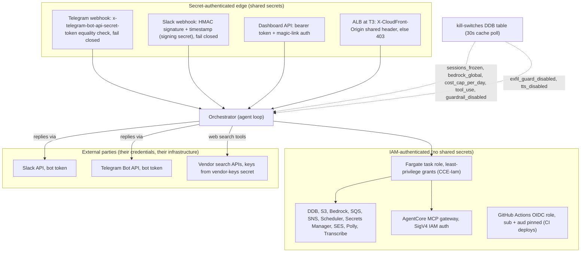

<!-- drift-gate: verified against P2 (WI-2.1..2.4, owner decisions 37, 41, 50, 51). Mapped sources touched: `src/adapters/dashboard/handler.ts` (both send routes now refuse an unknown agent or a model outside the catalog before spend; a `clientMessageId` becomes a conditional TURN# record; Stop aborts the turn; typed errors carry a code and a fixed message, never exception text), `src/agent/agent-loop.ts` (the abort signal, tool start/end with capped arguments and results, the guardrail stream mode read from runtime-config) and `src/adapters/telegram/handler.ts` / `src/adapters/slack/handler.ts` (a PARITY SKIP comment only). The one trust-relevant change is the guardrail's stream mode on ConverseStream (owner decision 50): recorded in a new Legend bullet with the measured cause (decision 51), AWS's stated trade-off and the runtime switch back. No IAM grant, kill switch, capability, principal or trust boundary was added; the TURN# record lives inside the existing sessions-table containment. -->
<!-- drift-gate: verified against P1 (WI-1.1..1.4, owner decisions 1, 9, 46, 47). The mapped source touched is `src/adapters/dashboard/handler.ts`: a conversation's owner becomes a PERSON (a session's userId, or the one user an admin linked a user-less token to), every dashboard and Jarvis conversation route enforces it (`src/adapters/dashboard/jarvis.ts` applies the same rule), an admin's read of someone else's conversation is audited before anything is returned, and `POST /api/tokens/:hashPrefix/link` adds the audited, one-time link. No IAM grant, kill switch, capability or trust boundary was added: the override rides `security:write` (the tier DELETE /sessions already used) and the link `tokens:write` behind the existing admin-rank `/tokens` gate. A new Legend bullet records the owner model; the containment bullet's `#` sentence is corrected. -->
<!-- drift-gate: verified against WI-1.0, the sessions-table containment gate (owner decision 11). The only mapped source touched is `src/adapters/dashboard/handler.ts`, which gains `isConversationRow` and applies it to the two existing sessions reads; `src/adapters/dashboard/jarvis.ts`, which is not a mapped source, applies the same predicate to the Jarvis `sessions` action. No route, capability, IAM grant, kill switch, principal or trust boundary changed: the two routes already required `sessions:read` and the Jarvis action its `viewer` role floor (`authorizeRead`), and this NARROWS what all three return. It closes a disclosure rather than opening one, so a new Legend bullet records the rule. -->
<!-- drift-gate: verified against the War Room PDF-safety slice. The existing `GET /api/warroom-transcripts/:id` route now passes transcript text through `toPdfSafeText` and turns a failed render into a 422; no route, IAM grant, principal or trust boundary changed. `assertPdfRenderable` still refuses content its callers own. -->
<!-- drift-gate: verified against the corrupt-but-successful builder fixes; no depicted trust boundary, IAM grant or kill switch changed. The mapped-source edits are truncatedNotice applied on the tool-loop return path as well as the non-tool one, and repairEmptyTurns switching from optional chaining to a typeof check so a legacy turn whose text is a number is repaired rather than throwing a TypeError inside getSession. Both are availability and data-integrity concerns inside an existing boundary. -->
<!-- drift-gate: verified against the War Room table-name fix (WRT-9 / M12). The only mapped source touched is infra/lib/compute-stack.ts, which gains three TABLE_* env entries on the orchestrator container. No IAM statement, role, principal, kill switch or trust boundary changes: infra/lib/iam-stack.ts already grants the task role on warroomMeetingsTable / warroomTurnsTable / warroomConnectionsTable via CDK table constructs, so those ARNs already follow CCE_NAME_SUFFIX. This removes an authorization ANOMALY rather than adding a grant -- before it, a suffixed environment asked for production table names and was correctly denied. Table names are configuration, not secrets, and none is injected through the ECS secrets mapping. -->
<!-- drift-gate: verified against the War Room transcript PDF route (fix/warroom-scroll-and-pdf). The only mapped source touched is `src/adapters/dashboard/handler.ts`, which gains `GET /api/warroom-transcripts/:id` INSIDE the existing dashboard bearer boundary: the router-wide middleware (bearer auth, dashboard_read_disabled, role rank) runs first, the handler then requires the same `warroom:read` capability every War Room read requires and honours the existing `warroom_disabled` kill switch, and the PDF bytes stream straight back — no S3 object, no presigned URL, no new IAM grant, no new principal or trust boundary. -->
<!-- drift-gate: verified against the Paperclip staging-contract probe. The existing staging GitHub OIDC deploy role gains RunTask/DescribeTasks for the staging orchestrator probe, PassRole only for the staging orchestrator task/execution roles with PassedToService=ecs-tasks.amazonaws.com, and read access only to the staging orchestrator log group; production receives none of these grants. This is a least-privilege extension inside the already-depicted OIDC/IAM boundary, with no new principal, assumption path, network edge, or trust boundary. The mapped compute-stack edit is a reworded comment on the orchestrator task's PAPERCLIP_COMPANY_ID secret entry. -->
<!-- drift-gate: verified against the Paperclip staging target-group repair. The private Cloud Map-only ECS service no longer registers with an unattached ALB target group; its existing container health check remains authoritative, and no listener, ingress rule, IAM grant, or trust boundary changed. -->
<!-- drift-gate: verified against the Paperclip secret-population hotfix. The existing deploy role now receives kms:Decrypt and kms:GenerateDataKey on only the existing data CMK so Secrets Manager can read and replace the encrypted Paperclip secret; no trust boundary or role assumption changed. -->
<!-- drift-gate: verified against the Paperclip fresh-install repair. The existing GitHub OIDC deploy role gains least-privilege create/hardening access to the deterministic state bucket and write access only under cloud-build/; no trust boundary or role assumption changed. -->
<!-- drift-gate: verified against the knowledge-durability hotfix; the task role gained bucket + object access on the new vectors bucket, which this diagram shows as an unenumerated grant; no depicted trust boundary changed -->
<!-- drift-gate: verified against the empty-turn poisoning fix (PR #96); the mapped sources changed only the chat-history repair path and the tool-loop output ceiling, which are availability and data-integrity concerns — no depicted trust boundary, IAM grant or kill switch changed -->
<!-- drift-gate: verified against ADR 0010 Phase 9; no trust boundary moved. The only mapped source touched is `infra/lib/compute-stack.ts`, and only a comment in it: CCE_PAPERCLIP_ENABLED is now purely the runtime router flag the orchestrator task reads, while the Paperclip substrate is provisioned by deploy tier. No IAM statement, role, kill switch or authorization path changes - notably the Paperclip task role stays separate from the orchestrator task role (DL-2), and the engine still admits 5432 from its own SG only. `infra/lib/iam-stack.ts` is untouched by this change; the ordering trap its comments describe (cicdRole grants must land in an earlier deploy than the step that uses them) now keys on the tier instead of the variable, which is recorded in the workflow comments rather than here. Prior verification: Phase 4 widened the GitHub OIDC DEPLOY role with the PaperclipSecretPopulate / PaperclipCloudBuild statements, mirrored into the prod and staging branches. -->
# Architecture, security view (trust boundaries)

> Three kinds of trust hold the system together: shared secrets authenticate everything crossing the public edge (webhook signatures, the dashboard bearer token, CloudFront's origin header), IAM authenticates everything the orchestrator does inside AWS (one task role with least-privilege grants), and external services like Slack, Telegram, and vendor search APIs are reached with stored credentials. Kill switches in a DynamoDB table sit at every one of these boundaries and can shut a path down in about 30 seconds (cache-poll propagation). Nothing inside the VPC trusts a request that has not passed one of the secret-auth checks at the edge.

## Legend

- Solid arrows are authenticated calls; dotted arrows show where kill switches intercept.
- **Fail-closed webhooks**: a missing or `REPLACE_ME` Telegram secret or Slack signing secret REJECTS requests (401). Signature verification is **unconditional** — there is no per-surface `*_signature_check_disabled` bypass switch (removed in Wave A; see the note below); break-glass for a broken secret is to close ingress, not to accept unsigned traffic.
- **Kill-switch placement** (all in the `claudeclaw-kill-switches` table, namespaced MCP tools ride the same `tool_use` switch as built-ins):
  - edge: none — webhook signature verification is unconditional and cannot be switched off (Wave A)
  - turn entry: `sessions_frozen`, per-identity rate limits, `bedrock_global`, `cost_cap_per_day`
  - in-turn: `tool_use` / `tool_dispatch_disabled` (re-checked before every tool round, so a mid-incident flip stops in-flight turns too), `guardrail_disabled`, `exfil_guard_disabled`, `tts_disabled`
  - armed: `paperclip_disabled` (41st switch, ADR 0010) — checked inside the transport at **every** client invoke (`src/lib/paperclip/client.ts`), and again at the dashboard ACL routes (`src/adapters/dashboard/missions.ts`), the inbound dispatch route (`src/adapters/dashboard/paperclip-dispatch.ts`) and the Paperclip agent tools (`src/lib/tools/paperclip-tools.ts`), so no caller can bypass it; it is the permanent Netzar-side stop that works even when Paperclip is unreachable, and it stays registered permanently regardless of how the integration is provisioned
- Bedrock is drawn inside the IAM boundary because calls are IAM-signed and stay in the AWS account/region, but prompts do leave the app process; the data-flow inventory in the security model doc is the authoritative list of processors.
- Propagation is a cache poll (~30s TTL), not push; flipping a switch is not instantaneous.
- Ingress authentication is UNCONDITIONAL (Wave A): the slack/telegram signature-check bypass switches were removed — an unsigned webhook carries an attacker-controlled sender principal, so no switch may accept unsigned traffic. Break-glass for a broken/missing secret is closed ingress (401), and a missing secret rejects rather than passing unverified.
- Availability under throttle (H2): the turn path degrades Opus -> Sonnet -> Haiku only when the failure precedes the first emitted chunk; validation/guardrail/auth errors never trigger a model switch.
- Audit-trail hardening (C5c): control-plane changes (kill-switch set, token mint/revoke/link, IAM apply) and every admin read of a conversation that is not theirs are on the always-audited list (immune to `audit_log_disabled`), and the privilege-granting ones await their audit write, surfacing a 500 instead of silence when no store accepts it.
- Spend control (C2-full): every agent turn passes a fail-closed admission gate before Bedrock is invoked — the atomic spend-ledger table (in the task role's per-table DdbRW grant) reserves worst-case headroom so concurrent tasks cannot collectively overshoot the daily cap; a ledger outage blocks spend rather than admitting it.
- Output ceiling: runtime-config `agent/max_output_tokens` tunes every turn's model-call ceiling; writing it through `/config` is admin-only (`src/adapters/dashboard/handler.ts:242`), the value is clamped to 1024-32768, and the daily cost cap still bounds spend.
- Emergency kill phrase: any inbound chat message containing it (all three surfaces share the agent-loop path) trips the same panic freeze as the dashboard panic button, before any Bedrock work; the phrase reaches the task from the dashboard secret's `kill_phrase` field.
- Route authorization is defense in depth: dashboard agent-mutation routes require BOTH operator-rank and `agents:write`, while the MCP-registry write (`PUT /api/integrations/mcp`) requires **admin**-rank and `config:write` — so a custom profile that clears the rank gate but has the capability stripped is still denied. The double gate is intentional; do not collapse it into a single check.
- War Room transcript export (`GET /api/warroom-transcripts/:id`, dashboard router): sits behind the dashboard bearer middleware and additionally requires the `warroom:read` capability and an inactive `warroom_disabled` switch, exactly the gates the `/api/warroom/*` reads enforce; the transcript PDF is built in-process and streamed as an attachment, so no generated-artifact object is created and nothing is presigned.
- Tool-surface containment (PR #107): model-supplied tool args are not trusted for authorization. Mission tools reject an `owner` other than the calling agent, knowledge ingest/search resolve their corpus scope server-side (own scope + shared only, so a prompt-injected agent cannot poison the shared corpus or read another agent's), and War Room turns enforce the per-meeting tool blocklist through `runAgentTurn`'s `blockedTools` (spec stripped from the model AND dispatch refused).
- Session-listing containment (WI-1.0, owner decision 11): the `claudeclaw-sessions` table is shared — `src/lib/state/jarvis-memory-repo.ts` stores Jarvis long-term memory in it as `PK=JARVIS#<hashPrefix16>`, `SK=TURN#<iso>#<uuid>` — so every reader that lists conversations now selects conversation rows explicitly through `isConversationRow` (`src/adapters/dashboard/handler.ts`) instead of mapping whatever the table returns into a conversation by stripping key prefixes. Before this, the cross-agent `GET /api/sessions`, its CSV export and the Jarvis `sessions` action each rendered a memory row as a conversation whose `agentId` was the principal's own `JARVIS#<hashPrefix16>`, disclosing that id to any holder of `sessions:read` (the Jarvis action checks a `viewer` role floor instead). The rule is an **allowlist** of the conversation key shape (`PK=AGENT#…` with `SK=CHAT#<chatId>` and no further `#` segment), not a blocklist of the foreign types that exist today, so a future item type added to the same table is excluded by default rather than by remembering to exclude it. A `chatId` containing `#` can no longer reach a key: since P1 every sessions-table key stores it as `_` (owner decision 47), so the rule never hides a real conversation.
- Conversation ownership (P1 WI-1.1, owner decisions 1 and 9): a conversation belongs to a PERSON, whichever token they signed in with — `dashboardIdentity` is `dashboard:user:<userId>` for a magic-link session, or for a token with no user of its own that an admin linked to one (`POST /api/tokens/:hashPrefix/link`: `tokens:write`, one link per token, never moved, `token_linked` audited). Before P1 it was `dashboard:<tokenHash>`, and each login mints a new token, so the next login orphaned everything the last one wrote. The send routes refuse a conversation the caller does not own BEFORE anything reads or writes it — slash commands included — with the 404 the delete route gives a missing one; the transcript, the list, the CSV export, the per-chat export and the Jarvis `sessions` action return only the caller's own conversations; an admin (`security:write`) may read or delete anyone's, and each such read is audited as `session_read_override` before anything is returned — a read whose audit cannot be written returns nothing. A slash command never creates a conversation nobody owns (`/warroom` in a new chat creates it for its caller). An agent's `dynamodb_query` tool never returns the per-message records, though it still reads its own partition's conversation rows, as before P1; the memories routes are not owner-scoped either (both carried). `appendTurns` stamps the owner once and never overwrites it, which closes the old takeover chain (one message into someone else's conversation used to take it). A token with no person behind it gets no durable chat: its conversations keep the 7-day TTL, and nothing makes one durable later — not a scheduled task, not a link made afterwards.
- Guardrail stream mode (P2, owner decisions 50 and 51): a streamed turn now sends the Bedrock guardrail as `guardrailConfig.streamProcessingMode: 'async'`, so the answer reaches the browser as it is written and the guardrail scans alongside it. In the default synchronous mode Bedrock holds the whole answer until its scan finishes — measured on real Bedrock against the staging guardrail (decision 51): no guardrail, first text at 1.37 s; default mode, first text at 3.20 s with every event inside the last 156 ms; async, first text at 1.23 s — which is why the deployed dashboard never streamed (F1 Layer B's twelfth check). The trade-off is AWS's own: a harmful sentence can reach the screen before the guardrail blocks the rest of the reply, and async mode cannot mask sensitive information (this guardrail masks nothing — every PII entity is `BLOCK`). The app's live redactor still scrubs every chunk against the block-severity exfil patterns first (AWS key, API key header, PEM private key, Slack token, GitHub PAT, card number, US SSN). Runtime-config `bedrock/guardrail_stream_mode = sync` puts the guardrail back in front without a redeploy (writing it through `/config` is admin-only). `streamProcessingMode` exists only on ConverseStream: the non-streamed tool-loop rounds keep the synchronous guardrail, and a plain Converse never carries the field.
- Send-time checks and turn records (P2 WI-2.3, plan MSG-09): both send routes refuse an agent id the registry does not know (`404 unknown_agent`; before P2 an unknown id silently ran as `main`) and a model override outside the published catalog (`400 unknown_model`) BEFORE any spend. A web client's `clientMessageId` becomes a turn record — `PK=AGENT#<agentId>`, `SK=CHAT#<chatId>#TURN#<id>`, a 7-day `ttl` — written with `attribute_not_exists(SK)` before the model call, so the same id can never start a second paid call (`409 turn_duplicate`), an id reused for a different message is refused (`409 turn_conflict`), and the record reaches exactly one final state. It is a child of the conversation's key, so the containment rule above hides it and the delete cascade removes it. Tool results are stored with the reply, capped at 2 KB; tool ARGUMENTS are shown live and never stored anywhere (decision 41).
- The opt-in IAM-copilot write grant (`CCE_IAM_COPILOT_WRITE=1`, default off) no longer includes `iam:CreateUser`: minting a fresh principal was the one escalation path the infra-role Deny cannot enumerate.
- Generated-artifact containment: the S3 key for a generated document is derived server-side from `ctx.chatId` (sanitized `[^A-Za-z0-9_-] -> _`) plus a fresh UUID — the model supplies the document *spec*, never a storage path, so a prompt-injected agent cannot steer where bytes land or overwrite another chat's object. The display filename taken from the spec title is separately sanitized and length-capped because it reaches a download filename. Delivery rides `ToolMedia` to the surface rather than a presigned URL embedded in reply text: a URL in the text is read by the model and reproduced in its output, which both mangles the signature and needlessly widens what the model can echo.
- CI build/deploy path (ADR 0010): the GitHub OIDC deploy role can start ONE CodeBuild project, `claudeclaw[-suffix]-paperclip-cloud-build`, and pass ONE role to it — the least-privilege build role that pushes to a single ECR repo and reads a single S3 prefix. Before staging source, that deploy role may create and apply the versioning, SSE and public-access-block baseline to only the deterministic environment state bucket; object writes remain limited to `cloud-build/`. Its later Paperclip secret merge is scoped to the two Paperclip secret ARNs and, because they use the customer-managed data key, `kms:Decrypt` plus `kms:GenerateDataKey` on that one key. The image is built on a native ARM64 host and self-verifies its architecture inside the build, so a wrong-platform image is never pushed. Source for that build is `git archive HEAD` of the checkout: tracked, committed files only, so a runner-local `.env` cannot reach the build.
- Sources: `src/adapters/telegram/handler.ts`, `src/adapters/slack/handler.ts`, `src/adapters/dashboard/handler.ts`, `src/agent/agent-loop.ts`, `infra/lib/iam-stack.ts`, `infra/lib/compute-stack.ts` (origin header rule).
