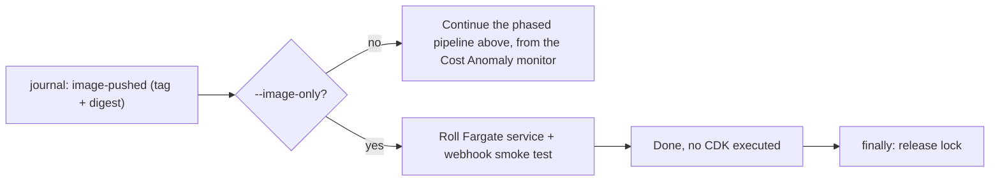

<!-- drift-gate: a depicted flow DID change and the diagram was updated. `scripts/deploy.ts` gains PHASE b.5, a one-shot Paperclip schema migration that runs between phase b (secrets) and phase c (runtime-config seed) and ABORTS the deploy on a non-zero exit, because the long-running Paperclip service deliberately does not carry PAPERCLIP_MIGRATION_AUTO_APPLY. It is a TWO-DEPLOY protocol like the cloudflared connector readiness gate, but it never decides what EXISTS: the first deploy has no migration task definition yet, so it defers -- and the operator declares that run with CCE_PAPERCLIP_BOOTSTRAP=1, which lands the whole Paperclip stack, service included, at DesiredCount 0 so no task starts and nothing fails. The second deploy migrates and rolls the service up to 1. Without that flag an unmigratable b.5 ABORTS having touched nothing. Its targets are read from the LIVE CloudFormation outputs of CCE-Paperclip, not from the gitignored cdk-outputs.json, so the lookup answers identically on CI, a fresh clone and a laptop. The CI driver mirrors the whole phase in a `Migrate Paperclip database` step, because CI does not run scripts/deploy.ts and the migration otherwise never ran on the only path that reaches a customer account. Phase a additionally forwards the resolved Paperclip image digest into synth. Everything else -- the phase order, the lock, the money gate, the manifest -- is unchanged. Prior verification: the `--image-only` fast path was SPLIT into its own diagram; no node text changed and no phase order changed. Reason: adding the Paperclip build to the phase-a node pushed this file to ~41 nodes against docs-mermaid.mjs's MAX_NODES budget of 40, and that checker's own remedy is "split the diagram by concern". `--image-only` is the right seam because it is a MODE rather than a phase — it shares everything up to the image-pushed journal entry and then leaves the pipeline entirely, running no anomaly monitor, no confirmation gate, no CDK, no secrets and no seed. The main flow now goes JIMG --> ANOM directly with the fast path named on the edge, and the two nodes it lost (IMGONLY, ROLLONLY) are redrawn below with their own terminal, so nothing depicted was deleted. Verified locally with `node scripts/ci/docs-mermaid.mjs --extract-only`, which performs the budget check WITHOUT rendering and therefore is trustworthy on this machine despite M21. Prior verification: verified against the Paperclip Phase 1.5 image pipeline; ONE depicted node changed, no phase order changed. The SCHEDCHK node is updated below: phase a now also BUILDS the vendored Paperclip image into the repo it ensures, through the same CodeBuild path as the orchestrator's Docker-free build (cloud-build.ts is parameterized with a Dockerfile + context, not copied), resolves its digest, and threads it into the manifest as a linux/arm64 ContainerImageRecord via deploy-phases.ts buildImageRecords, whose containerName is now the exported manifest.ts constant PAPERCLIP_CONTAINER_NAME (that name and the `${app}-paperclip` task family are PREDICTIONS of what Phase 4's paperclip-stack.ts will choose, so they are pinned in one place with a note naming the places that must change together). Only the content tag is pushed into the Paperclip repo — no `:latest`, on either driver — because that repo is created with no lifecycle policy and its one legitimate consumer is a task definition pinned to the recorded digest; the orchestrator's `:latest` is unchanged, which is why the buildspec's pushLatest parameter defaults to true. Everything stays inside the single `if (paperclipEnabled)` block, so an unarmed deploy still creates no project, starts no build and pushes no image, and its manifest is byte-unchanged. The BUILD node above is deliberately NOT changed: it depicts the orchestrator image build, which is untouched — cloudBuildBuildSpec() with no arguments emits the identical `-f Dockerfile .` line — and the second build genuinely happens later, at phase a, which is the node that moved. The node text calls out the SKIP because it is the load-bearing property: the Paperclip image is tagged by the git TREE HASH of vendor/paperclip (contentImageTag), not by the app's short git sha, so a commit that cannot change the vendored image does not trigger a ~10 minute ARM CodeBuild, a second git-archive upload to the state bucket, or another layer set in a repo with no lifecycle policy; on a tag hit the existing digest is read straight out of ECR and still recorded, so re-running an armed deploy is a no-op that keeps the manifest complete. The CI mirror (.github/workflows/deploy.yml, which is not a mapped source and is the driver that actually reaches staging) computes the same tag with `git rev-parse HEAD:vendor/paperclip`, performs the same skip, and was reordered to load-inspect-then-push so a wrong-architecture image cannot reach ECR before the check fails. Prior verification: verified against the Paperclip Phase 2 readiness work; ONE depicted node changed, no phase order changed. Phase a now also ensures the Paperclip ECR repository, beside ensureSchedulerGroup and behind the same CCE_PAPERCLIP_ENABLED flag as the two substrate stacks, named from buildResourceNames().paperclipEcrRepo rather than a regex over ECR_REPO_NAME. This REVERSES the "deploy.ts no longer creates claudeclaw[-suffix]-paperclip" note recorded below: that removal was correct at the time because the repo was created UNGATED on every deploy for an image nothing pushed, but it left nothing at all creating the repo, which blocked ADR 0010 Phase 2. Gated creation is the version that does not lie: an unarmed deploy still creates no repo. bootstrap-state.ts still creates the orchestrator repo only, so the BOOT node text is unchanged and remains accurate. The SCHEDCHK node text is updated below. Phase b additionally writes better_auth_secret into the Paperclip secret when PAPERCLIP_BETTER_AUTH_SECRET is set, as a MERGE rather than a replace, so the reconciler/agent/dispatch keys minted against the running instance survive later deploys; that is a value written inside the existing PHASEB node, not a new step, so no node changed for it. Prior verification: verified against the Paperclip Phase 1 arming fix; two depicted NODES changed, no phase order changed. Phase a's foundation list now carries CCE-Database and CCE-Filesystem only when CCE_PAPERCLIP_ENABLED=1, matching the gate in infra/bin/app.ts. Naming them unconditionally failed SILENTLY rather than loudly: `validateStacksSelected` (aws-cdk lib/cli/cdk-toolkit.js) throws only when the TOTAL selected count is zero, and the six always-present names kept it non-zero, so an unsynthesized CCE-Database was dropped and the deploy reported success having created no Aurora and no EFS. Demonstrated with `cdk ls CCE-Network CCE-Database` against a flag-off assembly: exit 0, CCE-Database silently absent. The bootstrap node also loses its second ECR repo — deploy.ts no longer creates `claudeclaw[-suffix]-paperclip` because nothing pushes a Paperclip image until ADR 0010 Phase 2, and bootstrap-state.ts never created it at all, so that node text was wrong as drawn. cdkEnvBag and SYNTH_INPUT_ALLOWLIST both gained CCE_PAPERCLIP_ENABLED; without the bag entry, setting it in .env reached synth as undefined and armed nothing. Both node texts updated below. Prior verification: verified against the Paperclip Phase 1 foundations (ADR 0010); two depicted NODES changed, no phase order changed. Phase a's foundation list gains CCE-Database (Aurora Serverless v2 for Paperclip) and CCE-Filesystem (EFS + access point + log group), and bootstrap's idempotent ECR ensure now creates TWO repos: the orchestrator's and `claudeclaw[-suffix]-paperclip` (derived from ECR_REPO_NAME so the suffix shape carries). The Paperclip image itself is NOT built or pushed by this pipeline yet — that arrives with the Phase 2 service work. Both node texts updated below. Prior verification: verified against the env-bag allowlist fix; no depicted phase changed. `cdkEnvBag` gained CCE_OPS_ALERT_EMAIL. Worth recording because the bag is an ALLOWLIST and that is not obvious from the diagram: a variable set in .env but absent here never reaches the cdk child process. The 2026-08-15 staging deploy set CCE_OPS_ALERT_EMAIL, succeeded, created every outage alarm — and left the SNS topic with zero subscribers, because the value stopped at this boundary. The connector token remains deliberately excluded from the bag, the manifest and cdk.out. Prior verification: verified against the readiness-gate reordering; a depicted phase ORDER changed. The public-connector readiness gate moved from between phases c and d to BEFORE phase a. `cdk deploy --exclusively` still synthesizes the whole app, so ComputeStack was being constructed during phase a with CCE_PUBLIC_CONNECTOR_READY unset — which silently emitted a task definition with no cloudflared container before the synth assert existed, and aborted the 2026-08-15 staging deploy at phase a once it did. The gate is a read-only DescribeSecret with no phase dependency, so it belongs ahead of the first synth; secretsClient is hoisted with it and still shared by phase b. Gate semantics and the deploy-only-reads-the-stage rule are unchanged. Also in this change: deploy.yml forwards CCE_OPS_ALERT_EMAIL, without which a CI deploy created every outage alarm and subscribed nobody. Prior verification: verified against the staging-public-url change; no depicted phase changed. The readiness gate recorded below now resolves its secret name per environment (buildPublicTunnelSecretName(nameSuffix)) instead of a frozen production literal, so a staging deploy probes staging's secret rather than reporting production's as its own. Gate position, semantics, and the deploy-only-reads-the-stage rule are all unchanged. Prior verification: the pgnos public-dashboard merge — no depicted PHASE changed, but a gate was added between phase c and phase d and is recorded here: when CCE_PUBLIC_ACCESS=1, deploy.ts DescribeSecret-checks the tunnel secret for the CCE-PUBLIC-READY version stage and sets CCE_PUBLIC_CONNECTOR_READY. It only reads stage existence, never the token. First deploy creates the secret alone; the sidecar attaches on a later deploy once `npm run public:setup` has written the token, because an essential container pointed at an unresolvable secret would fail the rollout. manifest.ts gained two SYNTH_INPUT_ALLOWLIST entries (CCE_PUBLIC_ACCESS, CCE_PUBLIC_HOSTNAME); the token remains excluded by design. Prior verification: PR #104 — dead-import removals only. -->
# Deploy pipeline, phased

> `npm run deploy` runs a phased pipeline: read-only preflight first, then bootstrap of the three state primitives (state bucket, lock table, ECR repo) and acquisition of a mandatory lease lock with heartbeat, then the image build with an arm64 architecture gate, then a read-only Cost Anomaly monitor resolution (attach to the account's existing DIMENSIONAL/SERVICE monitor when one exists, create otherwise) and a tier-aware confirmation gate, then CDK stacks in two waves with secret population and runtime-config seeding in between. Every mutating step appends an immutable journal entry to the state bucket, and on success the deploy manifest is atomically promoted under the held lock. Failures exit loudly at labeled gates before any further mutation, and the lock is released in a finally block no matter what.

```mermaid
flowchart TD
  START["npm run deploy"] --> PRECHECK["Pre-check: env file, AWS creds, Docker"]
  PRECHECK --> PREFLIGHT["Preflight: read-only doctor checks (grants, quotas, collisions, TLS)"]
  PREFLIGHT -->|"any FAIL"| XPRE["EXIT before any resource is created"]
  PREFLIGHT --> BOOT["bootstrap-state: state bucket + lock table + ECR repo (orchestrator), idempotent SDK creates"]
  BOOT --> LOCK["Acquire deploy lock: conditional write, lease + fencing token, 60s heartbeat"]
  LOCK -->|"lock held by someone else"| XLOCK["EXIT naming current holder"]
  LOCK --> BUILD["Write in-progress marker + deploy id, then docker buildx --platform linux/arm64, push to private ECR"]
  BUILD --> ARCH{"Image manifest arch == linux/arm64?"}
  ARCH -->|"no"| XARCH["EXIT: amd64 image would crash-loop on ARM64 Fargate"]
  ARCH -->|"yes"| JIMG["journal: image-pushed (tag + digest)"]
  JIMG -->|"--image-only: see the fast path below"| ANOM["Resolve Cost Anomaly monitor: attach to existing SERVICE monitor or create (read-only, fail-soft)"]
  ANOM --> CONFIRM["Confirmation gate (tier-aware cost estimate)"]
  CONFIRM -->|"operator declines"| XDECL["EXIT 10: calm decline, no infrastructure created (distinct code so `up` stops instead of verifying)"]
  CONFIRM -->|"confirmed or --yes"| PHASEA["Phase a: foundation stacks (Network, Storage, Guardrails, Secrets, Dynamo, Messaging; + Database, Filesystem only when CCE_PAPERCLIP_ENABLED=1)"]
  PHASEA --> SCHEDCHK["Verify EventBridge Scheduler group exists; when CCE_PAPERCLIP_ENABLED=1 also ensure the Paperclip ECR repo, then build the vendored arm64 Paperclip image in CodeBuild and record its digest (build SKIPPED when its content tag is already in ECR)"]
  SCHEDCHK --> PHASEB["Phase b: populate secrets with per-deploy staging labels"]
  PHASEB -->|"write failure on a configured surface"| XSEC["EXIT with exact per-secret recovery command"]
  PHASEB --> PHASEBH["Phase b.5 (CCE_PAPERCLIP_ENABLED=1): compose database_url into the Paperclip secret, then RunTask the one-shot schema migration. Non-zero exit ABORTS before any stack update; DEFERS on the first deploy, when no migration task definition exists yet"]
  PHASEBH --> PHASEC["Phase c: seed runtime-config defaults (idempotent, skips existing keys)"]
  PHASEC --> PHASED["Phase d: remaining stacks (cdk deploy --all), force-roll ECS, wait stable + ALB healthy"]
  PHASED --> SURF["Surface validation, mode-scoped: Slack signed probe, Telegram setWebhook + getWebhookInfo, dashboard token round-trip"]
  SURF --> MANIFEST["Assemble manifest: sha, digest, secret versions, seed revision, stack hashes"]
  MANIFEST --> PROMOTE["Promote manifest under lock: deploys/id/manifest.json then manifests/latest.json, fencing token stamped"]
  PROMOTE --> CLEAR["Clear in-progress marker + webhook smoke test"]
  CLEAR --> SURFOK{"All configured surfaces passed?"}
  SURFOK -->|"yes"| DONE["Deploy complete, run npm run status"]
  SURFOK -->|"no"| XSURF["EXIT 1: deploy recorded in manifest but NOT healthy"]
  RELEASE["finally: release lock (success, failure, abort alike)"]
  DONE --> RELEASE
  XSURF --> RELEASE
```

### The `--image-only` fast path

Split out of the diagram above rather than drawn inside it: `--image-only` is a
different **mode**, not another phase. It shares everything up to the journal
entry and then leaves the pipeline entirely — no anomaly monitor, no
confirmation gate, no CDK, no secrets, no seed. `npm run deploy:cloud` is this
path, which is why it is safe for app changes and cannot touch infrastructure
like the daily cost cap.

## Legend

- Diamond nodes are gates; `EXIT` nodes are labeled failure exits. Phases a-d each append a journal entry (`foundation-complete`, `secrets-populated`, `seed-complete`, `compute-complete`) as immutable per-deploy S3 objects (conditional `IfNoneMatch` writes, duplicate seq fails loudly).
- `--help` / `-h` answers BEFORE the pipeline starts (`scripts/lib/help.ts`, shared by every lifecycle CLI): asking for help never reaches pre-check, bootstrap, or any other node above.
- The lock is mandatory for EVERY mutating lifecycle path (deploy, rollback, seed, teardown, maintenance, handover, update); losing the heartbeat mid-deploy aborts immediately.
- A leftover in-progress marker from a crashed deploy is reported; phases are idempotent so the run continues fresh (journal-based `--resume` lands with the rollback work).
- The anomaly-monitor resolution runs before the env bag is built: AWS allows one DIMENSIONAL/SERVICE monitor per account (auto-created `Default-Services-Monitor`), so when `CCE_ANOMALY_MONITOR_ARN` is unset the deploy discovers the existing monitor via `ce:GetAnomalyMonitors` and pins it, letting the Guardrails stack attach instead of colliding. Any discovery error warns and keeps the create path.
- The confirmation gate derives its resource list from the `TIERS` shape plus `CCE_PRIVATE_ENDPOINTS`, and its dollar figure by spawning `scripts/cost-estimate.mjs --json` (static docs/cost-guide.md ranges as the fail-soft fallback). A decline exits with the distinct `DEPLOY_EXIT_DECLINED` (10, `scripts/lib/exit-codes.ts`) so callers can tell "operator said No" (nothing created; the pushed image stays in ECR) from success (0) and failure (1); the up conductor keys on it to stop cleanly instead of running verify against nothing.
- Secrets inject at task START, which is why phase d force-rolls the service after phase b wrote new versions.
- **Phase b.5 is two-deploy on purpose, and it never decides whether anything exists.** The Paperclip service does not carry `PAPERCLIP_MIGRATION_AUTO_APPLY`, so the schema is migrated by a one-shot task and never by a rollout. That task definition is created by phase d, so the FIRST armed deploy has nothing to run: the operator declares it with `CCE_PAPERCLIP_BOOTSTRAP=1`, phase b.5 writes `database_url` and defers, and phase d lands the whole Paperclip stack -- service, both task definitions, target group -- with `DesiredCount 0`, so no task starts and nothing fails. Clear the flag and deploy again: b.5 finds the migration task definition, migrates, and phase d rolls the service up to 1. Without the flag an unmigratable b.5 ABORTS the deploy having touched nothing, rather than continuing. The earlier design instead let b.5 set `CCE_PAPERCLIP_SERVICE_READY`, which synth read to decide whether the `AWS::ECS::Service` existed at all; that is the M33 defect and it is gone -- a probe that cannot read its input must never be able to remove a running resource. The CI driver mirrors this with a `Migrate Paperclip database` step, because CI does not run `scripts/deploy.ts`. Any other ordering deadlocks -- an essential container started against an unmigrated database fails its rollout, CloudFormation rolls the stack back, and the migration task definition goes with it.
- Surface-validation failure is deliberately AFTER manifest promotion: the deploy is recorded truthfully, but the command exits nonzero.
- Sources: `scripts/deploy.ts`, `scripts/lib/lifecycle/bootstrap-state.ts`, `scripts/lib/lifecycle/lock.ts`, `scripts/lib/lifecycle/journal.ts`, `scripts/lib/lifecycle/manifest.ts`, `scripts/lib/lifecycle/ids.ts`.
