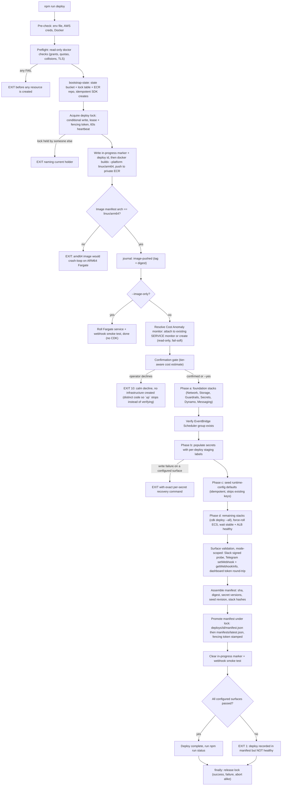

<!-- drift-gate: verified against the staging-public-url change; no depicted phase changed. The readiness gate recorded below now resolves its secret name per environment (buildPublicTunnelSecretName(nameSuffix)) instead of a frozen production literal, so a staging deploy probes staging's secret rather than reporting production's as its own. Gate position, semantics, and the deploy-only-reads-the-stage rule are all unchanged. Prior verification: the pgnos public-dashboard merge — no depicted PHASE changed, but a gate was added between phase c and phase d and is recorded here: when CCE_PUBLIC_ACCESS=1, deploy.ts DescribeSecret-checks the tunnel secret for the CCE-PUBLIC-READY version stage and sets CCE_PUBLIC_CONNECTOR_READY. It only reads stage existence, never the token. First deploy creates the secret alone; the sidecar attaches on a later deploy once `npm run public:setup` has written the token, because an essential container pointed at an unresolvable secret would fail the rollout. manifest.ts gained two SYNTH_INPUT_ALLOWLIST entries (CCE_PUBLIC_ACCESS, CCE_PUBLIC_HOSTNAME); the token remains excluded by design. Prior verification: PR #104 — dead-import removals only. -->
# Deploy pipeline, phased

> `npm run deploy` runs a phased pipeline: read-only preflight first, then bootstrap of the three state primitives (state bucket, lock table, ECR repo) and acquisition of a mandatory lease lock with heartbeat, then the image build with an arm64 architecture gate, then a read-only Cost Anomaly monitor resolution (attach to the account's existing DIMENSIONAL/SERVICE monitor when one exists, create otherwise) and a tier-aware confirmation gate, then CDK stacks in two waves with secret population and runtime-config seeding in between. Every mutating step appends an immutable journal entry to the state bucket, and on success the deploy manifest is atomically promoted under the held lock. Failures exit loudly at labeled gates before any further mutation, and the lock is released in a finally block no matter what.

## Legend

- Diamond nodes are gates; `EXIT` nodes are labeled failure exits. Phases a-d each append a journal entry (`foundation-complete`, `secrets-populated`, `seed-complete`, `compute-complete`) as immutable per-deploy S3 objects (conditional `IfNoneMatch` writes, duplicate seq fails loudly).
- `--help` / `-h` answers BEFORE the pipeline starts (`scripts/lib/help.ts`, shared by every lifecycle CLI): asking for help never reaches pre-check, bootstrap, or any other node above.
- The lock is mandatory for EVERY mutating lifecycle path (deploy, rollback, seed, teardown, maintenance, handover, update); losing the heartbeat mid-deploy aborts immediately.
- A leftover in-progress marker from a crashed deploy is reported; phases are idempotent so the run continues fresh (journal-based `--resume` lands with the rollback work).
- The anomaly-monitor resolution runs before the env bag is built: AWS allows one DIMENSIONAL/SERVICE monitor per account (auto-created `Default-Services-Monitor`), so when `CCE_ANOMALY_MONITOR_ARN` is unset the deploy discovers the existing monitor via `ce:GetAnomalyMonitors` and pins it, letting the Guardrails stack attach instead of colliding. Any discovery error warns and keeps the create path.
- The confirmation gate derives its resource list from the `TIERS` shape plus `CCE_PRIVATE_ENDPOINTS`, and its dollar figure by spawning `scripts/cost-estimate.mjs --json` (static docs/cost-guide.md ranges as the fail-soft fallback). A decline exits with the distinct `DEPLOY_EXIT_DECLINED` (10, `scripts/lib/exit-codes.ts`) so callers can tell "operator said No" (nothing created; the pushed image stays in ECR) from success (0) and failure (1); the up conductor keys on it to stop cleanly instead of running verify against nothing.
- Secrets inject at task START, which is why phase d force-rolls the service after phase b wrote new versions.
- Surface-validation failure is deliberately AFTER manifest promotion: the deploy is recorded truthfully, but the command exits nonzero.
- Sources: `scripts/deploy.ts`, `scripts/lib/lifecycle/bootstrap-state.ts`, `scripts/lib/lifecycle/lock.ts`, `scripts/lib/lifecycle/journal.ts`, `scripts/lib/lifecycle/manifest.ts`, `scripts/lib/lifecycle/ids.ts`.
