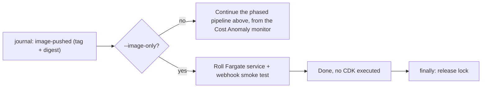

<!-- drift-gate: a depicted flow DID change and the diagram was updated (Work Platform step 6 (ADR 0016, ADR 0014)). deploy-phases.ts: phase b now merge-adds `signup_probe_email=REPLACE_ME` beside `company_id` and `lock_auditor_key`, each only when absent; the phase b node says so. deploy.ts passes the sign-up window switch `CCE_PAPERCLIP_SIGNUP_WINDOW` into the CDK environment and adds a sign-up check after the service is stable (decided 2026-10-04: the check is the orchestrator's own start-time lock, and the script probes only when `PAPERCLIP_BASE_URL` is set; the code change follows `79b06d0`, where the script probes the private address and aborts on `sign_up_open`). The phase order and the other nodes and edges are unchanged. -->
<!-- drift-gate: a depicted flow DID change and the diagram was updated (Work Platform step 2). deploy-phases.ts: phase b now merge-adds lock_auditor_key=REPLACE_ME beside company_id, each only when absent, so the Paperclip runtime lock reports unknown (fail closed) until the operator bootstrap writes the real key. The scripts/deploy.ts edit is comments only (the Paperclip image is pinned and no longer patched). -->
<!-- drift-gate: verified against the Paperclip staging-contract probe. The only mapped-source change is in deploy-phases.ts: phase b now treats the Paperclip secret's better_auth_secret as write-if-absent so a populated Secrets Manager value survives later deploys; the phase order and every depicted node and edge are unchanged. -->
<!-- drift-gate: the Paperclip fresh-install repair changes depicted phase b: after Secrets exists, it merge-adds company_id=REPLACE_ME only when absent, then later tenant bootstrap replaces it with the pinned company id. Existing values always win over the default, so upgrades preserve live credentials. -->
<!-- drift-gate: a depicted flow DID change and the diagram was updated. ADR 0010 Phase 9 makes Paperclip part of a standard install: the gate moves off CCE_PAPERCLIP_ENABLED and onto the DEPLOY TIER (TierShape.paperclipEnabled - Tier 0 Hobby provisions none of it, Tier 1+ does), and `scripts/deploy.ts` phase a therefore names CCE-Database and CCE-Filesystem UNCONDITIONALLY. That is the point of the change rather than a detail of it: `cdk deploy` errors only when NO name matches, so while synth could omit a stack the phase-a list named, the missing one was dropped SILENTLY and the deploy exited 0 having created no Aurora (M22). Three nodes are reworded (phase a, the scheduler/ECR/image-build step, phase b.5); no node, edge or exit path is added, removed or reordered. `scripts/lib/lifecycle/manifest.ts` gains DEPLOY_TIER in SYNTH_INPUT_ALLOWLIST, which the diagram does not depict - it depicts THAT a manifest is assembled, not which env keys it records. Verified by synthesizing the app four ways (infra/bin/app.stack-set.test.ts) and by `npx cdk ls` with the variable unset, =0 and =1: 18 stacks every time. -->
# Deploy pipeline, phased

> `npm run deploy` runs a phased pipeline: read-only preflight first, then bootstrap of the three state primitives (state bucket, lock table, ECR repo) and acquisition of a mandatory lease lock with heartbeat, then the image build with an arm64 architecture gate, then a read-only Cost Anomaly monitor resolution (attach to the account's existing DIMENSIONAL/SERVICE monitor when one exists, create otherwise) and a tier-aware confirmation gate, then CDK stacks in two waves with secret population and runtime-config seeding in between. Every mutating step appends an immutable journal entry to the state bucket, and on success the deploy manifest is atomically promoted under the held lock. Failures exit loudly at labeled gates before any further mutation, and the lock is released in a finally block no matter what.

```mermaid
flowchart TD
  START["npm run deploy"] --> PRECHECK["Pre-check: env file, AWS creds, Docker"]
  PRECHECK --> PREFLIGHT["Preflight: read-only doctor checks (grants, quotas, collisions, TLS)"]
  PREFLIGHT -->|"any FAIL"| XPRE["EXIT before any resource is created"]
  PREFLIGHT --> BOOT["bootstrap-state: state bucket + lock table + ECR repo (orchestrator), idempotent SDK creates"]
  BOOT --> LOCK["Acquire deploy lock: conditional write, lease + fencing token, 60s heartbeat"]
  LOCK -->|"lock held by someone else"| XLOCK["EXIT naming current holder"]
  LOCK --> BUILD["Write in-progress marker + deploy id, then docker buildx --platform linux/arm64, push to private ECR"]
  BUILD --> ARCH{"Image manifest arch == linux/arm64?"}
  ARCH -->|"no"| XARCH["EXIT: amd64 image would crash-loop on ARM64 Fargate"]
  ARCH -->|"yes"| JIMG["journal: image-pushed (tag + digest)"]
  JIMG -->|"--image-only: see the fast path below"| ANOM["Resolve Cost Anomaly monitor: attach to existing SERVICE monitor or create (read-only, fail-soft)"]
  ANOM --> CONFIRM["Confirmation gate (tier-aware cost estimate)"]
  CONFIRM -->|"operator declines"| XDECL["EXIT 10: calm decline, no infrastructure created (distinct code so `up` stops instead of verifying)"]
  CONFIRM -->|"confirmed or --yes"| PHASEA["Phase a: foundation stacks (Network, Storage, Guardrails, Secrets, Dynamo, Messaging, Database, Filesystem - all eight named unconditionally, because all eight always synthesize)"]
  PHASEA --> SCHEDCHK["Verify EventBridge Scheduler group exists; at a tier that provisions Paperclip (T1+) also ensure the Paperclip ECR repo, then build the vendored arm64 Paperclip image in CodeBuild and record its digest (build SKIPPED when its content tag is already in ECR)"]
  SCHEDCHK --> PHASEB["Phase b: populate secrets with per-deploy staging labels; merge-add Paperclip company_id, lock_auditor_key and signup_probe_email only when absent"]
  PHASEB -->|"write failure on a configured surface"| XSEC["EXIT with exact per-secret recovery command"]
  PHASEB --> PHASEBH["Phase b.5 (tiers that provision Paperclip, T1+): compose database_url into the Paperclip secret, then RunTask the one-shot schema migration. Non-zero exit ABORTS before any stack update; DEFERS on the first deploy, when no migration task definition exists yet"]
  PHASEBH --> PHASEC["Phase c: seed runtime-config defaults (idempotent, skips existing keys)"]
  PHASEC --> PHASED["Phase d: remaining stacks (cdk deploy --all), force-roll ECS, wait stable + ALB healthy"]
  PHASED --> SURF["Surface validation, mode-scoped: Slack signed probe, Telegram setWebhook + getWebhookInfo, dashboard token round-trip"]
  SURF --> MANIFEST["Assemble manifest: sha, digest, secret versions, seed revision, stack hashes"]
  MANIFEST --> PROMOTE["Promote manifest under lock: deploys/id/manifest.json then manifests/latest.json, fencing token stamped"]
  PROMOTE --> CLEAR["Clear in-progress marker + webhook smoke test"]
  CLEAR --> SURFOK{"All configured surfaces passed?"}
  SURFOK -->|"yes"| DONE["Deploy complete, run npm run status"]
  SURFOK -->|"no"| XSURF["EXIT 1: deploy recorded in manifest but NOT healthy"]
  RELEASE["finally: release lock (success, failure, abort alike)"]
  DONE --> RELEASE
  XSURF --> RELEASE
```

### The `--image-only` fast path

Split out of the diagram above rather than drawn inside it: `--image-only` is a
different **mode**, not another phase. It shares everything up to the journal
entry and then leaves the pipeline entirely — no anomaly monitor, no
confirmation gate, no CDK, no secrets, no seed. `npm run deploy:cloud` is this
path, which is why it is safe for app changes and cannot touch infrastructure
like the daily cost cap.

## Legend

- Diamond nodes are gates; `EXIT` nodes are labeled failure exits. Phases a-d each append a journal entry (`foundation-complete`, `secrets-populated`, `seed-complete`, `compute-complete`) as immutable per-deploy S3 objects (conditional `IfNoneMatch` writes, duplicate seq fails loudly).
- `--help` / `-h` answers BEFORE the pipeline starts (`scripts/lib/help.ts`, shared by every lifecycle CLI): asking for help never reaches pre-check, bootstrap, or any other node above.
- The lock is mandatory for EVERY mutating lifecycle path (deploy, rollback, seed, teardown, maintenance, handover, update); losing the heartbeat mid-deploy aborts immediately.
- A leftover in-progress marker from a crashed deploy is reported; phases are idempotent so the run continues fresh (journal-based `--resume` lands with the rollback work).
- The anomaly-monitor resolution runs before the env bag is built: AWS allows one DIMENSIONAL/SERVICE monitor per account (auto-created `Default-Services-Monitor`), so when `CCE_ANOMALY_MONITOR_ARN` is unset the deploy discovers the existing monitor via `ce:GetAnomalyMonitors` and pins it, letting the Guardrails stack attach instead of colliding. Any discovery error warns and keeps the create path.
- The confirmation gate derives its resource list from the `TIERS` shape plus `CCE_PRIVATE_ENDPOINTS`, and its dollar figure by spawning `scripts/cost-estimate.mjs --json` (static docs/cost-guide.md ranges as the fail-soft fallback). A decline exits with the distinct `DEPLOY_EXIT_DECLINED` (10, `scripts/lib/exit-codes.ts`) so callers can tell "operator said No" (nothing created; the pushed image stays in ECR) from success (0) and failure (1); the up conductor keys on it to stop cleanly instead of running verify against nothing.
- Secrets inject at task START, which is why phase d force-rolls the service after phase b wrote new versions.
- **Phase b.5 is two-deploy on purpose, and it never decides whether anything exists.** The Paperclip service does not carry `PAPERCLIP_MIGRATION_AUTO_APPLY`, so the schema is migrated by a one-shot task and never by a rollout. That task definition is created by phase d, so the FIRST armed deploy has nothing to run: the operator declares it with `CCE_PAPERCLIP_BOOTSTRAP=1`, phase b.5 writes `database_url` and defers, and phase d lands the whole Paperclip stack -- service, both task definitions, target group -- with `DesiredCount 0`, so no task starts and nothing fails. Clear the flag and deploy again: b.5 finds the migration task definition, migrates, and phase d rolls the service up to 1. Without the flag an unmigratable b.5 ABORTS the deploy having touched nothing, rather than continuing. The earlier design instead let b.5 set `CCE_PAPERCLIP_SERVICE_READY`, which synth read to decide whether the `AWS::ECS::Service` existed at all; that is the M33 defect and it is gone -- a probe that cannot read its input must never be able to remove a running resource. The CI driver mirrors this with a `Migrate Paperclip database` step, because CI does not run `scripts/deploy.ts`. Any other ordering deadlocks -- an essential container started against an unmigrated database fails its rollout, CloudFormation rolls the stack back, and the migration task definition goes with it.
- Surface-validation failure is deliberately AFTER manifest promotion: the deploy is recorded truthfully, but the command exits nonzero.
- Sources: `scripts/deploy.ts`, `scripts/lib/lifecycle/bootstrap-state.ts`, `scripts/lib/lifecycle/lock.ts`, `scripts/lib/lifecycle/journal.ts`, `scripts/lib/lifecycle/manifest.ts`, `scripts/lib/lifecycle/ids.ts`.
