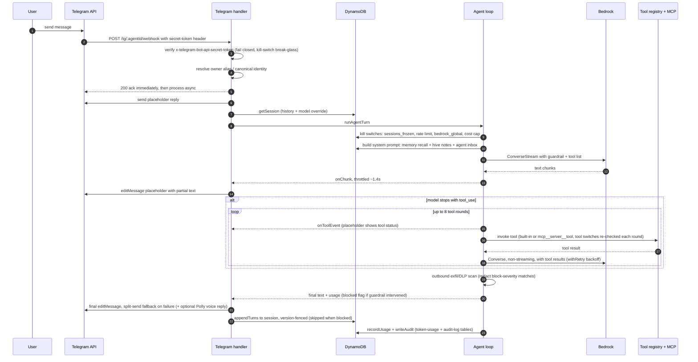

<!-- drift-gate: verified against the codebase-review fixes PR (#107); mapped-source changes = retry + per-round kill-switch recheck on tool rounds, split-send fallback on the final edit, version-fenced appendTurns, streaming-redactor timeout. Steps 36/41/42 and the legend updated to match. -->
# Request lifecycle, one Telegram message end-to-end

> When a user sends a Telegram message, the webhook is verified against a shared secret (unconditionally — the old signature-bypass kill switch was removed in Wave A; a missing secret closes ingress), acknowledged immediately, and processed asynchronously: the handler posts a placeholder reply, loads the session from DynamoDB, and runs the agent loop. The loop builds a system prompt enriched with memories, hive notes, and inbox items, then streams a Bedrock Converse call (with the guardrail attached) into throttled edits of the placeholder; if the model asks for tools, it switches to a non-streaming dispatch loop of up to 8 rounds. The final text passes an outbound DLP scan, replaces the placeholder, and both turns plus usage and an audit record are persisted, unless the guardrail blocked the turn, in which case nothing is saved.

## Legend

- The 200 ack at step 5 happens before any model work; Telegram retries on non-200 within about 60 seconds, so the handler never blocks the webhook on Bedrock latency.
- Guardrail-blocked turns return a friendly notice and are NOT persisted; this holds on every surface, including both Slack send paths (main bot and per-agent apps). Legacy blocked turns are scrubbed from history before each call (`stripBlockedTurns`) so one tripped message cannot poison the session.
- Slash commands (`/newchat`, `/model`, ...) and active War Room sessions branch off before step 6 (the placeholder reply) and never reach the agent loop — the handler runs the slash-command router and the War Room check ahead of posting the placeholder. Voice notes are transcribed and fed in as text, and images/PDFs ride along as inline Bedrock content blocks.
- The same `runAgentTurn` serves Slack and the dashboard chat; only the adapter steps (placeholder edits vs SSE events) differ. Slack additionally has two send paths (main bot and per-agent apps).
- Binaries a tool produced (generated images and generated documents) do NOT travel in the reply text. Tools return them on `ToolMedia`, collected into `AgentTurnResponse.media` (capped at 4 per turn), and each surface delivers from that channel after the final message: Telegram `sendPhoto` for images, Slack `uploadFile` for both, dashboard chat an `image` or `artifact` SSE event. This is load-bearing rather than cosmetic — a presigned URL placed in the reply text is read by the model and reproduced in its own output, and a signed S3 URL does not survive that round trip (an observed production document link lost its entire `X-Amz-*` query string and returned AccessDenied). Documents are tagged `kind: 'artifact'` so they are never sent down an image path; Telegram currently skips them, with the reason recorded at the call site, because it has no `sendDocument` helper.
- Model fallback (H2) is live on the initial streamed call: a throttle/unavailability BEFORE any chunk is emitted walks Opus -> Sonnet -> Haiku and pins the session to the fallback model (per-process affinity, no oscillation). Once a chunk reached the user, a mid-stream failure propagates unchanged — two models are never spliced into one reply. Tool-dispatch rounds ride the model the initial call settled on.
- Review-fixes hardening (PR #107): tool-dispatch rounds and the budget-exhausted synthesis call share the initial call's retry/backoff (a mid-loop throttle no longer voids the turn), and the synthesis instruction rides inside the final toolResult user message to keep Converse's strict role alternation. The final placeholder edit is checked and falls back to split delivery (Telegram caps messages at 4096 chars), so an oversized reply is never dropped while persisting as sent. `appendTurns` is fenced with an optimistic version counter so concurrent tasks re-merge instead of overwriting each other, and the streaming DLP redactor carries the same 50ms per-pattern timeout as the scanner.
- Spend admission (C2-full) wraps the whole turn: before any Bedrock work, `ledger-gate.ts` either checks the strict daily counter (legacy) or atomically reserves worst-case headroom on the spend-ledger table (`cost/ledger_enabled`), and the persist step settles the reservation with the actual cost. Blocked admissions throw before the model is ever invoked; refusal/error exits release the un-spent hold.
- Privilege-changing dashboard mutations (token mint/revoke, IAM apply) use the AWAITED variant `writeAuditOrThrow` (C5c): the route 500s when no audit store accepted the event, and those actions (plus kill-switch sets) are never suppressible by `audit_log_disabled`. Turn-time audits stay fire-and-forget.
- The audit writer shown at persist time is the SAME module every dashboard route uses; its action catalog (the `AuditEvent` union) is additive and includes non-turn actions (member/token/seat/config CRUD) written outside this flow. Only the turn-time `agent_turn` write is depicted here.
- Before every stage shown: the emergency kill-phrase check (static reply, audit action `emergency_kill_phrase`, no model call) and then the sessions-frozen check short-circuit the turn.
- Sources: `src/adapters/telegram/handler.ts`, `src/agent/agent-loop.ts`, `src/lib/memory/context-builder.ts`, `src/lib/safety/exfil-guard.ts`, `src/lib/audit/audit-writer.ts`.
