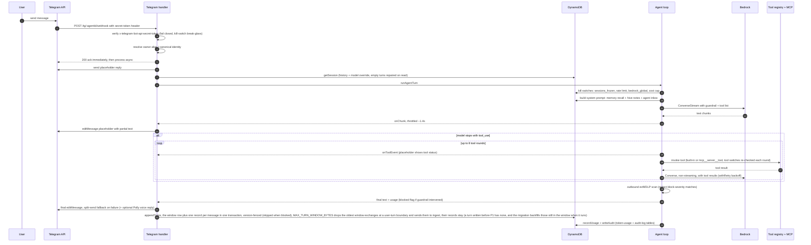

<!-- drift-gate: verified against P2 (WI-2.1..2.4). Mapped sources touched: `src/agent/agent-loop.ts` (the abort signal stops the model call and every later tool round; tool start/end carry the call id, capped arguments and a capped result; a stopped turn's spend is settled from an estimate), `src/lib/state/sessions-repo.ts` (turn records, tool results stored with the reply and evicted before turns under the byte budget, the per-record text cap leaving room for them) and `src/adapters/telegram/handler.ts` (a PARITY SKIP comment only: the Telegram flow drawn here is unchanged). The dashboard's side of the same turn is recorded in a new Legend bullet; the depicted Telegram steps did not change. -->
<!-- drift-gate: verified against P1 (WI-1.1..1.4, owner decisions 1, 9, 11, 46, 47). Mapped sources touched: `src/lib/state/sessions-repo.ts` (appendTurns now writes the window row and one record per message in ONE version-fenced transaction; the owner is stamped once; /newchat keeps turnsTotal; getFullHistory; deleteSession cascades; reownLegacyConversation; `#` in a chat id stored as `_`) and `src/lib/audit/audit-writer.ts` (two always-audited actions, `token_linked` and `session_read_override`). The persist step and two Legend bullets are updated to match; no other step of this flow changed. -->
<!-- drift-gate: verified against the corrupt-but-successful builder fixes; step 8 and the history-poisoning note below already describe the guard, and this change closes two holes in it. truncatedNotice now also covers the tool-loop return path, which is the path a document request actually takes. repairEmptyTurns now uses a typeof check rather than optional chaining, because a legacy turn whose text is a number threw a TypeError inside getSession and turned a poisoned chat into a 500. -->
<!-- drift-gate: verified against the empty-turn poisoning fix (PR #96); mapped-source changes = repairEmptyTurns applied in getSession, truncatedNotice on the non-tool return, and TOOL_LOOP_MAX_TOKENS raised from 1024. Step 8 and the history-poisoning note updated to match. -->
# Request lifecycle, one Telegram message end-to-end

> When a user sends a Telegram message, the webhook is verified against a shared secret (unconditionally — the old signature-bypass kill switch was removed in Wave A; a missing secret closes ingress), acknowledged immediately, and processed asynchronously: the handler posts a placeholder reply, loads the session from DynamoDB, and runs the agent loop. The loop builds a system prompt enriched with memories, hive notes, and inbox items, then streams a Bedrock Converse call (with the guardrail attached) into throttled edits of the placeholder; if the model asks for tools, it switches to a non-streaming dispatch loop of up to 8 rounds. The final text passes an outbound DLP scan, replaces the placeholder, and both turns plus usage and an audit record are persisted, unless the guardrail blocked the turn, in which case nothing is saved.

## Legend

- The 200 ack at step 5 happens before any model work; Telegram retries on non-200 within about 60 seconds, so the handler never blocks the webhook on Bedrock latency.
- Guardrail-blocked turns return a friendly notice and are NOT persisted; this holds on every surface, including both Slack send paths (main bot and per-agent apps). Legacy blocked turns are scrubbed from history before each call (`stripBlockedTurns`) so one tripped message cannot poison the session.
- History poisoning has two known triggers, and both are guarded, because Bedrock rejects the WHOLE `messages` array rather than the offending turn — so one bad stored turn kills every later turn in that chat, permanently, not just its own. The first is the blocked-turn notice above. The second is an **empty** assistant turn, which Bedrock refuses with `messages: text content blocks must be non-empty`: a reply truncated at `max_tokens` mid-tool-call carries no text block at all, and generating a document is its common trigger because the whole spec must be emitted inline as tool-call JSON. `repairEmptyTurns` substitutes placeholder text for any empty turn inside `getSession` (step 8), which covers every consumer that builds Converse messages and lets already-poisoned chats heal with no migration; text is substituted rather than the turn dropped because Converse also demands strict role alternation. Neither return path can emit empty text any more: `truncatedNotice` covers the non-tool return AND the tool-loop return, which is the path a document request actually takes. The repair itself uses a `typeof` check rather than optional chaining, because a legacy turn whose stored text is a number would otherwise throw a TypeError inside `getSession` and turn a poisoned chat into a 500. Every model call in the turn carries the ceiling resolved per turn (default `TURN_MAX_TOKENS` 8192, runtime-tunable) rather than the 1024 that could not hold a document spec.
- `resolveTurnMaxTokens` reads runtime-config `agent/max_output_tokens` once per turn, defaulting to `TURN_MAX_TOKENS` (8192) and clamping to 1024-32768; all three model calls (the initial streamed call, each tool-loop round and the post-loop synthesis call) use that one resolved ceiling.
- Slash commands (`/newchat`, `/model`, `/missions`, `/mission`, ...) and active War Room sessions branch off before step 6 (the placeholder reply) and never reach the agent loop — the handler runs the slash-command router and the War Room check ahead of posting the placeholder. The mission commands are the cross-surface case: they talk to the Mission ACL and render through `src/lib/missions/format.ts`, so Telegram, both Slack send paths and the dashboard print the same string without any adapter knowing what a mission is. Size is the one thing that module does NOT settle for everyone: its 3000-character cap is on source characters, and each surface still has to bound what its own API measures — Telegram measures the HTML render, which escaping can expand roughly 5x (measured: 1059 source characters send as 5055; 2175 send as 9315), so `sendMessage` splits on the rendered length rather than the source. The one thing that travels the other way is the assignment push: when `create_mission` hands work to a different agent, it posts a one-line notice back into the originating chat through `deliverToReplyChat()`, which routes `ToolContext.replyChatId` to Telegram or either Slack path — and resolves WHICH bot should speak, because both surfaces run more than one: a per-agent Slack app's id carries an `app-<agentId>` segment (the main bot's does not, and keeps the workspace token) and a Telegram id carries `:bot-<agentId>`, naming the per-agent token its `/tg/:agentId/webhook` received the message on rather than the turn's agent, which the sticky default routinely makes `main` (the dashboard supplies no `replyChatId` at all and is a marked parity gap). The send result is not discarded: a refused push returns false and the create receipt says the chat was not notified. Voice notes are transcribed and fed in as text, and images/PDFs ride along as inline Bedrock content blocks.
- The same `runAgentTurn` serves Slack and the dashboard chat; only the adapter steps (placeholder edits vs SSE events) differ. Slack additionally has two send paths (main bot and per-agent apps).
- Binaries a tool produced (generated images and generated documents) do NOT travel in the reply text. Tools return them on `ToolMedia`, collected into `AgentTurnResponse.media` (capped at 4 per turn), and each surface delivers from that channel after the final message: Telegram `sendPhoto` for images, Slack `uploadFile` for both, dashboard chat an `image` or `artifact` SSE event. This is load-bearing rather than cosmetic — a presigned URL placed in the reply text is read by the model and reproduced in its own output, and a signed S3 URL does not survive that round trip (an observed production document link lost its entire `X-Amz-*` query string and returned AccessDenied). Documents are tagged `kind: 'artifact'` so they are never sent down an image path; Telegram currently skips them, with the reason recorded at the call site, because it has no `sendDocument` helper.
- Model fallback (H2) is live on the initial streamed call: a throttle/unavailability BEFORE any chunk is emitted walks Opus -> Sonnet -> Haiku and pins the session to the fallback model (per-process affinity, no oscillation). Once a chunk reached the user, a mid-stream failure propagates unchanged — two models are never spliced into one reply. Tool-dispatch rounds ride the model the initial call settled on.
- Review-fixes hardening (PR #107): tool-dispatch rounds and the budget-exhausted synthesis call share the initial call's retry/backoff (a mid-loop throttle no longer voids the turn), and the synthesis instruction rides inside the final toolResult user message to keep Converse's strict role alternation. The final placeholder edit is checked and falls back to split delivery (Telegram caps messages at 4096 chars), so an oversized reply is never dropped while persisting as sent. `appendTurns` is fenced with an optimistic version counter so concurrent tasks re-merge instead of overwriting each other, and the streaming DLP redactor carries the same 50ms per-pattern timeout as the scanner.
- Spend admission (C2-full) wraps the whole turn: before any Bedrock work, `ledger-gate.ts` either checks the strict daily counter (legacy) or atomically reserves worst-case headroom on the spend-ledger table (`cost/ledger_enabled`), and the persist step settles the reservation with the actual cost. Blocked admissions throw before the model is ever invoked; refusal/error exits release the un-spent hold.
- Privilege-changing dashboard mutations (token mint/revoke/link, IAM apply) use the AWAITED variant `writeAuditOrThrow` (C5c): the route 500s when no audit store accepted the event, and those actions (plus kill-switch sets and every admin read of a conversation that is not theirs, `session_read_override`) are never suppressible by `audit_log_disabled`. Turn-time audits stay fire-and-forget.
- The audit writer shown at persist time is the SAME module every dashboard route uses; its action catalog (the `AuditEvent` union) is additive and includes non-turn actions (member/token/seat/config CRUD) written outside this flow. Only the turn-time `agent_turn` write is depicted here.
- Durable transcript (P1, owner decision 11: new item types in the existing sessions table, no CDK): every message is ALSO its own record beside its conversation, `SK=CHAT#<chatId>#MSG#<seq>` with `seq` its place in the whole conversation, written in the same all-or-nothing transaction as the window row; a record whose sequence number is taken fails the write rather than overwriting history — unless it is a leftover of an earlier conversation under the same id that is already past its own expiry, which is cleared first. The window stays exactly what the model replays — MAX_TURNS, the byte budget and the ingest backstop are unchanged — and the records are what the dashboard reloads (`getFullHistory`) and what a delete removes (`deleteSession` cascades, records first, row last). `/newchat` empties the window but keeps the records and the sequence. The conversation's owner, and whether it expires, are settled when it first has an owner and never changed after: a person's lasts, anyone else's expires. A scheduled task (which cannot say who is sending) that saves before its chat's first turn starts the conversation with no owner and an expiry; the first owner to save settles it, and a person's makes it, and the records already in it, last. One nobody claims keeps expiring, visible only to an admin. A slash command creates one only for `/warroom`, owned by its caller. A `#` in a chat id is stored as `_` in every key (owner decision 47).
- The dashboard turn lifecycle (P2): the stream route opens the SSE response first and writes a `: ping` comment every 15 s for as long as the turn runs, so an idle proxy (Cloudflare closes at about 100 s) never cuts a long tool turn. A client that sends `protocol: 2` gets positional `delta` events (`{i, t}`: keep the text before `i`, append `t` — positional because the live redactor can rewrite text already sent); every other client keeps the cumulative `chunk`. Each tool call is a `tool` event (id, the arguments capped at 1 KB) followed by a `tool_result` event (the output capped at 2 KB, `isError`, `truncated`) on every branch, the kill-switched and blocked ones included. The client going away — Stop, Escape, a closed tab — aborts the turn: the signal reaches the Bedrock request, no further tool round or model call starts, the partial answer is saved marked `stopped` (a fixed notice when nothing was written, because an empty turn poisons the chat), and the partial generation's spend is settled from an estimate rather than released. A failure is an `error` event carrying `{code, message}` (`cost_cap_exceeded`, `cost_cap_unverifiable`, `kill_switch_active`, `model_error`, `internal_error`) — never the raw exception text — and no `error` ever follows `final`: a save that fails after the answer is logged and the stream ends `done: not_saved`. With a `clientMessageId` the turn record moves from `streaming` to exactly one of `complete`, `stopped`, `error` or `refused`.
- Before every stage shown: the emergency kill-phrase check (static reply, audit action `emergency_kill_phrase`, no model call) and then the sessions-frozen check short-circuit the turn.
- Sources: `src/adapters/telegram/handler.ts`, `src/agent/agent-loop.ts`, `src/lib/memory/context-builder.ts`, `src/lib/safety/exfil-guard.ts`, `src/lib/audit/audit-writer.ts`, `src/lib/state/sessions-repo.ts`.
