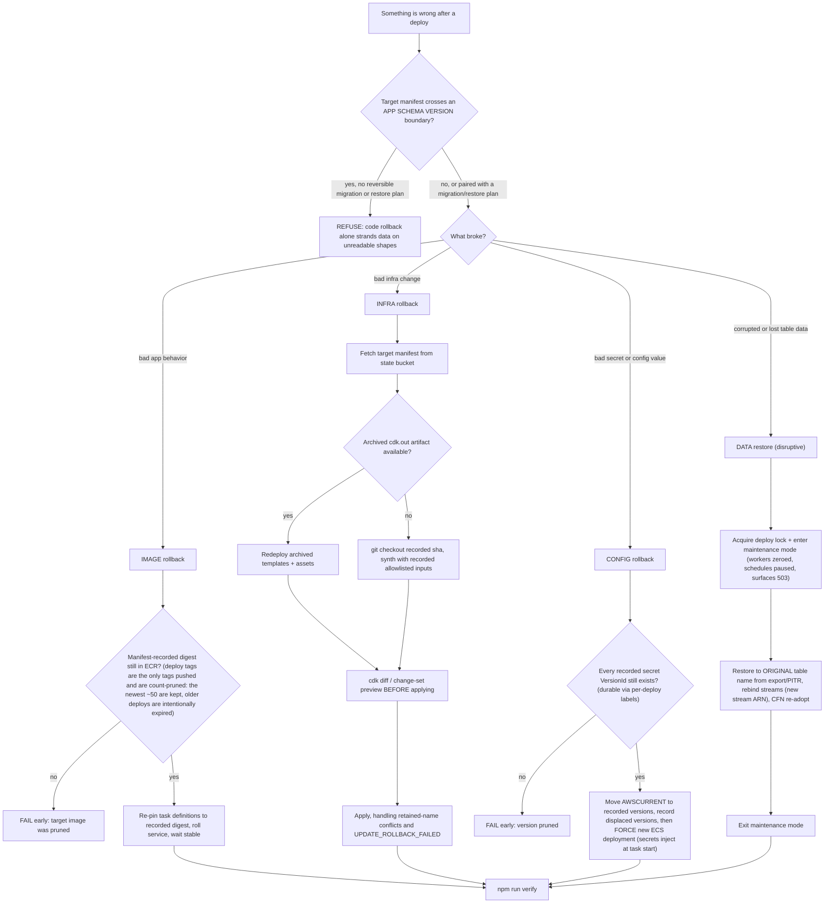

<!-- drift-gate: verified against Paperclip Phase 4; no depicted flow changed and no rollback class moved. The only `scripts/lib/lifecycle/manifest.ts` edit is three names added to SYNTH_INPUT_ALLOWLIST -- CCE_PAPERCLIP_IMAGE_DIGEST, CCE_PAPERCLIP_HOSTNAME and CCE_PAPERCLIP_BOOTSTRAP. They belong there for exactly the reason CCE_PAPERCLIP_ENABLED already does: each one changes what synth PRODUCES, so a re-synth from an archived manifest that did not replay them would float the Paperclip image off its digest, set a PAPERCLIP_PUBLIC_URL that 403s every board mutation, or bring a deliberately scaled-to-zero service back up against an unmigrated database. CCE_PAPERCLIP_SERVICE_READY is deliberately NOT among them and must never be added: it belonged to the rejected design in which synth omitted the FargateService unless a probe said '1', so replaying an empty value would have DELETED a running service -- the M33 defect. Nothing in the tree reads that name. Its replacement can only move DesiredCount, so the worst a replay can do is scale down, recoverably. No manifest FIELD is added and no class is added. The second mapped-source change INVERTS the decision recorded immediately below: `collectPrivateEcrDigests` no longer SKIPS the Paperclip record. That skip rested on one premise -- "no service consumes this image" -- and Phase 4 ended it, so the IMGPRE node now covers two private-ECR digests instead of one and a target whose Paperclip image has been deleted fails early rather than silently leaving Paperclip on the newer image. The depicted flow is unchanged: same precondition, same early failure, same class set. One gap is named rather than hidden -- `runImageClass` still re-points only the orchestrator service, so the IMAGE class now verifies more than it restores; rolling the Paperclip service itself back to a recorded digest is the INFRA class today (a `cdk deploy` of the archived assembly, which re-pins the task definition through CCE_PAPERCLIP_IMAGE_DIGEST) and a dedicated path is unbuilt. None of the three is a secret: a digest, a hostname and a '1' flag; the Paperclip API keys and the composed DATABASE_URL live only in Secrets Manager and must never be added. Prior verification: verified against the Paperclip Phase 1.5 image pipeline; no depicted flow changed, and the IMGPRE node stays accurate as drawn. Two mapped sources changed. manifest.ts exports PAPERCLIP_CONTAINER_NAME, a constant, adding no field to the manifest and no input to a re-synth. rollback-classes.ts makes collectPrivateEcrDigests SKIP the record whose containerName is that constant. That is deliberate and is the decision worth recording here: an armed install's manifest now carries TWO private-ECR image records where it carried one, and the IMAGE class re-points exactly ONE service — the orchestrator, planned from the record named 'orchestrator' and applied to targets.cluster/targets.service. Verifying the Paperclip digest in that preflight would abort a rollback of a RUNNING service because a digest in a DIFFERENT repo is missing: a repo teardown deletes with --force, that has no lifecycle policy, and that Phase 9 will churn, for a service that does not exist until Phase 4. The depicted precondition therefore still reads correctly — the digests an image rollback depends on are still all verified before anything is touched — and the class set, the schema gate and the `npm run verify` exit gate are untouched. Phase 4 gives Paperclip a service; whoever adds its rollback verifies that digest on THAT path rather than deleting the skip. Prior verification: verified against the Paperclip Phase 1 arming fix; no depicted flow changed. The only mapped-source change is manifest.ts adding CCE_PAPERCLIP_ENABLED to SYNTH_INPUT_ALLOWLIST, which records one more synth input in the manifest. It matters to THIS diagram because an INFRA rollback re-synthesizes from the manifest: without the entry, a rollback of a deployment that had the Paperclip substrate armed would re-synth with the flag unset and silently drop CCE-Database and CCE-Filesystem from the assembly. It introduces no rollback class, moves no precondition, and leaves the schema gate and the `npm run verify` exit gate untouched. Prior verification: verified against the pgnos public-dashboard merge; no depicted flow changed. The only mapped-source change is manifest.ts adding CCE_PUBLIC_ACCESS and CCE_PUBLIC_HOSTNAME to SYNTH_INPUT_ALLOWLIST, which records two synth inputs in the manifest. It introduces no rollback class, moves no precondition, and leaves the schema gate and the `npm run verify` exit gate untouched. -->
# Rollback classes, decision flowchart

> Rollback is four distinct operations, not one: image (re-pin the previous container digest), infra (redeploy archived CDK output), config (restore recorded secret versions), and data (a disruptive table restore under maintenance mode). Each class has hard preconditions checked before anything is touched, the most important being the application schema gate, because rolling back code across a schema boundary strands the app on item shapes it cannot read. Every class ends the same way, with `npm run verify` as the gate that declares the rollback done.

## Legend

- The schema gate applies to every class, which is why it is the first decision: each manifest carries an application schema version (DDB item shapes, runtime-config keys, queue/scheduler payload formats) and downgrades across a boundary are refused unless paired with a reversible migration or a data-restore plan.
- Image rollback is the existing `rollback.ts` path, fixed by the manifest contract; it validates the manifest schema version and fails loud on mismatch.
- The "recorded allowlisted inputs" an infra rollback re-synths from are the manifest's `synthInputs` (`SYNTH_INPUT_ALLOWLIST` in `manifest.ts`): a non-secret subset of the deploy env bag that includes everything synth-shaping, notably the delegated-zone override (`HOSTED_ZONE_ID`/`HOSTED_ZONE_NAME`), the Cost Anomaly monitor pin (`CCE_ANOMALY_MONITOR_ARN`), and the endpoint opt-in (`CCE_PRIVATE_ENDPOINTS`). A key missing from that allowlist means a rollback silently re-synths with a DIFFERENT input than the deploy it restores.
- Config rollback works from any machine via the Secrets Manager API; restoring a version WITHOUT rolling the service changes nothing, because secrets inject at task start.
- Data restore is the only class that requires maintenance mode; restoring live tables under running tasks creates split-brain state and replays stale work. Stream rebinding is required even for original-name restores.
- Status: the manifest/lock/journal machinery these flows consume is live (`scripts/lib/lifecycle/`), and the image/infra/config rollback classes are implemented (`scripts/lib/lifecycle/rollback-classes.ts` plus the `scripts/rollback.ts` CLI, with `rollback-classes.test.ts` coverage). Only the data-restore class remains a forward-looking contract this diagram depicts.
- `npm run deploy:rollback -- --help` answers before any of this starts (`scripts/lib/help.ts`, shared by every lifecycle CLI): asking for help never touches the lock, the manifests, or the service.
- Sources: `scripts/lib/lifecycle/rollback-classes.ts`, `scripts/lib/lifecycle/manifest.ts`, `scripts/lib/lifecycle/lock.ts`, `scripts/rollback.ts`.
