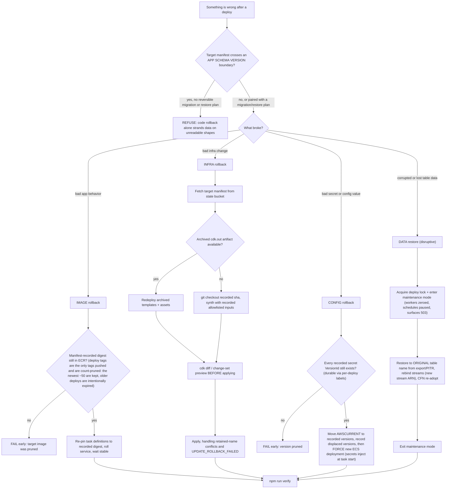

<!-- drift-gate: verified against ADR 0010 Phase 9; no rollback class moved. DEPLOY_TIER/CCE_TIER preserve the tier-shaped Paperclip substrate during re-synth, while CCE_PAPERCLIP_IMAGE_DIGEST and CCE_PAPERCLIP_BOOTSTRAP preserve the image and recoverable desired-count state. The retired console hostname is intentionally not replayed. -->
# Rollback classes, decision flowchart

> Rollback is four distinct operations, not one: image (re-pin the previous container digest), infra (redeploy archived CDK output), config (restore recorded secret versions), and data (a disruptive table restore under maintenance mode). Each class has hard preconditions checked before anything is touched, the most important being the application schema gate, because rolling back code across a schema boundary strands the app on item shapes it cannot read. Every class ends the same way, with `npm run verify` as the gate that declares the rollback done.

## Legend

- The schema gate applies to every class, which is why it is the first decision: each manifest carries an application schema version (DDB item shapes, runtime-config keys, queue/scheduler payload formats) and downgrades across a boundary are refused unless paired with a reversible migration or a data-restore plan.
- Image rollback is the existing `rollback.ts` path, fixed by the manifest contract; it validates the manifest schema version and fails loud on mismatch.
- The "recorded allowlisted inputs" an infra rollback re-synths from are the manifest's `synthInputs` (`SYNTH_INPUT_ALLOWLIST` in `manifest.ts`): a non-secret subset of the deploy env bag that includes everything synth-shaping, notably the delegated-zone override (`HOSTED_ZONE_ID`/`HOSTED_ZONE_NAME`), the Cost Anomaly monitor pin (`CCE_ANOMALY_MONITOR_ARN`), and the endpoint opt-in (`CCE_PRIVATE_ENDPOINTS`). A key missing from that allowlist means a rollback silently re-synths with a DIFFERENT input than the deploy it restores.
- Config rollback works from any machine via the Secrets Manager API; restoring a version WITHOUT rolling the service changes nothing, because secrets inject at task start.
- Data restore is the only class that requires maintenance mode; restoring live tables under running tasks creates split-brain state and replays stale work. Stream rebinding is required even for original-name restores.
- Status: the manifest/lock/journal machinery these flows consume is live (`scripts/lib/lifecycle/`), and the image/infra/config rollback classes are implemented (`scripts/lib/lifecycle/rollback-classes.ts` plus the `scripts/rollback.ts` CLI, with `rollback-classes.test.ts` coverage). Only the data-restore class remains a forward-looking contract this diagram depicts.
- `npm run deploy:rollback -- --help` answers before any of this starts (`scripts/lib/help.ts`, shared by every lifecycle CLI): asking for help never touches the lock, the manifests, or the service.
- Sources: `scripts/lib/lifecycle/rollback-classes.ts`, `scripts/lib/lifecycle/manifest.ts`, `scripts/lib/lifecycle/lock.ts`, `scripts/rollback.ts`.
