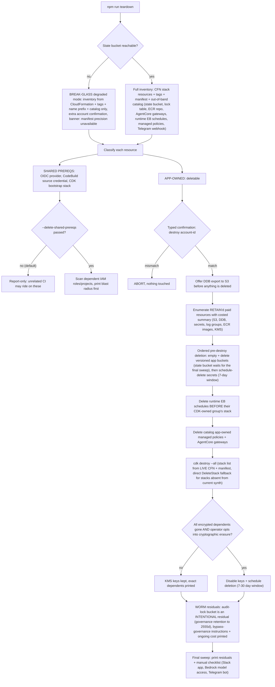

<!-- drift-gate: verified against ADR 0010 Phase 9; no depicted flow changed. The `scripts/lib/lifecycle/teardown-plan.ts` change moves CCE-Database, CCE-Filesystem and CCE-Paperclip out of the CCE_PAPERCLIP_ENABLED conditional and into ALWAYS_ON_STACK_SUFFIXES, because the app now constructs all three at every tier. This list only chooses the DESTROY METHOD (cdk destroy vs direct DeleteStack), never WHAT is destroyed - that still comes from live CloudFormation plus the manifest, which is the branch this tree depicts and which is unchanged. The change makes the depicted "in the current app?" test answer yes for a live Aurora stack in every configuration, including an install that has since dropped to Tier 0 while its RETAIN'd, deletion-protected cluster is still alive - direct DeleteStack cannot delete that cluster. Prior verification: Phase 1.5 turned teardown.ts's final sweep of the cloud-build primitives into a loop over both ECR repo names. -->
# Teardown decision tree

> Teardown inventories everything from CloudFormation, tags, the manifest, and the out-of-band resource catalog, then classifies resources as app-owned (deletable) versus shared account prerequisites (report-only by default), and demands a typed confirmation before destroying anything. Destruction is ordered so encrypted data can still be exported and decrypted on the way out: export offer first, then dependents, then buckets, then secrets on their 7-day window, with KMS key deletion blocked until every encrypted dependent is gone. Some things survive on purpose, most notably the WORM audit-lock bucket, and a break-glass mode still works when the state bucket itself is lost.

## Legend

- Diamonds are operator decisions; the typed confirmation requires literally typing `destroy <account-id>` so a wrong-account teardown cannot happen on muscle memory.
- The three bootstrap primitives (state bucket, deploy-lock table, private ECR repo) are owned by teardown, not `cdk destroy`, because they were created outside CDK.
- KMS keys are treated as DEPENDENCIES, not leftovers: deleting a key before its encrypted data is exported is cryptographic erasure, so the gate defaults closed.
- The SES `netzar-magic-link` configuration set and its ops-alerts event destination are created **out of band** (CLI, like the AgentCore gateways) and are not in the out-of-band catalog, so teardown neither inventories nor deletes them. They read the logs CMK via its `AllowSES` grant, so scheduling that key for deletion silently breaks bounce/complaint delivery before the config set itself is gone. Delete the event destination by hand, or expect it in the final-sweep residuals.
- Break-glass exists so a lost state store never strands paid resources; deploy and rollback hard-require state, only teardown degrades.
- Status: `scripts/teardown.ts` is fully implemented (with `scripts/lib/lifecycle/teardown-plan.ts` and `teardown-plan.test.ts` coverage); this diagram depicts the flow that code executes.
- `npm run teardown -- --help` answers before any of this starts (`scripts/lib/help.ts`, shared by every lifecycle CLI): asking for help never reaches the inventory, the confirm, or any mutation.
- Sources: `scripts/teardown.ts`, `scripts/lib/lifecycle/teardown-plan.ts`, `scripts/lib/lifecycle/bootstrap-state.ts`, `infra/lib/storage-stack.ts` (Object Lock + RETAIN policies).
