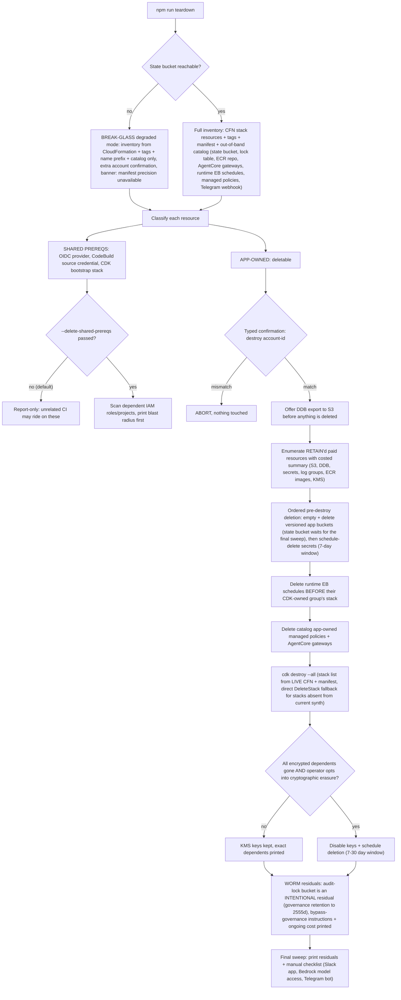

<!-- drift-gate: verified against the knowledge-durability hotfix; the new vectors bucket joins the teardown/destroy name lists and, being versioned, routes through the existing empty-and-delete versioned-bucket step; no depicted branch changed -->
# Teardown decision tree

> Teardown inventories everything from CloudFormation, tags, the manifest, and the out-of-band resource catalog, then classifies resources as app-owned (deletable) versus shared account prerequisites (report-only by default), and demands a typed confirmation before destroying anything. Destruction is ordered so encrypted data can still be exported and decrypted on the way out: export offer first, then dependents, then buckets, then secrets on their 7-day window, with KMS key deletion blocked until every encrypted dependent is gone. Some things survive on purpose, most notably the WORM audit-lock bucket, and a break-glass mode still works when the state bucket itself is lost.

## Legend

- Diamonds are operator decisions; the typed confirmation requires literally typing `destroy <account-id>` so a wrong-account teardown cannot happen on muscle memory.
- The three bootstrap primitives (state bucket, deploy-lock table, private ECR repo) are owned by teardown, not `cdk destroy`, because they were created outside CDK.
- KMS keys are treated as DEPENDENCIES, not leftovers: deleting a key before its encrypted data is exported is cryptographic erasure, so the gate defaults closed.
- Break-glass exists so a lost state store never strands paid resources; deploy and rollback hard-require state, only teardown degrades.
- Status: `scripts/teardown.ts` is fully implemented (with `scripts/lib/lifecycle/teardown-plan.ts` and `teardown-plan.test.ts` coverage); this diagram depicts the flow that code executes.
- `npm run teardown -- --help` answers before any of this starts (`scripts/lib/help.ts`, shared by every lifecycle CLI): asking for help never reaches the inventory, the confirm, or any mutation.
- Sources: `scripts/teardown.ts`, `scripts/lib/lifecycle/teardown-plan.ts`, `scripts/lib/lifecycle/bootstrap-state.ts`, `infra/lib/storage-stack.ts` (Object Lock + RETAIN policies).
