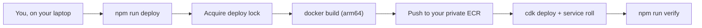
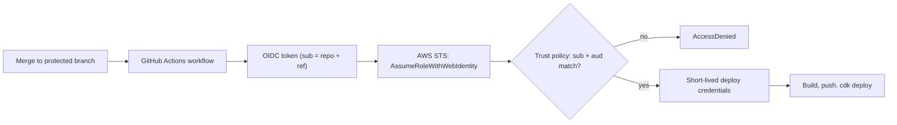
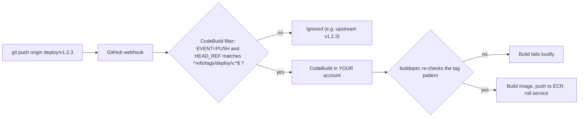

# Connecting GitHub to AWS

> Plain English: you do not need any GitHub-to-AWS connection to run this
> product, the default is deploying from your laptop with `npm run deploy`
> and that is a complete, supported setup. If you want pushes or tags to
> deploy for you, there are exactly two optional accelerators: GitHub
> Actions assuming an AWS role with no stored keys, or AWS CodeBuild
> watching your repo for a special deploy tag. Whichever you pick, the rule
> that keeps you safe is the same: be precise about WHO can trigger a deploy
> and WHICH branch or tag is trusted, because a deploy trigger is deploy
> authority over your AWS account.

This guide covers the single most-asked operational question: "how do I hook
my GitHub repo to my AWS account?" The honest answer has three tiers, and
two of them are optional. Nothing in tiers (b) or (c) is a prerequisite for
anything else in this repo; the product deploys fully without either.

## The three tiers

| Tier | Name | Flag | What triggers a deploy | AWS credentials involved |
| --- | --- | --- | --- | --- |
| (a) | No CI (default) | none | You, running `npm run deploy` | Your local AWS CLI credentials |
| (b) | GitHub Actions OIDC | `CCE_CICD_ENABLED=1` | A workflow run in YOUR fork | Short-lived role assumption, no stored keys |
| (c) | CodeBuild tag deploys | `CCE_CODEBUILD_ENABLED=1` | Pushing a deploy tag (`deploy/v*`) | None in GitHub at all; AWS pulls from GitHub |

### Decision table

| You are... | Pick | Why |
| --- | --- | --- |
| A solo operator | (a) | Zero extra setup, zero extra trust surface. Your laptop, your credentials, the deploy lock serializes you against yourself. |
| A team that lives in GitHub Actions | (b) | Reviewed merges to a protected branch (or a GitHub Environment with required reviewers) become deploys. No long-lived AWS keys stored anywhere in GitHub. |
| Under an org policy of "no cloud access from GitHub runners" or "no secrets in GitHub" | (c) | GitHub never holds AWS credentials and never assumes an AWS role. AWS holds a read credential for GitHub instead, and builds inside your account when a deploy tag appears. |

Tiers (b) and (c) can coexist, but most installs should pick one or none.

---

## Tier (a): no CI, deploy from your laptop (the default)

Plain English: you run one command, it builds the image on your machine,
pushes it to your account's private registry, and updates the running
service. Nothing in GitHub can touch your AWS account.

Technical: `npm run deploy` runs the full phased pipeline described in
[lifecycle.md](lifecycle.md) and
[diagrams/deploy-pipeline.md](diagrams/deploy-pipeline.md): read-only
preflight, bootstrap of the state bucket / lock table / ECR repo, then the
mandatory DynamoDB lease lock with heartbeat before any mutation
(`scripts/lib/lifecycle/lock.ts`), image build with an arm64 gate, CDK
stacks, secret population, seeding, verification, and an atomically promoted
deploy manifest.



Trust scope: whatever your local AWS credentials can do. GitHub is just a
place the code lives.

---

## Tier (b): GitHub Actions OIDC deploys

Plain English: GitHub proves to AWS "this workflow run is really from THIS
repository, on THIS branch", and AWS hands it a short-lived badge to deploy.
No AWS password or access key is ever saved in GitHub, so there is nothing
in GitHub to steal.

Technical: the workflow requests an OIDC token from GitHub's token service
and exchanges it for temporary credentials via `sts:AssumeRoleWithWebIdentity`
against a deploy role in your account. You create the OIDC identity provider
once with a CLI one-liner (see the out-of-band catalog's
`github-oidc-provider` entry in [out-of-band-catalog.md](out-of-band-catalog.md)),
then enable the path at synth time:

```bash
CCE_CICD_ENABLED=1
CCE_GITHUB_OWNER=<your-org-or-user>          # required, no default
CCE_GITHUB_REPO=<your-fork>                  # required, no default
CCE_GITHUB_DEPLOY_REFS=refs/heads/main       # and/or...
CCE_GITHUB_DEPLOY_ENVIRONMENTS=production
```



### Where the control lives

The IAM deploy role's TRUST POLICY, and nowhere else. The trust resolution
is fail-closed in [../infra/lib/github-oidc.ts](../infra/lib/github-oidc.ts):

- `CCE_GITHUB_OWNER` and `CCE_GITHUB_REPO` have NO defaults; synth errors if
  they are missing. A default would grant the upstream repository deploy
  authority into your account the moment you flipped CI on.
- The trust uses `StringEquals` (exact match, never `StringLike`) on
  `token.actions.githubusercontent.com:sub`, pinned to the exact subjects
  you list: `repo:<owner>/<repo>:ref:refs/heads/main` for each entry in
  `CCE_GITHUB_DEPLOY_REFS`, and `repo:<owner>/<repo>:environment:<name>` for
  each entry in `CCE_GITHUB_DEPLOY_ENVIRONMENTS`. A repo-wide
  `repo:owner/name:*` subject is never produced, and inputs containing
  wildcards are rejected.
- The trust also requires
  `token.actions.githubusercontent.com:aud == sts.amazonaws.com`, so a token
  minted for some other audience cannot assume the role.

Exact trust scope: only a workflow run in your named repo, on a ref or
GitHub Environment you listed, can assume the role. A pull-request context,
a feature branch, or any other repository simply is not a trusted subject.
Pair the trusted ref with branch protection (or required Environment
reviewers) on the GitHub side, otherwise "trusted branch" only means
"whoever can push to it".

---

## Tier (c): CodeBuild tag deploys

Plain English: you push a tag named like `deploy/v1.2.3` and AWS notices,
checks out the code, builds it inside your own account, and rolls the
service. GitHub never holds any AWS credential, not even a temporary one;
instead AWS holds a GitHub credential that can read your repo.

Technical: a CodeBuild project in your account subscribes to your repo via a
webhook. Enabling it needs two out-of-band steps AWS cannot infer: issue a
GitHub PAT or App credential [EXTERNAL], then register it account-wide with
`aws codebuild import-source-credentials --region <your-region>` [CLI]. The
credential is regional: CodeBuild stores exactly one credential per source-provider
type (e.g. GITHUB) per region, shared by all projects in that region, so run this
in the same region you deploy to. Then synth with:

```bash
CCE_CODEBUILD_ENABLED=1
CCE_GITHUB_OWNER=<your-org-or-user>   # required, no default
CCE_GITHUB_REPO=<your-fork>           # required, no default
CCE_DEPLOY_TAG_PATTERN=deploy/v*      # optional, this is the default
```



### The tag namespace split

Upstream releases and "deploy to my account" use DIFFERENT tag namespaces,
on purpose:

- `v*` (e.g. `v1.2.3`) is the UPSTREAM RELEASE namespace. Release notes,
  changelogs, and version pins live here. Pushing or fetching one of these
  tags must never deploy anything.
- `deploy/v*` (e.g. `deploy/v1.2.3`) is the DEPLOY TRIGGER namespace,
  configurable via `CCE_DEPLOY_TAG_PATTERN`. Only these tags ship.

Without the split, syncing your fork with an upstream release tag could
deploy unreviewed code to your AWS account. With it, taking `v1.2.3` from
upstream is inert; you deploy it by deliberately tagging `deploy/v1.2.3`.

The pattern has ONE source of truth:
[../infra/lib/deploy-tag-pattern.ts](../infra/lib/deploy-tag-pattern.ts)
(`normalizeDeployTagPattern`). It validates the pattern (exactly one `*`, a
restricted character set, and a literal prefix that cannot be empty or
overlap the `v*` namespace) and derives both enforcement points:

1. The CodeBuild WEBHOOK FILTER, an anchored `HEAD_REF` regex
   (`^refs/tags/deploy/v.*$` by default) combined with `EVENT=PUSH`, wired
   in [../infra/lib/codebuild-stack.ts](../infra/lib/codebuild-stack.ts).
2. The BUILDSPEC RUNTIME REFUSAL in [../buildspec.yml](../buildspec.yml):
   webhook-triggered builds check `CODEBUILD_WEBHOOK_TRIGGER` (shape
   `tag/<name>`) against the same pattern and fail loudly on a mismatch.
   Manual `aws codebuild start-build` runs carry no webhook trigger and skip
   the check; authorizing StartBuild is IAM's job (below).

Unit tests in `infra/lib/deploy-tag-pattern.test.ts` prove the two cases
that matter with the default pattern: `refs/tags/deploy/v1.2.3` TRIGGERS a
deploy and `refs/tags/v1.2.3` does NOT.

### Tag trust, stated honestly

With tier (c), anyone who can push a deploy tag ships code to your AWS
account. The webhook filter checks WHAT the tag is named, not WHO pushed it.
So the people-control must live in GitHub, as repository RULESETS targeting
the deploy-tag pattern:

- Restrict tag CREATE, UPDATE, and DELETE for `deploy/v*` to release
  managers (or a dedicated release App), not to everyone with write access.
- Block force-updates and deletions of deploy tags, so a tag cannot be
  quietly moved to different code after review.
- Require signed tags where your org supports it. Note the limit honestly:
  a signed release alone does NOT stop an authorized user from moving or
  re-creating a tag; the ruleset's update/delete restrictions are what stop
  that.

If you change `CCE_DEPLOY_TAG_PATTERN`, change the ruleset target to match.
The module, the webhook filter, the buildspec guard, and your rulesets must
all describe the same namespace.

### Where each control lives

| Control | Lives in | Enforced by |
| --- | --- | --- |
| Who may create/move/delete deploy tags | GitHub repository rulesets | GitHub, at push time |
| Which tags trigger a build | CodeBuild webhook filter (`EVENT=PUSH` + anchored `HEAD_REF`) | AWS, at webhook delivery |
| Belt-and-suspenders tag check | `buildspec.yml` pre_build refusal | The build itself, at runtime |
| Who may start a build manually | IAM: restrict `codebuild:StartBuild` on the project ARN to deploy operators | AWS IAM, at API call |

One thing CodeBuild cannot do: the project's service role trust is for the
CodeBuild SERVICE (`codebuild.amazonaws.com`) to assume the role, it cannot
filter git refs or tag names. Do not look for a tag condition in the role
trust policy; the ref filtering lives only in the webhook filter and the
buildspec guard, and the human filtering lives only in GitHub rulesets plus
a restricted `codebuild:StartBuild`.

---

## The lifecycle lock, stated honestly

Local `npm run deploy`, rollback, seed, and teardown all acquire the
mandatory DynamoDB lease lock (`scripts/lib/lifecycle/lock.ts`) before
mutating anything, so concurrent operations refuse to interleave.

The CI paths do NOT take that lock today:

- Tier (c): `buildspec.yml` pushes to ECR and rolls the ECS service without
  acquiring the lock. This is a known gap, marked with a loud TODO at the
  mutation site in [../buildspec.yml](../buildspec.yml) and tracked under
  the deploy-manifest/lock work (IaC readiness item 14). Until it lands,
  treat tag deploys and local lifecycle operations as mutually exclusive by
  convention: do not push a deploy tag while a local deploy, rollback, or
  teardown is running, and vice versa.
- Tier (b): the Actions workflow likewise builds and runs `cdk deploy`
  directly rather than through the locked pipeline; its only serialization
  is GitHub's own per-workflow concurrency group, which knows nothing about
  local deploys. Same convention applies, same item 14 fix.

When item 14's unified path lands, both CI tiers will acquire the same lock
as local deploys and this section will shrink to one sentence.

---

## Summary of trust scopes

| Path | Exactly who can deploy |
| --- | --- |
| (a) Laptop | Holders of AWS credentials with deploy permissions |
| (b) Actions OIDC | Workflow runs in `CCE_GITHUB_OWNER/CCE_GITHUB_REPO` on a ref in `CCE_GITHUB_DEPLOY_REFS` or an environment in `CCE_GITHUB_DEPLOY_ENVIRONMENTS`, exact match, correct audience |
| (c) CodeBuild tags | Anyone GitHub rulesets allow to push a `CCE_DEPLOY_TAG_PATTERN` tag, plus any principal IAM allows `codebuild:StartBuild` on the project |

---

## Dogfooding: promote-by-deploy-tag

Plain English: when WE update our own production install, we do not get a
special path. An upstream release is cut as `v1.2.3`; updating prod means
PROMOTING it by pushing the corresponding deploy tag, one documented line:

```bash
git tag deploy/v1.2.3 && git push origin deploy/v1.2.3
```

The deploy tag is an AUTHORIZATION TRIGGER ONLY, never the release
identity. The buildspec NORMALIZES the deploy tag to its upstream tag by
stripping the pattern's namespace prefix, defined as the literal prefix
up to and including its last `/` (the whole literal prefix when it has
no `/`), plus the literal suffix: with the default `deploy/v*` pattern,
`deploy/v1.2.3` normalizes to `v1.2.3`; with a custom `release/cce-*`
pattern, `release/cce-1.2.3` normalizes to `cce-1.2.3`. The pipeline then
verifies the upstream signed metadata for THAT tag and ignores whatever
commit the deploy tag happens to point at, so a mis-pointed (or
maliciously moved) deploy tag can authorize only a real, verified
release, never arbitrary code.

What runs today versus what arms later: the normalization and the
`RELEASE_TAG` export are live in [../buildspec.yml](../buildspec.yml)
now. The shim-driven update path, reading the CURRENTLY DEPLOYED version
from the manifest and running that version's updater shim against the
target, exactly the old-code-to-new-code path adopters exercise, is
guarded behind `CCE_UPDATE_PIPELINE=1` plus the existence of
`scripts/update/shim.ts`, and arms when the first public release ships
the shim (readiness items 42/47). Until then the legacy image build
keeps running unchanged. Manual-preflight and approval-required actions
make the armed build REFUSE unless an approval artifact tied to the
exact target version and required-actions hash exists in the state
bucket's `approvals/` prefix, so dogfooding feels the same manual pain
adopters do.
